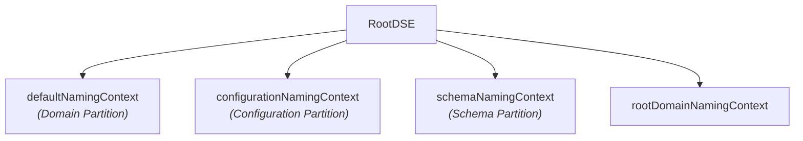

## Checklist

>[!important] Main objective: **interrogate Active Directory via LDAP to enumerate directory objects and their attributes to gether information about the domain**.

**Discovery**

- [ ] Identify LDAP endpoints:
	- [ ] TCP port `389` — LDAP / StartTLS
	- [ ] TCP port `636` — LDAPS (LDAP over TLS/SSL)
	- [ ] TCP port `3268` — Global Catalog
	- [ ] TCP port `3269` — Global Catalog SSL
- [ ] Query RootDSE (zero-length Base DN query):
	- [ ] Retrieve `defaultNamingContext` (Base DN).
	- [ ] Retrieve `configurationNamingContext`.
	- [ ] Retrieve `schemaNamingContext`.
	- [ ] Retrieve `dnsHostName` and Domain Controller FQDN.
	- [ ] Identify supported SASL mechanisms and LDAP capabilities.
- [ ] Decide whether to query the domain LDAP endpoint or Global Catalog.
- [ ] Test for anonymous and `Guest` bind.

**Enumeration**

- [ ] Enumerate all domain users; among these, retrieve active accounts, privileged accounts, and service accounts.
- [ ] Enumerate all domain groups groups; among these, retrieve privileged groups and nested group memberships (nested expansion).
- [ ] Enumerate Domain Controllers and computer accounts.
- [ ] Enumerate Organizational Units (OUs) and container structure.
- [ ] Enumerate domain trust relationships (`objectClass=trustedDomain`).
- [ ] Retrieve default domain password and lockout policy.
- [ ] Retrieve FGPP (Fine-Grained Password Policies).

**Security checks**

- [ ] Find accounts that don't require Kerberos pre-authentication — susceptible to [[AS-REP roasting]].
- [ ] Find accounts with SPNs (Service Principal Names) — susceptible to [[Kerberoasting]].
- [ ] Find unconstrained, constrained, and resource-based constrained delegation.
- [ ] Retrieve readable LAPS passwords (`ms-MACS-MachinePassword` / `msLAPS-Password`).
- [ ] Find BitLocker recovery objects (`msFVE-RecoveryInformation`).
- [ ] Find gMSA accounts and readable `msDS-ManagedPassword` blobs.
- [ ] Search for credentials (`description`, `comment`, `userPassword`, `userCertificate`).
- [ ] Enumerate Group Managed Service Accounts (gMSA).
- [ ] Collect data for BloodHound.

## LDAP

>**[LDAP](https://en.wikipedia.org/wiki/Lightweight_Directory_Access_Protocol) (Lightweight Directory Access Protocol)** is an open, vendor-neutral application protocol used to query and manage data in centralized directory services.

- Active Directory uses LDAP as a primary way to query the domain database.
### LDAP ports and transport

| Port (TCP) | Name                    | Description                                                                                                                           | Scheme     |
| ---------- | ----------------------- | ------------------------------------------------------------------------------------------------------------------------------------- | ---------- |
| **`389`**  | LDAP                    | Standard LDAP communication; cleartext unless upgraded to encrypted via StartTLS.                                                     | `ldap://`  |
| **`636`**  | LDAPS                   | LDAP over TLS/SSL; TLS is negotiated immediately after TCP connection.                                                                | `ldaps://` |
| **`3268`** | Global Catalog          | Unencrypted Global Catalog queries; searches across a partial set of attributes for all objects in an entire AD forest (forest-wide). | `ldap://`  |
| **`3269`** | Global Catalog over TLS | Encrypted Global Catalog queries over TLS.                                                                                            | `ldaps://` |

>[!note]+ Querying LDAP (`389` / `636`) vs. Global Catalog (`3268` / `3269`)
> - Standard LDAP queries (ports `389` / `636`) search **all objects and their attributes for the current domain**. 
> - Querying Global Catalog (ports `3268` / `3269`) searches **a partial set of attributes for all objects in an entire AD forest**.
> - The Global Catalog contains a *partial attribute set*, meaning not all attributes are present (especially sensitive or less common ones), but they may belong to other domains in the forest.

### Directory structure concepts

>A **Distinguished Name (DN)** is a unique, globally unique identifier for a specific entry within the directory tree. 

- A DN functions like an absolute file path in a filesystem (e.g., `/var/log/auth.log`).
- A DN consists of a sequence of **RDNs (Relative Distinguished Names)**, separated by commas, ordered from the specific leaf object on the far left to the root on the far right (e.g., `CN=John Doe,OU=Employees,DC=corp,DC=example,DC=com`):

$$\text{DN} = \text{RDN}_{\text{leaf}}, \text{RDN}_{\text{parent}}, \dots, \text{RDN}_{\text{root}}$$

>An **RDN (Relative Distinguished Name)** represents a attribute value that uniquely identifies an entry relative to its immediate parent container.

- Each RDN consists of an attribute type and a value joined by an equal sign, e.g. `CN=John Doe` or `OU=Engineering`.
- An RDN is only required to be unique within its specific parent container. For example, multiple objects with the RDN `CN=John Doe` can exist across the directory hierarchy, provided they reside in different containers/OUs.

>A **Base DN** is the specific node withing the directory tree designated as the starting point for an LDAP search query.

- When an application or script queries LDAP, setting a Base DN restricts the search scope strictly to that entry and its child object, ignoring the rest of the directory tree.
- For example, specifying `DC=example,DC=com` searches the entire domain, and specifying `OU=Employees,DC=example,DC=com` limits the search strictly to objects inside the `Employees` OU.

>A **subordinate** refers to any entry that is immediately below another entry in the DIT (Directory Information Tree) hierarchy
### Common DN attributes

- To define components of a DN, LDAP uses standardized short-hand attribute abbreviations:
	- **`CN` — Common Name**
		- Identifies individual leaf objects or system containers within a directory (such as users, computers, security groups, or infrastructure services), e.g., `CN=Administrator`, `CN=Domain Admins`, `CN=SQL-SERVER-01`.
	- **`OU` — Organizational Unit**
		- Identifies a administrative container used to logically group users, computers, and other sub-containers within a domain for management and Group Policy application, e.g., `OU=Employees`, `OU=Servers`.
	- **`DC` — Domain Component**
		- Identifies individual components of a DNS domain name. Each portion of a domain separated by a dot becomes a distinct `DC` entry in the DN sequence. For example, the DNS name `example.com` translates to `DC=example,DC=com`.

### RootDSE

>**RootDSE** (Root Directory Service Entry) is a special, unnamed pseudo-object located at the root of the directory tree. It is used to provide information about the LDAP server itself and doesn't store actual domain objects.

- RootDSE has a **zero-length Distinguished Name (DN)** and resides at the null search base (in `ldapsearch`, `-b ""`). It can be queried with the filter `(objectClass=*)` (base object search).
- By default, you **don't credentials** to query the RootDSE (this is done so clients can discover server capabilities before authenticating).
- RootDSE holds pointers to the main directory partitions, or naming contexts (`defaultNamingContext`, `configurationNamingContext`, `schemaNamingContext`); it tells applications where to start searching depending on what kind of data they need.

>[!tip]+
> - To query RootDSE via `ldapsearch`:
> 
> ```bash
> ldapsearch -x -H ldap://10.10.11.5 -b '' -s base
> ```

>[!example]-
> ```bash
> ldapsearch -x -H ldap://10.129.95.210 -b '' -s base
> ```
> 
> ```bash
> # extended LDIF
> #
> # LDAPv3
> # base <> with scope baseObject
> # filter: (objectclass=*)
> # requesting: ALL
> #
> 
> #
> dn:
> currentTime: 20260814164814.0Z
> subschemaSubentry: CN=Aggregate,CN=Schema,CN=Configuration,DC=htb,DC=local
> dsServiceName: CN=NTDS Settings,CN=FOREST,CN=Servers,CN=Default-First-Site-Nam
>  e,CN=Sites,CN=Configuration,DC=htb,DC=local
> namingContexts: DC=htb,DC=local
> namingContexts: CN=Configuration,DC=htb,DC=local
> namingContexts: CN=Schema,CN=Configuration,DC=htb,DC=local
> namingContexts: DC=DomainDnsZones,DC=htb,DC=local
> namingContexts: DC=ForestDnsZones,DC=htb,DC=local
> defaultNamingContext: DC=htb,DC=local
> schemaNamingContext: CN=Schema,CN=Configuration,DC=htb,DC=local
> configurationNamingContext: CN=Configuration,DC=htb,DC=local
> rootDomainNamingContext: DC=htb,DC=local
> supportedControl: 1.2.840.113556.1.4.319
> supportedControl: 1.2.840.113556.1.4.801
> supportedControl: 1.2.840.113556.1.4.473
> supportedControl: 1.2.840.113556.1.4.528
> supportedControl: 1.2.840.113556.1.4.417
> supportedControl: 1.2.840.113556.1.4.619
> supportedControl: 1.2.840.113556.1.4.841
> supportedControl: 1.2.840.113556.1.4.529
> supportedControl: 1.2.840.113556.1.4.805
> supportedControl: 1.2.840.113556.1.4.521
> supportedControl: 1.2.840.113556.1.4.970
> supportedControl: 1.2.840.113556.1.4.1338
> supportedControl: 1.2.840.113556.1.4.474
> supportedControl: 1.2.840.113556.1.4.1339
> supportedControl: 1.2.840.113556.1.4.1340
> supportedControl: 1.2.840.113556.1.4.1413
> supportedControl: 2.16.840.1.113730.3.4.9
> supportedControl: 2.16.840.1.113730.3.4.10
> supportedControl: 1.2.840.113556.1.4.1504
> supportedControl: 1.2.840.113556.1.4.1852
> supportedControl: 1.2.840.113556.1.4.802
> supportedControl: 1.2.840.113556.1.4.1907
> supportedControl: 1.2.840.113556.1.4.1948
> supportedControl: 1.2.840.113556.1.4.1974
> supportedControl: 1.2.840.113556.1.4.1341
> supportedControl: 1.2.840.113556.1.4.2026
> supportedControl: 1.2.840.113556.1.4.2064
> supportedControl: 1.2.840.113556.1.4.2065
> supportedControl: 1.2.840.113556.1.4.2066
> supportedControl: 1.2.840.113556.1.4.2090
> supportedControl: 1.2.840.113556.1.4.2205
> supportedControl: 1.2.840.113556.1.4.2204
> supportedControl: 1.2.840.113556.1.4.2206
> supportedControl: 1.2.840.113556.1.4.2211
> supportedControl: 1.2.840.113556.1.4.2239
> supportedControl: 1.2.840.113556.1.4.2255
> supportedControl: 1.2.840.113556.1.4.2256
> supportedControl: 1.2.840.113556.1.4.2309
> supportedLDAPVersion: 3
> supportedLDAPVersion: 2
> supportedLDAPPolicies: MaxPoolThreads
> supportedLDAPPolicies: MaxPercentDirSyncRequests
> supportedLDAPPolicies: MaxDatagramRecv
> supportedLDAPPolicies: MaxReceiveBuffer
> supportedLDAPPolicies: InitRecvTimeout
> supportedLDAPPolicies: MaxConnections
> supportedLDAPPolicies: MaxConnIdleTime
> supportedLDAPPolicies: MaxPageSize
> supportedLDAPPolicies: MaxBatchReturnMessages
> supportedLDAPPolicies: MaxQueryDuration
> supportedLDAPPolicies: MaxDirSyncDuration
> supportedLDAPPolicies: MaxTempTableSize
> supportedLDAPPolicies: MaxResultSetSize
> supportedLDAPPolicies: MinResultSets
> supportedLDAPPolicies: MaxResultSetsPerConn
> supportedLDAPPolicies: MaxNotificationPerConn
> supportedLDAPPolicies: MaxValRange
> supportedLDAPPolicies: MaxValRangeTransitive
> supportedLDAPPolicies: ThreadMemoryLimit
> supportedLDAPPolicies: SystemMemoryLimitPercent
> highestCommittedUSN: 932725
> supportedSASLMechanisms: GSSAPI
> supportedSASLMechanisms: GSS-SPNEGO
> supportedSASLMechanisms: EXTERNAL
> supportedSASLMechanisms: DIGEST-MD5
> dnsHostName: FOREST.htb.local
> ldapServiceName: htb.local:forest$@HTB.LOCAL
> serverName: CN=FOREST,CN=Servers,CN=Default-First-Site-Name,CN=Sites,CN=Config
>  uration,DC=htb,DC=local
> supportedCapabilities: 1.2.840.113556.1.4.800
> supportedCapabilities: 1.2.840.113556.1.4.1670
> supportedCapabilities: 1.2.840.113556.1.4.1791
> supportedCapabilities: 1.2.840.113556.1.4.1935
> supportedCapabilities: 1.2.840.113556.1.4.2080
> supportedCapabilities: 1.2.840.113556.1.4.2237
> isSynchronized: TRUE
> isGlobalCatalogReady: TRUE
> domainFunctionality: 7
> forestFunctionality: 7
> domainControllerFunctionality: 7
> 
> # search result
> search: 2
> result: 0 Success
> 
> # numResponses: 2
> # numEntries: 1
> ```
> 
> 
### Naming contexts (directory partitions)

- Active Directory breaks its database (`NTDS.dit`) into distinct administrative boundaries called **naming contexts** or **directory partitions**. Every Domain Controller holds specific partitions based on its role in the forest.



- **`defaultNamingContext`** (Current domain partition)
	- The primary storage container for all domain-specific objects. 
	- It holds users, computers, service accounts, security groups, containers, and OUs created within that specific domain.
	- Format example: `DC=example,DC=com`.
- **`configurationNamingContext`** (Forest-wide configuration partition)
	- A forest-wide partition (replicates across all DCs in the entire AD forest); stores infrastructure data, including AD site topologies, IP subnets, services, directory partitions, and PKI integration data.
	- Format example: `DC=Configuration,DC=example,DC=com`.
- **`schemaNamingContext`** (Forest-wide schema partition)
	- A single, forest-wide partition that contains formal definitions for every object class and attribute allowed to exist in the AD database. 
	- It dictates structural rules (e.g., what mandatory and optional attributes a `user` object must possess).
	- Example format: `CN=Schema,CN=Configuration,DC=example,DC=com`.
- **`rootDomainNamingContext`** (Forest root domain partition)
	- A read-only pointer attribute present in the RootDSE that specifies the Base DN of the forest root domain (the very first domain created in the AD forest).
	- Format Example: `DC=example,DC=com` (when querying a child domain like `corp.example.com`).
- **`namingContexts`**
	- All naming contexts held by the server; includes domain, configuration, schema, and DNS zones.

## Search bases and scopes

- The **search base (base DN)** defines the starting point in the directory tree where the query begins.
- The **search scope** determines how deep relative to that base LDAP searches.

| Search scope    | Description                                                                                                                                                 |
| --------------- | ----------------------------------------------------------------------------------------------------------------------------------------------------------- |
| `base`          | `baseObject`<br>Limits the search to **only the entry** specified as the search base; doesn't search any subordinates.                                      |
| `one`           | `singleLevel`<br>Searches **only the immediate children** of the search base; doesn't include the base entry itself, nor does it search deeper descendants. |
| `sub` (default) | `wholeSubtree`<br>Searches **the entire subtree** starting from the search base, including the base entry itself and all the descendants to any depth.      |
| `children`      | `subordinateSubtree`<br>Similar to `one`, but requires support for LDAPv3 subordinate feature extension.                                                    |

>[!note] See [`The LDAP Search Operation — ldap.com`](https://ldap.com/the-ldap-search-operation/).

## LDAP filter syntax

- LDAP filters use **Polish Notation** (prefix notation), where operators come **before** their operands: `(OPERATOR(condition_1)(condition_2))`.
### Logical operators

| Operator     | Sign | Description                                                         | Example                                                                                                                      |
| ------------ | ---- | ------------------------------------------------------------------- | ---------------------------------------------------------------------------------------------------------------------------- |
| **Equality** | `=`  | Exact match of attribute value; <br>`(attr=value)`                  | `(sAMAccountName=jdoe)`                                                                                                      |
| **Wildcard** | `*`  | Substring match;<br>`(attr=*)`                                      | `(cn=svc-*)`                                                                                                                 |
| **Presence** | `=*` | Attribute exists and is not empty;<br>`(attr=*)`                    | `(mail=*)` <br>*(Finds entries where `mail` attribute exists and is not empty)*                                              |
| **`AND`**    | `&`  | Logical `AND` (all conditions must match);<br>`(&(f1)(f2))`         | `(&(objectClass=user)(sAMAccountName=jdoe))`                                                                                 |
| **`OR`**     | `\|` | Logical `OR` (at least one condition must match);<br>`(\|(f1)(f2))` | `(\|(objectClass=user)(objectClass=group))`                                                                                  |
| **`NOT`**    | `!`  | Logical `NOT` (negates inner filter);<br>`(!(f1))`                  | `(&(objectClass=user)(!(userAccountControl:1.2.840.113556.1.4.803:=2)))`<br>*(Find active users by excluding disabled ones)* |

- Query the RootDSE to find basic domain information:

```bash
ldapsearch -x -H ldap://10.10.11.5 -b '' -s base '(objectClass=*)'
```

>[!note] When an LDAP server receives a search request where the Base DN is an empty string `''` and the search scope is set to `base`, it recognizes this as a request to return the **RootDSE object itself**. Since here you query the RootDSE, you don't need to specify the base DN as in any other LDAP query.

>[!note] `'(objectClass=*)'` matches any object regardless of class (which matches the RootDSE entry).

>[!example]-
> ```bash
> ldapsearch -x -H ldap://10.129.95.210 -b '' -s base '(objectClass=*)'
> ```
> 
> ```bash
> # extended LDIF
> #
> # LDAPv3
> # base <> with scope baseObject
> # filter: (objectClass=*)
> # requesting: ALL
> #
> 
> #
> dn:
> currentTime: 20260815103850.0Z
> subschemaSubentry: CN=Aggregate,CN=Schema,CN=Configuration,DC=htb,DC=local
> dsServiceName: CN=NTDS Settings,CN=FOREST,CN=Servers,CN=Default-First-Site-Nam
>  e,CN=Sites,CN=Configuration,DC=htb,DC=local
> namingContexts: DC=htb,DC=local
> namingContexts: CN=Configuration,DC=htb,DC=local
> namingContexts: CN=Schema,CN=Configuration,DC=htb,DC=local
> namingContexts: DC=DomainDnsZones,DC=htb,DC=local
> namingContexts: DC=ForestDnsZones,DC=htb,DC=local
> defaultNamingContext: DC=htb,DC=local
> schemaNamingContext: CN=Schema,CN=Configuration,DC=htb,DC=local
> configurationNamingContext: CN=Configuration,DC=htb,DC=local
> rootDomainNamingContext: DC=htb,DC=local
> supportedControl: 1.2.840.113556.1.4.319
> supportedControl: 1.2.840.113556.1.4.801
> supportedControl: 1.2.840.113556.1.4.473
> supportedControl: 1.2.840.113556.1.4.528
> supportedControl: 1.2.840.113556.1.4.417
> supportedControl: 1.2.840.113556.1.4.619
> supportedControl: 1.2.840.113556.1.4.841
> supportedControl: 1.2.840.113556.1.4.529
> supportedControl: 1.2.840.113556.1.4.805
> supportedControl: 1.2.840.113556.1.4.521
> supportedControl: 1.2.840.113556.1.4.970
> supportedControl: 1.2.840.113556.1.4.1338
> supportedControl: 1.2.840.113556.1.4.474
> supportedControl: 1.2.840.113556.1.4.1339
> supportedControl: 1.2.840.113556.1.4.1340
> supportedControl: 1.2.840.113556.1.4.1413
> supportedControl: 2.16.840.1.113730.3.4.9
> supportedControl: 2.16.840.1.113730.3.4.10
> supportedControl: 1.2.840.113556.1.4.1504
> supportedControl: 1.2.840.113556.1.4.1852
> supportedControl: 1.2.840.113556.1.4.802
> supportedControl: 1.2.840.113556.1.4.1907
> supportedControl: 1.2.840.113556.1.4.1948
> supportedControl: 1.2.840.113556.1.4.1974
> supportedControl: 1.2.840.113556.1.4.1341
> supportedControl: 1.2.840.113556.1.4.2026
> supportedControl: 1.2.840.113556.1.4.2064
> supportedControl: 1.2.840.113556.1.4.2065
> supportedControl: 1.2.840.113556.1.4.2066
> supportedControl: 1.2.840.113556.1.4.2090
> supportedControl: 1.2.840.113556.1.4.2205
> supportedControl: 1.2.840.113556.1.4.2204
> supportedControl: 1.2.840.113556.1.4.2206
> supportedControl: 1.2.840.113556.1.4.2211
> supportedControl: 1.2.840.113556.1.4.2239
> supportedControl: 1.2.840.113556.1.4.2255
> supportedControl: 1.2.840.113556.1.4.2256
> supportedControl: 1.2.840.113556.1.4.2309
> supportedLDAPVersion: 3
> supportedLDAPVersion: 2
> supportedLDAPPolicies: MaxPoolThreads
> supportedLDAPPolicies: MaxPercentDirSyncRequests
> supportedLDAPPolicies: MaxDatagramRecv
> supportedLDAPPolicies: MaxReceiveBuffer
> supportedLDAPPolicies: InitRecvTimeout
> supportedLDAPPolicies: MaxConnections
> supportedLDAPPolicies: MaxConnIdleTime
> supportedLDAPPolicies: MaxPageSize
> supportedLDAPPolicies: MaxBatchReturnMessages
> supportedLDAPPolicies: MaxQueryDuration
> supportedLDAPPolicies: MaxDirSyncDuration
> supportedLDAPPolicies: MaxTempTableSize
> supportedLDAPPolicies: MaxResultSetSize
> supportedLDAPPolicies: MinResultSets
> supportedLDAPPolicies: MaxResultSetsPerConn
> supportedLDAPPolicies: MaxNotificationPerConn
> supportedLDAPPolicies: MaxValRange
> supportedLDAPPolicies: MaxValRangeTransitive
> supportedLDAPPolicies: ThreadMemoryLimit
> supportedLDAPPolicies: SystemMemoryLimitPercent
> highestCommittedUSN: 1070877
> supportedSASLMechanisms: GSSAPI
> supportedSASLMechanisms: GSS-SPNEGO
> supportedSASLMechanisms: EXTERNAL
> supportedSASLMechanisms: DIGEST-MD5
> dnsHostName: FOREST.htb.local
> ldapServiceName: htb.local:forest$@HTB.LOCAL
> serverName: CN=FOREST,CN=Servers,CN=Default-First-Site-Name,CN=Sites,CN=Config
>  uration,DC=htb,DC=local
> supportedCapabilities: 1.2.840.113556.1.4.800
> supportedCapabilities: 1.2.840.113556.1.4.1670
> supportedCapabilities: 1.2.840.113556.1.4.1791
> supportedCapabilities: 1.2.840.113556.1.4.1935
> supportedCapabilities: 1.2.840.113556.1.4.2080
> supportedCapabilities: 1.2.840.113556.1.4.2237
> isSynchronized: TRUE
> isGlobalCatalogReady: TRUE
> domainFunctionality: 7
> forestFunctionality: 7
> domainControllerFunctionality: 7
> 
> # search result
> search: 2
> result: 0 Success
> 
> # numResponses: 2
> # numEntries: 1
> ```

- Dump all users (`sAMAccountName`, `userPrincipalName`, and `mail` attributes):

```bash
ldapsearch -x -H ldap://10.10.11.5 -b 'DC=example,DC=com' '(objectClass=user)'  sAMAccountName userPrincipalName mail
```

>[!example]-
> ```bash
> ldapsearch -x -H ldap://10.129.95.210 -b 'DC=htb,DC=local' '(objectClass=user)' sAMAaccountName userPrincipalName mail
> ```
> 
> ```bash
> # extended LDIF
> #
> # LDAPv3
> # base <DC=htb,DC=local> with scope subtree
> # filter: (objectClass=user)
> # requesting: sAMAaccountName userPrincipalName mail 
> #
> 
> # Guest, Users, htb.local
> dn: CN=Guest,CN=Users,DC=htb,DC=local
> 
> # DefaultAccount, Users, htb.local
> dn: CN=DefaultAccount,CN=Users,DC=htb,DC=local
> 
> # FOREST, Domain Controllers, htb.local
> dn: CN=FOREST,OU=Domain Controllers,DC=htb,DC=local
> 
> # EXCH01, Computers, htb.local
> dn: CN=EXCH01,CN=Computers,DC=htb,DC=local
> 
> # Exchange Online-ApplicationAccount, Users, htb.local
> dn: CN=Exchange Online-ApplicationAccount,CN=Users,DC=htb,DC=local
> userPrincipalName: Exchange_Online-ApplicationAccount@htb.local
> 
> # SystemMailbox{1f05a927-89c0-4725-adca-4527114196a1}, Users, htb.local
> dn: CN=SystemMailbox{1f05a927-89c0-4725-adca-4527114196a1},CN=Users,DC=htb,DC=
>  local
> userPrincipalName: SystemMailbox{1f05a927-89c0-4725-adca-4527114196a1}@htb.loc
>  al
> mail: SystemMailbox{1f05a927-89c0-4725-adca-4527114196a1}@htb.local
> 
> # SystemMailbox{bb558c35-97f1-4cb9-8ff7-d53741dc928c}, Users, htb.local
> dn: CN=SystemMailbox{bb558c35-97f1-4cb9-8ff7-d53741dc928c},CN=Users,DC=htb,DC=
>  local
> userPrincipalName: SystemMailbox{bb558c35-97f1-4cb9-8ff7-d53741dc928c}@htb.loc
>  al
> mail: SystemMailbox{bb558c35-97f1-4cb9-8ff7-d53741dc928c}@htb.local
> 
> # SystemMailbox{e0dc1c29-89c3-4034-b678-e6c29d823ed9}, Users, htb.local
> dn: CN=SystemMailbox{e0dc1c29-89c3-4034-b678-e6c29d823ed9},CN=Users,DC=htb,DC=
>  local
> userPrincipalName: SystemMailbox{e0dc1c29-89c3-4034-b678-e6c29d823ed9}@htb.loc
>  al
> mail: SystemMailbox{e0dc1c29-89c3-4034-b678-e6c29d823ed9}@htb.local
> 
> # DiscoverySearchMailbox {D919BA05-46A6-415f-80AD-7E09334BB852}, Users, htb.loc
>  al
> dn: CN=DiscoverySearchMailbox {D919BA05-46A6-415f-80AD-7E09334BB852},CN=Users,
>  DC=htb,DC=local
> userPrincipalName: DiscoverySearchMailbox {D919BA05-46A6-415f-80AD-7E09334BB85
>  2}@htb.local
> mail: DiscoverySearchMailbox{D919BA05-46A6-415f-80AD-7E09334BB852}@htb.local
> 
> # Migration.8f3e7716-2011-43e4-96b1-aba62d229136, Users, htb.local
> dn: CN=Migration.8f3e7716-2011-43e4-96b1-aba62d229136,CN=Users,DC=htb,DC=local
> userPrincipalName: Migration.8f3e7716-2011-43e4-96b1-aba62d229136@htb.local
> mail: Migration.8f3e7716-2011-43e4-96b1-aba62d229136@htb.local
> 
> # FederatedEmail.4c1f4d8b-8179-4148-93bf-00a95fa1e042, Users, htb.local
> dn: CN=FederatedEmail.4c1f4d8b-8179-4148-93bf-00a95fa1e042,CN=Users,DC=htb,DC=
>  local
> userPrincipalName: FederatedEmail.4c1f4d8b-8179-4148-93bf-00a95fa1e042@htb.loc
>  al
> mail: FederatedEmail.4c1f4d8b-8179-4148-93bf-00a95fa1e042@htb.local
> 
> # SystemMailbox{D0E409A0-AF9B-4720-92FE-AAC869B0D201}, Users, htb.local
> dn: CN=SystemMailbox{D0E409A0-AF9B-4720-92FE-AAC869B0D201},CN=Users,DC=htb,DC=
>  local
> userPrincipalName: SystemMailbox{D0E409A0-AF9B-4720-92FE-AAC869B0D201}@htb.loc
>  al
> mail: SystemMailbox{D0E409A0-AF9B-4720-92FE-AAC869B0D201}@htb.local
> 
> # SystemMailbox{2CE34405-31BE-455D-89D7-A7C7DA7A0DAA}, Users, htb.local
> dn: CN=SystemMailbox{2CE34405-31BE-455D-89D7-A7C7DA7A0DAA},CN=Users,DC=htb,DC=
>  local
> userPrincipalName: SystemMailbox{2CE34405-31BE-455D-89D7-A7C7DA7A0DAA}@htb.loc
>  al
> mail: SystemMailbox{2CE34405-31BE-455D-89D7-A7C7DA7A0DAA}@htb.local
> 
> # SystemMailbox{8cc370d3-822a-4ab8-a926-bb94bd0641a9}, Users, htb.local
> dn: CN=SystemMailbox{8cc370d3-822a-4ab8-a926-bb94bd0641a9},CN=Users,DC=htb,DC=
>  local
> userPrincipalName: SystemMailbox{8cc370d3-822a-4ab8-a926-bb94bd0641a9}@htb.loc
>  al
> mail: SystemMailbox{8cc370d3-822a-4ab8-a926-bb94bd0641a9}@htb.local
> 
> # HealthMailboxc3d7722415ad41a5b19e3e00e165edbe, Monitoring Mailboxes, Microsof
>  t Exchange System Objects, htb.local
> dn: CN=HealthMailboxc3d7722415ad41a5b19e3e00e165edbe,CN=Monitoring Mailboxes,C
>  N=Microsoft Exchange System Objects,DC=htb,DC=local
> userPrincipalName: HealthMailboxc3d7722415ad41a5b19e3e00e165edbe@htb.local
> mail: HealthMailboxc3d7722415ad41a5b19e3e00e165edbe@htb.local
> 
> # HealthMailboxfc9daad117b84fe08b081886bd8a5a50, Monitoring Mailboxes, Microsof
>  t Exchange System Objects, htb.local
> dn: CN=HealthMailboxfc9daad117b84fe08b081886bd8a5a50,CN=Monitoring Mailboxes,C
>  N=Microsoft Exchange System Objects,DC=htb,DC=local
> userPrincipalName: HealthMailboxfc9daad117b84fe08b081886bd8a5a50@htb.local
> mail: HealthMailboxfc9daad117b84fe08b081886bd8a5a50@htb.local
> 
> # HealthMailboxc0a90c97d4994429b15003d6a518f3f5, Monitoring Mailboxes, Microsof
>  t Exchange System Objects, htb.local
> dn: CN=HealthMailboxc0a90c97d4994429b15003d6a518f3f5,CN=Monitoring Mailboxes,C
>  N=Microsoft Exchange System Objects,DC=htb,DC=local
> userPrincipalName: HealthMailboxc0a90c97d4994429b15003d6a518f3f5@htb.local
> mail: HealthMailboxc0a90c97d4994429b15003d6a518f3f5@htb.local
> 
> # HealthMailbox670628ec4dd64321acfdf6e67db3a2d8, Monitoring Mailboxes, Microsof
>  t Exchange System Objects, htb.local
> dn: CN=HealthMailbox670628ec4dd64321acfdf6e67db3a2d8,CN=Monitoring Mailboxes,C
>  N=Microsoft Exchange System Objects,DC=htb,DC=local
> userPrincipalName: HealthMailbox670628ec4dd64321acfdf6e67db3a2d8@htb.local
> mail: HealthMailbox670628ec4dd64321acfdf6e67db3a2d8@htb.local
> 
> # HealthMailbox968e74dd3edb414cb4018376e7dd95ba, Monitoring Mailboxes, Microsof
>  t Exchange System Objects, htb.local
> dn: CN=HealthMailbox968e74dd3edb414cb4018376e7dd95ba,CN=Monitoring Mailboxes,C
>  N=Microsoft Exchange System Objects,DC=htb,DC=local
> userPrincipalName: HealthMailbox968e74dd3edb414cb4018376e7dd95ba@htb.local
> mail: HealthMailbox968e74dd3edb414cb4018376e7dd95ba@htb.local
> 
> # HealthMailbox6ded67848a234577a1756e072081d01f, Monitoring Mailboxes, Microsof
>  t Exchange System Objects, htb.local
> dn: CN=HealthMailbox6ded67848a234577a1756e072081d01f,CN=Monitoring Mailboxes,C
>  N=Microsoft Exchange System Objects,DC=htb,DC=local
> userPrincipalName: HealthMailbox6ded67848a234577a1756e072081d01f@htb.local
> mail: HealthMailbox6ded67848a234577a1756e072081d01f@htb.local
> 
> # HealthMailbox83d6781be36b4bbf8893b03c2ee379ab, Monitoring Mailboxes, Microsof
>  t Exchange System Objects, htb.local
> dn: CN=HealthMailbox83d6781be36b4bbf8893b03c2ee379ab,CN=Monitoring Mailboxes,C
>  N=Microsoft Exchange System Objects,DC=htb,DC=local
> userPrincipalName: HealthMailbox83d6781be36b4bbf8893b03c2ee379ab@htb.local
> mail: HealthMailbox83d6781be36b4bbf8893b03c2ee379ab@htb.local
> 
> # HealthMailboxfd87238e536e49e08738480d300e3772, Monitoring Mailboxes, Microsof
>  t Exchange System Objects, htb.local
> dn: CN=HealthMailboxfd87238e536e49e08738480d300e3772,CN=Monitoring Mailboxes,C
>  N=Microsoft Exchange System Objects,DC=htb,DC=local
> userPrincipalName: HealthMailboxfd87238e536e49e08738480d300e3772@htb.local
> mail: HealthMailboxfd87238e536e49e08738480d300e3772@htb.local
> 
> # HealthMailboxb01ac647a64648d2a5fa21df27058a24, Monitoring Mailboxes, Microsof
>  t Exchange System Objects, htb.local
> dn: CN=HealthMailboxb01ac647a64648d2a5fa21df27058a24,CN=Monitoring Mailboxes,C
>  N=Microsoft Exchange System Objects,DC=htb,DC=local
> userPrincipalName: HealthMailboxb01ac647a64648d2a5fa21df27058a24@htb.local
> mail: HealthMailboxb01ac647a64648d2a5fa21df27058a24@htb.local
> 
> # HealthMailbox7108a4e350f84b32a7a90d8e718f78cf, Monitoring Mailboxes, Microsof
>  t Exchange System Objects, htb.local
> dn: CN=HealthMailbox7108a4e350f84b32a7a90d8e718f78cf,CN=Monitoring Mailboxes,C
>  N=Microsoft Exchange System Objects,DC=htb,DC=local
> userPrincipalName: HealthMailbox7108a4e350f84b32a7a90d8e718f78cf@htb.local
> mail: HealthMailbox7108a4e350f84b32a7a90d8e718f78cf@htb.local
> 
> # HealthMailbox0659cc188f4c4f9f978f6c2142c4181e, Monitoring Mailboxes, Microsof
>  t Exchange System Objects, htb.local
> dn: CN=HealthMailbox0659cc188f4c4f9f978f6c2142c4181e,CN=Monitoring Mailboxes,C
>  N=Microsoft Exchange System Objects,DC=htb,DC=local
> userPrincipalName: HealthMailbox0659cc188f4c4f9f978f6c2142c4181e@htb.local
> mail: HealthMailbox0659cc188f4c4f9f978f6c2142c4181e@htb.local
> 
> # Sebastien Caron, Exchange Administrators, Information Technology, Employees, 
>  htb.local
> dn: CN=Sebastien Caron,OU=Exchange Administrators,OU=Information Technology,OU
>  =Employees,DC=htb,DC=local
> userPrincipalName: sebastien@htb.local
> 
> # Lucinda Berger, IT Management, Information Technology, Employees, htb.local
> dn: CN=Lucinda Berger,OU=IT Management,OU=Information Technology,OU=Employees,
>  DC=htb,DC=local
> userPrincipalName: lucinda@htb.local
> 
> # Andy Hislip, Helpdesk, Information Technology, Employees, htb.local
> dn: CN=Andy Hislip,OU=Helpdesk,OU=Information Technology,OU=Employees,DC=htb,D
>  C=local
> userPrincipalName: andy@htb.local
> 
> # Mark Brandt, Sysadmins, Information Technology, Employees, htb.local
> dn: CN=Mark Brandt,OU=Sysadmins,OU=Information Technology,OU=Employees,DC=htb,
>  DC=local
> userPrincipalName: mark@htb.local
> 
> # Santi Rodriguez, Developers, Information Technology, Employees, htb.local
> dn: CN=Santi Rodriguez,OU=Developers,OU=Information Technology,OU=Employees,DC
>  =htb,DC=local
> userPrincipalName: santi@htb.local
> 
> # search reference
> ref: ldap://ForestDnsZones.htb.local/DC=ForestDnsZones,DC=htb,DC=local
> 
> # search reference
> ref: ldap://DomainDnsZones.htb.local/DC=DomainDnsZones,DC=htb,DC=local
> 
> # search reference
> ref: ldap://htb.local/CN=Configuration,DC=htb,DC=local
> 
> # search result
> search: 2
> result: 0 Success
> 
> # numResponses: 34
> # numEntries: 30
> # numReferences: 3
> ```

- Find all security groups containing `Admin`:

```bash
ldapsearch -x -H ldap://10.10.11.5 -b 'DC=example,DC=com' '(&(objectClass=group)(cn=*Admin*))' 
```

- Find active user accounts that have a Service Principal Name (SPN) set (accounts susceptible to [[Kerberoasting]]):

```bash
ldapsearch -x -H ldap://10.10.11.5 -b 'DC=example,DC=com' '(&(objectClass=user)(servicePrincipalName=*))' sAMAccountName servicePrincipalName
```

>[!tip]+ **`-E pr=1000/noprompt`** (paged searching)
> 
> - Active Directory **limits search results to 1,000 entries by default**. If your query hits the limit, add paged search controls to retrieve the full dataset:
> 
> ```bash
> ldapsearch -x -H ldap://10.10.11.5 'DC=example,DC=com' -E pr=1000/noprompt '(objectClass=user)'
> ```


### Escaping special characters in filters

- Certain characters have special meaning inside filter values and must be escaped as hex values `\XX`:

| Character | Escape |
| --------- | ------ |
| `*`       | `\2a`  |
| `(`       | `\28`  |
| `)`       | `\29`  |
| `\`       | `\5c`  |
| `NUL`     | `\00`  |

- Search for a literal asterisk in `description` (not wildcard):

```bash
'(description=Project\2a)'
```

### Bitwise matching rules (Extensible Match OIDs)

- In Active Directory LDAP queries, certain properties — notably `userAccountControl` (UAC), `groupType`, and `msDS-User-Account-Control-Computed` — are stored as **bitmasks** (32-bit integers where individual bits represent specific flags, like `Account Disabled` or "`assword Never Expires`).
- Standard LDAP operators like `=` or `>=` do not work well for bitmask fields because an account might have multiple flags enabled at the same time (e.g., `514` = `NORMAL_ACCOUNT [512] + ACCOUNTDISABLE [2]`). 
- To query individual bits, Microsoft implemented special **Extensible Match Rule OIDs** (Object Identifiers).

| Matching rule OID         | Identifier name               | Description                                                                                                                                                          |
| ------------------------- | ----------------------------- | -------------------------------------------------------------------------------------------------------------------------------------------------------------------- |
| `1.2.840.113556.1.4.803`  | `LDAP_MATCHING_RULE_BIT_AND`  | Bitwise `AND`; evaluates to `true` if **all bits** specified in the assertion value are set in the attribute value of an object.                                     |
| `1.2.840.113556.1.4.804`  | `LDAP_MATCHING_RULE_BIT_OR`   | Bitwise `OR`; evaluates to `true` if **at least one of the bits** specified in the assertion value are set in the attribute value of an object.                      |
| `1.2.840.113556.1.4.1941` | `LDAP_MATCHING_RULE_IN_CHAIN` | Walks the chain of ancestry in objects (via DN attributes like `member` or `memberOf`) all the way to the root to find matches (transitive group membership search). |

- Syntax for an extensible match rule in an LDAP search filter:

$$\text{attribute : OID := decimal bitmask}$$
- Where **attribute** is the bitmask attribute (e.g., `userAccountControl`), **OID** is the specific bitwise matching rule, and **decimal bitmask** is the numeric value of the bit flag(s) you are testing.

---

- Find disabled user accounts (`ACCOUNTDISABLE` flag (`2`) is set):

```bash
ldapsearch -x -H ldap://10.10.11.5 -b 'DC=example,DC=com' '(&(objectCategory=person)(objectClass=user)(userAccountControl:1.2.840.113556.1.4.803:=2))' sAMAccountName userAccountControl
```

- Find enabled user accounts (`ACCOUNTDISABLE` flag (`2`) is **not** set):

```bash
ldapsearch -x -H ldap://10.10.11.5 -b 'DC=example,DC=com' '(&(objectCategory=person)(objectClass=user)(!(userAccountControl:1.2.840.113556.1.4.803:=2)))' sAMAccountName userAccountControl
```

- Find accounts with Kerberos pre-authentication disabled (`DONT_REQ_PREAUTH` flag (`4194304`) is set; targets for [[AS-REP roasting]]):

```bash
ldapsearch -x -H ldap://10.10.11.5 -b 'DC=example,DC=com' '(&(objectCategory=person)(objectClass=user)(!(userAccountControl:1.2.840.113556.1.4.803:=2)))' sAMAccountName userAccountControl
```

> [!example]-
> ```bash
> ldapsearch -x -H ldap://10.129.95.210 -b 'DC=htb,DC=local' '(&(objectClass=user)(!(userAccountControl:1.2.840.113556.1.4.803:=2))(OU=Employees))' sAMAaccountName userPrincipalName mail
> ```
> 
> ```bash
> # extended LDIF
> #
> # LDAPv3
> # base <DC=htb,DC=local> with scope subtree
> # filter: (&(objectClass=user)(!(userAccountControl:1.2.840.113556.1.4.803:=2))(OU=Employees))
> # requesting: sAMAaccountName userPrincipalName mail 
> #
> 
> # search reference
> ref: ldap://ForestDnsZones.htb.local/DC=ForestDnsZones,DC=htb,DC=local
> 
> # search reference
> ref: ldap://DomainDnsZones.htb.local/DC=DomainDnsZones,DC=htb,DC=local
> 
> # search reference
> ref: ldap://htb.local/CN=Configuration,DC=htb,DC=local
> 
> # search result
> search: 2
> result: 0 Success
> 
> # numResponses: 4
> # numReferences: 3
> ```

#### Common `userAccountControl` bitmask flags

| Flag                              | Decimal value | Hex value   | Description                                                                           |
| --------------------------------- | ------------- | ----------- | ------------------------------------------------------------------------------------- |
| `SCRIPT`                          | `1`           | `0x0001`    | Logon script executed.                                                                |
| `ACCOUNTDISABLE`                  | `2`           | `0x0002`    | User account is disabled.                                                             |
| `HOMEDIR_REQUIRED`                | `8`           | `0x0008`    | Home folder required.                                                                 |
| `LOCKOUT`                         | `16`          | `0x0010`    | Account is currently locked out.                                                      |
| `PASSWD_NOTREQD`                  | `32`          | `0x0020`    | No password required for account.                                                     |
| `PASSWD_CANT_CHANGE`              | `64`          | `0x0040`    | User cannot change password.                                                          |
| `ENCRYPTED_TEXT_PASSWORD_ALLOWED` | `128`         | `0x0080`    | Reversible encryption allowed for password.                                           |
| `NORMAL_ACCOUNT`                  | `512`         | `0x0200`    | Default standard user account.                                                        |
| `WORKSTATION_TRUST_ACCOUNT`       | `4096`        | `0x1000`    | Computer account for domain workstation/server.                                       |
| `SERVER_TRUST_ACCOUNT`            | `8192`        | `0x2000`    | Computer account for a DC.                                                            |
| `DONT_EXPIRE_PASSWORD`            | `65536`       | `0x10000`   | Password for account never expires.                                                   |
| `DONT_REQ_PREAUTH`                | `4194304`     | `0x40000`   | Kerberos pre-authentication is not required (AS-REP Roasting).                        |
| `TRUSTED_FOR_DELEGATION`          | `524288`      | `0x80000`   | Account trusted for **unconstrained Kerberos delegation**.                            |
| `TRUSTED_TO_AUTH_FOR_DELEGATION`  | `16777216`    | `0x1000000` | Account enabled for **constrained delegation with protocol transition** (`S4U2Self`). |

#### Common `groupType` flags

| Flag Name                        | Decimal Value | Description                                                          |
| -------------------------------- | ------------- | -------------------------------------------------------------------- |
| `GROUP_TYPE_BUILTIN_LOCAL_GROUP` | `1`           | Built-in system local group.                                         |
| `GROUP_TYPE_GLOBAL_GROUP`        | `2`           | Global Security/Distribution group.                                  |
| `GROUP_TYPE_DOMAIN_LOCAL_GROUP`  | `4`           | Domain Local Security/Distribution group.                            |
| `GROUP_TYPE_UNIVERSAL_GROUP`     | `8`           | Universal Security/Distribution group.                               |
| `GROUP_TYPE_SECURITY_ENABLED`    | `2147483648`  | (`-2147483648` signed) Group is a Security Group (not Distribution). |

## Enumerating Active Directory

### RootDSE and base DN

- Query the RootDSE (anonymously):

```bash
ldapsearch -x -H ldap://10.10.11.5 -b '' -s base
```

>[!example]-
> ```bash
> ldapsearch -x -H ldap://10.129.95.210 -b '' -s base
> ```
> 
> ```bash
> # extended LDIF
> #
> # LDAPv3
> # base <> with scope baseObject
> # filter: (objectclass=*)
> # requesting: ALL
> #
> 
> #
> dn:
> currentTime: 20260814164814.0Z
> subschemaSubentry: CN=Aggregate,CN=Schema,CN=Configuration,DC=htb,DC=local
> dsServiceName: CN=NTDS Settings,CN=FOREST,CN=Servers,CN=Default-First-Site-Nam
>  e,CN=Sites,CN=Configuration,DC=htb,DC=local
> namingContexts: DC=htb,DC=local
> namingContexts: CN=Configuration,DC=htb,DC=local
> namingContexts: CN=Schema,CN=Configuration,DC=htb,DC=local
> namingContexts: DC=DomainDnsZones,DC=htb,DC=local
> namingContexts: DC=ForestDnsZones,DC=htb,DC=local
> defaultNamingContext: DC=htb,DC=local
> schemaNamingContext: CN=Schema,CN=Configuration,DC=htb,DC=local
> configurationNamingContext: CN=Configuration,DC=htb,DC=local
> rootDomainNamingContext: DC=htb,DC=local
> supportedControl: 1.2.840.113556.1.4.319
> supportedControl: 1.2.840.113556.1.4.801
> supportedControl: 1.2.840.113556.1.4.473
> supportedControl: 1.2.840.113556.1.4.528
> supportedControl: 1.2.840.113556.1.4.417
> supportedControl: 1.2.840.113556.1.4.619
> supportedControl: 1.2.840.113556.1.4.841
> supportedControl: 1.2.840.113556.1.4.529
> supportedControl: 1.2.840.113556.1.4.805
> supportedControl: 1.2.840.113556.1.4.521
> supportedControl: 1.2.840.113556.1.4.970
> supportedControl: 1.2.840.113556.1.4.1338
> supportedControl: 1.2.840.113556.1.4.474
> supportedControl: 1.2.840.113556.1.4.1339
> supportedControl: 1.2.840.113556.1.4.1340
> supportedControl: 1.2.840.113556.1.4.1413
> supportedControl: 2.16.840.1.113730.3.4.9
> supportedControl: 2.16.840.1.113730.3.4.10
> supportedControl: 1.2.840.113556.1.4.1504
> supportedControl: 1.2.840.113556.1.4.1852
> supportedControl: 1.2.840.113556.1.4.802
> supportedControl: 1.2.840.113556.1.4.1907
> supportedControl: 1.2.840.113556.1.4.1948
> supportedControl: 1.2.840.113556.1.4.1974
> supportedControl: 1.2.840.113556.1.4.1341
> supportedControl: 1.2.840.113556.1.4.2026
> supportedControl: 1.2.840.113556.1.4.2064
> supportedControl: 1.2.840.113556.1.4.2065
> supportedControl: 1.2.840.113556.1.4.2066
> supportedControl: 1.2.840.113556.1.4.2090
> supportedControl: 1.2.840.113556.1.4.2205
> supportedControl: 1.2.840.113556.1.4.2204
> supportedControl: 1.2.840.113556.1.4.2206
> supportedControl: 1.2.840.113556.1.4.2211
> supportedControl: 1.2.840.113556.1.4.2239
> supportedControl: 1.2.840.113556.1.4.2255
> supportedControl: 1.2.840.113556.1.4.2256
> supportedControl: 1.2.840.113556.1.4.2309
> supportedLDAPVersion: 3
> supportedLDAPVersion: 2
> supportedLDAPPolicies: MaxPoolThreads
> supportedLDAPPolicies: MaxPercentDirSyncRequests
> supportedLDAPPolicies: MaxDatagramRecv
> supportedLDAPPolicies: MaxReceiveBuffer
> supportedLDAPPolicies: InitRecvTimeout
> supportedLDAPPolicies: MaxConnections
> supportedLDAPPolicies: MaxConnIdleTime
> supportedLDAPPolicies: MaxPageSize
> supportedLDAPPolicies: MaxBatchReturnMessages
> supportedLDAPPolicies: MaxQueryDuration
> supportedLDAPPolicies: MaxDirSyncDuration
> supportedLDAPPolicies: MaxTempTableSize
> supportedLDAPPolicies: MaxResultSetSize
> supportedLDAPPolicies: MinResultSets
> supportedLDAPPolicies: MaxResultSetsPerConn
> supportedLDAPPolicies: MaxNotificationPerConn
> supportedLDAPPolicies: MaxValRange
> supportedLDAPPolicies: MaxValRangeTransitive
> supportedLDAPPolicies: ThreadMemoryLimit
> supportedLDAPPolicies: SystemMemoryLimitPercent
> highestCommittedUSN: 932725
> supportedSASLMechanisms: GSSAPI
> supportedSASLMechanisms: GSS-SPNEGO
> supportedSASLMechanisms: EXTERNAL
> supportedSASLMechanisms: DIGEST-MD5
> dnsHostName: FOREST.htb.local
> ldapServiceName: htb.local:forest$@HTB.LOCAL
> serverName: CN=FOREST,CN=Servers,CN=Default-First-Site-Name,CN=Sites,CN=Config
>  uration,DC=htb,DC=local
> supportedCapabilities: 1.2.840.113556.1.4.800
> supportedCapabilities: 1.2.840.113556.1.4.1670
> supportedCapabilities: 1.2.840.113556.1.4.1791
> supportedCapabilities: 1.2.840.113556.1.4.1935
> supportedCapabilities: 1.2.840.113556.1.4.2080
> supportedCapabilities: 1.2.840.113556.1.4.2237
> isSynchronized: TRUE
> isGlobalCatalogReady: TRUE
> domainFunctionality: 7
> forestFunctionality: 7
> domainControllerFunctionality: 7
> 
> # search result
> search: 2
> result: 0 Success
> 
> # numResponses: 2
> # numEntries: 1
> ```
> 
> 

- Discovery the base DN (needed for subsequent searches):

```bash
ldapsearch -x -H ldap://10.10.11.5 -b '' -s base namingContexts defaultNamingContext
```


>[!note]+ `namingContexts` vs. `defaultNamingContext`
>- `namingContexts` lists all directory partitions/naming contexts hosted by that DC, including the domain and configuration schema.
>- `defaultNamingContext` identifies the DC's default **domain partition**, which is typically the base DN you want to know for further enumeration. 

## `windapsearch`

> [`windapsearch`](https://github.com/ropnop/windapsearch) is a Python script designed to enumerate Active Directory users, groups, and computers via LDAP search queries without needing complex manual filter syntax.

- Enumerate domain users:

```bash
windapsearch -d example.com -u "jdoe@example.com" -p "Password123!" --dc-ip 10.10.11.5 -U
```

- Enumerate privileged `Domain Admins` members:

```bash
windapsearch -d example.com -u "jdoe@example.com" -p "Password123!" --dc-ip 10.10.11.5 --da
```

- Enumerate accounts with Kerberos Delegation:

```bash
windapsearch -d example.com -u "jdoe@example.com" -p "Password123!" --dc-ip 10.10.11.5 --delegation
```

### `windapsearch` options reference

| Option | Description |
| --- | --- |
| `-d <domain>`, `--domain` | Target FQDN domain name or DC IP. |
| `-u <user>`, `--username` | Bind user account (UPN `user@domain.com` or `domain\user`). |
| `-p <pass>`, `--password` | Cleartext password for authentication. |
| `--dc-ip <ip>` | IP address of target Domain Controller. |
| `--attrs <attrs>` | Comma-separated list of attributes to display. |
| `-U`, `--users` | Enumerate all domain users. |
| `-G`, `--groups` | Enumerate all domain groups and members. |
| `-C`, `--computers` | Enumerate computer objects. |
| `--da` | Display members of `Domain Admins` group. |
| `--admin-objects` | Query objects with `adminCount=1`. |
| `--delegation` | Enumerate accounts configured for Kerberos Delegation. |
| `--unconstrained` | Enumerate Unconstrained Delegation accounts. |
| `--gpos` | Enumerate Group Policy Objects (GPOs). |
| `--custom <filter>` | Execute custom LDAP search filter. |
| `-full`, `--full` | Display all available object attributes. |

## NetExec / CrackMapExec LDAP (`nxc ldap`)

> `NetExec` includes a dedicated `ldap` protocol module capable of automated enumeration, password spraying, and security audits over LDAP/LDAPS.

- Test LDAP credentials against Domain Controller:

```bash
nxc ldap 10.10.11.5 -u 'jdoe' -p 'Password123!' -d 'example.com'
```

- Perform AS-REP Roasting via LDAP:

```bash
nxc ldap 10.10.11.5 -u 'jdoe' -p 'Password123!' -d 'example.com' --asreproast asrep_hashes.txt
```

- Enumerate gMSA service accounts:

```bash
nxc ldap 10.10.11.5 -u 'jdoe' -p 'Password123!' -d 'example.com' --gmsa
```

- Collect BloodHound directory data directly over LDAP:

```bash
nxc ldap 10.10.11.5 -u 'jdoe' -p 'Password123!' -d 'example.com' --bloodhound -c All
```

#### `nxc ldap` options reference

| Option               | Description                                                 |
| -------------------- | ----------------------------------------------------------- |
| `-u <username>`      | Username for authentication.                                |
| `-p <password>`      | Password or NTLM hash (`lmhash:nthash`).                    |
| `-k`, `--kerberos`   | Authenticate using Kerberos ticket (requires `KRB5CCNAME`). |
| `--users`            | Enumerate domain users.                                     |
| `--groups`           | Enumerate domain groups.                                    |
| `--computers`        | Enumerate domain computer objects.                          |
| `--active-users`     | Filter and display only enabled domain accounts.            |
| `--asreproast <out>` | Perform AS-REP Roasting and save hashes to output file.     |
| `--kerberoast <out>` | Perform Kerberoasting and save hashes to output file.       |
| `--pass-pol`         | Retrieve domain password policy via LDAP.                   |
| `--gmsa`             | Enumerate gMSA accounts and attempt password retrieval.     |
| `--bloodhound`       | Execute BloodHound ingestor via LDAP (`-c All`).            |
| `-M <module>`        | Execute specific NetExec LDAP module.                       |

## Impacket LDAP utilities

- **`impacket-GetNPUsers`** — queries LDAP for accounts with `DONT_REQ_PREAUTH` set and requests AS-REP tickets.

```bash
impacket-GetNPUsers -dc-ip 10.10.11.5 -request 'example.com/jdoe:Password123!'
```

- **`impacket-GetUserSPNs`** — queries LDAP for user accounts with `servicePrincipalName` set and requests Kerberos TGS tickets.

```bash
impacket-GetUserSPNs -dc-ip 10.10.11.5 -request 'example.com/jdoe:Password123!'
```

## References and further reading

- [`ldapsearch — OpenLDAP manual page`](https://www.openldap.org/software/man.cgi?query=ldapsearch)
- [`Active Directory: User-Account-Control Attribute Flags — Microsoft Docs`](https://learn.microsoft.com/en-us/troubleshoot/windows-server/active-directory/useraccountcontrol-manipulate-account-properties)
- [`Search Filter Syntax — Microsoft Docs`](https://learn.microsoft.com/en-us/windows/win32/adsi/search-filter-syntax)
- [`windapsearch — GitHub Repository`](https://github.com/ropnop/windapsearch)
- [`NetExec LDAP Documentation — NetExec`](https://www.netexec.wiki/)
- [`The LDAP Search Operation — ldap.com`](https://ldap.com/the-ldap-search-operation/)


TODO:
- Add `windapsearch`
- Fix technical inaccuracy, mistakes, invalid commands, etc.
- Fix structure
- Fix existing/add more explanations where needed

---

- For later: Create a separate guide for LDAP and how it works, and leave only `ldapsearch` and enumeration commands here 

## Appendix A: `ldapsearch` option reference

- **Special attribute selectors**:
	- `1.1` — Request **no attributes** (returns entries without attribute data).
	- `*` — Request **all user attributes**.
	- `+` — Request **all operational attributes** (e.g., `whenCreated`, `modifyTimeStamp`).

- **Connection & authentication**:

| Option | Description                                                              |
| ------ | ------------------------------------------------------------------------ |
| `-H`   | LDAP Server URI (e.g., `ldap://10.10.11.5` or `ldaps://10.10.11.5:636`). |
| `-x`   | Use **simple authentication** (username/password instead of SASL).       |
| `-D`   | Bind DN (e.g., `jdoe@example.com` or `CN=User,DC=example,DC=com`).       |
| `-w`   | Provide bind password directly inline.                                   |
| `-W`   | Prompt interactively for bind password.                                  |
| `-y`   | Read bind password from a specified file.                                |
| `-P`   | LDAP protocol version to use (default: `3`).                             |
| `-Z`   | Issue StartTLS request (`-ZZ` makes StartTLS mandatory).                 |

>**Bind DN (Bind Distinguished Name)** is the DN of the specific user or service account used to authenticate with an LDAP server. In other words, it is the username to use for authentication.

- **SASL authentication**:

| Option | Description                                             |
| ------ | ------------------------------------------------------- |
| `-I`   | Enable SASL interactive mode.                           |
| `-Q`   | Enable SASL quiet mode.                                 |
| `-Y`   | Specify SASL mechanism (e.g., `GSSAPI`, `DIGEST-MD5`).  |
| `-U`   | SASL authentication identity.                           |
| `-X`   | SASL authorization identity (`dn:<dn>` or `u:<user>`).  |
| `-R`   | Specify SASL realm.                                     |
| `-O`   | Set SASL security properties.                           |
| `-N`   | Disable reverse DNS for SASL hostname canonicalization. |
- **Search scope & query output**:

| Option | Description                                                                   |
| ------ | ----------------------------------------------------------------------------- |
| `-b`   | Base DN to start the search from (e.g., `DC=example,DC=com`).                 |
| `-s`   | Search scope: `base`, `one`, `sub` (subtree), or `children` (default: `sub`). |
| `-a`   | Alias dereferencing: `never` (default), `always`, `search`, or `find`.        |
| `-A`   | Retrieve attribute names only (suppresses values).                            |
| `-z`   | Limit output entries (`none`, `max`, or integer value).                       |
| `-l`   | Time limit in seconds (`none`, `max`, or integer value).                      |
| `-S`   | Sort results client-side by specified attribute name.                         |

- **Formatting & output**:

| Flag               | Description                                                          |
| ------------------ | -------------------------------------------------------------------- |
| `-L`               | Output in standard LDIFv1 format.                                    |
| `-LL`              | Output in LDIF format without comments.                              |
| `-LLL`             | Output in LDIF format without comments or LDIF version header.       |
| `-o ldif_wrap=<w>` | Set line wrapping column width (use `no` for no wrapping).           |
| `-u`               | Include User Friendly Entry Names (UFN) in the output.               |
| `-t`               | Write binary attribute values to files in a temporary directory.     |
| `-tt`              | Write all attribute values to files in a temporary directory.        |
| `-T path`          | Set custom destination directory for `-t` / `-tt` (default: `/tmp`). |

- Search extensions (`-E [!]<ext>[=<param>]`):

| Extension                                   | Description                                                                             |
| ------------------------------------------- | --------------------------------------------------------------------------------------- |
| `pr=<size>[/prompt\|noprompt]`              | `RFC 2696` **Paged Results** control (e.g., `-E pr=1000/noprompt` to bypass DC limits). |
| `dirSync=<flags>/<maxAttrCount>[/<cookie>]` | Microsoft AD **DirSync** control.                                                       |
| `extendedDn=<flag>`                         | Microsoft AD **Extended DN** output format.                                             |
| `showDeleted`                               | Microsoft AD **Show Deleted** objects (Tombstone recovery/audit).                       |
| `serverNotif`                               | Microsoft AD **Server Notification** control.                                           |
| `sss=[-]<attr[:OID]>...`                    | RFC 2891 **Server-Side Sorting**.                                                       |
| `vlv=<before>/<after>...`                   | **Virtual List Views** control for paged viewing.                                       |
| `mv=<filter>`                               | `RFC 3876` **Matched Values** filter.                                                   |
| `accountUsability`                          | Netscape account usability status control.                                              |
| `domainScope`                               | Restrict search scope to local domain.                                                  |
| `subentries[=true\|false]`                  | `RFC 3672` sub-entries query.                                                           |
>[!note] Prefixing an extension with `!` marks the control as **critical**.

- **General & troubleshooting**:

| Option                 | Description                                                    |
| ---------------------- | -------------------------------------------------------------- |
| `-d`                   | Set debug logging level.                                       |
| `-v`                   | Run in verbose mode.                                           |
| `-V`                   | Print version info (`-VV` for version only).                   |
| `-c`                   | Continuous operation mode (do not stop on errors).             |
| `-n`                   | Dry run (show what would be done without executing).           |
| `-f`                   | Read operations/filters from a specified file.                 |
| `-o nettimeout=<s>`    | Set network connection timeout in seconds.                     |
| `-e assert=<filter>`   | RFC 4528 assertion control.                                    |
| `-e authzid=<authzid>` | RFC 4370 authorization identity control.                       |
| `-e manageDSAit`       | RFC 3296 Manage DSA IT control (bypasses referral handling).   |
| `-e noop`              | Dry-run control (server evaluates but does not apply changes). |
| `-e ppolicy`           | Request password policy state control information.             |

## Appendix B: Attributes cheat sheet


- **General object attributes**:

| Attribute              | Description                                                |
| ---------------------- | ---------------------------------------------------------- |
| `dn`                   | Object DN (Distinguished Name).                            |
| `cn`                   | Common name.                                               |
| `name`                 | RDN value.                                                 |
| `distinguishedName`    | Full DN as an attribute.                                   |
| `objectClass`          | Class inheritance chain.                                   |
| `objectCategory`       | Object category; often more efficient for AD filters.      |
| `whenCreated`          | Creation timestamp.                                        |
| `whenChanged`          | Last modification timestamp.                               |
| `description`          | Common place for operational notes and accidental secrets. |
| `info`                 | Notes field.                                               |
| `adminDescription`     | Administrative description.                                |
| `memberOf`             | Direct group memberships.                                  |
| `nTSecurityDescriptor` | Object security descriptor; requires SD controls/rights.   |

- **User attributes**:

| Attribute                            | Description                                       |
| ------------------------------------ | ------------------------------------------------- |
| `sAMAccountName`                     | Legacy logon name.                                |
| `userPrincipalName`                  | UPN, often email-like.                            |
| `displayName`                        | Display name.                                     |
| `mail`                               | Email address.                                    |
| `userAccountControl`                 | UAC bitmask flags.                                |
| `msDS-User-Account-Control-Computed` | Computed account state, such as lockout.          |
| `lastLogonTimestamp`                 | Replicated approximate last logon.                |
| `pwdLastSet`                         | Password last-set time.                           |
| `accountExpires`                     | Account expiration time.                          |
| `badPwdCount`                        | Bad password counter on queried DC.               |
| `servicePrincipalName`               | SPNs; Kerberoasting indicator.                    |
| `adminCount`                         | Often `1` for objects protected by AdminSDHolder. |
| `primaryGroupID`                     | Primary group RID.                                |

- **Group attributes**:


| Attribute        | Description                              |
| ---------------- | ---------------------------------------- |
| `sAMAccountName` | Group logon-compatible name.             |
| `cn`             | Group common name.                       |
| `member`         | Direct members.                          |
| `memberOf`       | Parent groups.                           |
| `groupType`      | Scope and security/distribution bitmask. |
| `adminCount`     | Protected privileged group indicator.    |
| `managedBy`      | Owner/manager DN.                        |

- **Computes attributes**:


| Attribute                                  | Description                                |
| ------------------------------------------ | ------------------------------------------ |
| `sAMAccountName`                           | Computer account, usually ending in `$`.   |
| `dNSHostName`                              | FQDN (Fully-Qualified Domain Name).        |
| `operatingSystem`                          | OS name.                                   |
| `operatingSystemVersion`                   | OS version.                                |
| `lastLogonTimestamp`                       | Approximate last logon.                    |
| `userAccountControl`                       | Computer account flags.                    |
| `servicePrincipalName`                     | Host/service SPNs.                         |
| `msDS-AllowedToDelegateTo`                 | Constrained delegation target SPNs.        |
| `msDS-AllowedToActOnBehalfOfOtherIdentity` | RBCD security descriptor.                  |
| `ms-Mcs-AdmPwd`                            | Legacy Microsoft LAPS password attribute.  |
| `msLAPS-Password`                          | Windows LAPS password attribute.           |
| `msLAPS-EncryptedPassword`                 | Windows LAPS encrypted password attribute. |

- **Domain policy attributes**:


| Attribute                  | Description                      |
| -------------------------- | -------------------------------- |
| `minPwdLength`             | Minimum password length.         |
| `pwdHistoryLength`         | Password history count.          |
| `pwdProperties`            | Password property bitmask.       |
| `maxPwdAge`                | Maximum password age.            |
| `minPwdAge`                | Minimum password age.            |
| `lockoutThreshold`         | Failed logon threshold.          |
| `lockoutDuration`          | Lockout duration.                |
| `lockOutObservationWindow` | Bad-password observation window. |


# 2.33 SIDHistory

- **Find objects containing SIDHistory.**

```
ldapsearch -x -LLL \
  -H "$LDAPURI" \
  -D "$BINDDN" -W \
  -b "$BASE" \
  '(sIDHistory=*)' \
  sAMAccountName objectClass distinguishedName \
  objectSid sIDHistory
```

- Pay particular attention to:
    - privileged historical SIDs
    - foreign-domain SIDs
    - unexpected migration artifacts

---

# 2.34 AD-integrated DNS

- **Retrieve the Domain DNS naming context from RootDSE.**

```
ldapsearch -x -LLL \
  -H "$LDAPURI" \
  -D "$BINDDN" -W \
  -s base -b '' \
  '(objectClass=*)' \
  namingContexts
```

Example:

```
export DOMAIN_DNS_BASE="DC=DomainDnsZones,$BASE"
```

- **Enumerate DNS zones.**

```
ldapsearch -x -LLL \
  -H "$LDAPURI" \
  -D "$BINDDN" -W \
  -b "$DOMAIN_DNS_BASE" \
  '(objectClass=dnsZone)' \
  dc distinguishedName
```

- **Enumerate DNS node objects.**

```
ldapsearch -x -LLL \
  -H "$LDAPURI" \
  -D "$BINDDN" -W \
  -b "$DOMAIN_DNS_BASE" \
  '(objectClass=dnsNode)' \
  dc distinguishedName
```

- `dnsRecord` is binary and requires parsing to recover complete record contents.

---

# 2.35 AD CS discovery through LDAP

- **Enumerate Enterprise Certification Authorities.**

```
ldapsearch -x -LLL \
  -H "$LDAPURI" \
  -D "$BINDDN" -W \
  -b "CN=Enrollment Services,CN=Public Key Services,CN=Services,$CONFIG" \
  '(objectClass=pKIEnrollmentService)' \
  cn dNSHostName distinguishedName \
  certificateTemplates cACertificate
```

- **Enumerate certificate templates.**

```
ldapsearch -x -LLL \
  -H "$LDAPURI" \
  -D "$BINDDN" -W \
  -b "CN=Certificate Templates,CN=Public Key Services,CN=Services,$CONFIG" \
  '(objectClass=pKICertificateTemplate)' \
  cn displayName distinguishedName \
  pKIExtendedKeyUsage \
  msPKI-Certificate-Name-Flag \
  msPKI-Enrollment-Flag \
  msPKI-RA-Signature \
  msPKI-Template-Schema-Version
```

- Raw LDAP enumeration is useful for discovery.
- `Certipy` should later be used for security-focused AD CS analysis because it parses template permissions and known misconfiguration classes more effectively.

---

# 2.36 LDAP ACL and security-descriptor collection

- **Request object security descriptors explicitly.**

```
ldapsearch -x -LLL \
  -H "$LDAPURI" \
  -D "$BINDDN" -W \
  -E '1.2.840.113556.1.4.801=::MAMCAQc=' \
  -b "$BASE" \
  '(objectClass=*)' \
  distinguishedName nTSecurityDescriptor
```

- Raw security descriptors are binary and inconvenient to interpret manually.
- Prefer tools capable of resolving SIDs, ACE types, inherited permissions, and effective attack paths:
    - `bloodhound-python`
    - BloodHound
    - `bloodyAD`
    - Impacket `dacledit.py`
    - Impacket `owneredit.py`
- High-value permissions include:
    - `GenericAll`
    - `GenericWrite`
    - `WriteDACL`
    - `WriteOwner`
    - password-reset rights
    - group-member modification
    - SPN modification
    - RBCD-related attribute modification
    - GPO control
    - OU control

---

# 2.37 BloodHound collection from Linux

- LDAP should not normally be manually converted into BloodHound JSON.
- Use a collector that understands AD relationships and security descriptors.
- **Perform broad collection using** `**bloodhound-python**`**.**

```
bloodhound-python \
  -u "$USER" \
  -p "$PASS" \
  -d "$DOMAIN" \
  -ns "$DC_IP" \
  -c All
```

- Useful collection categories include:
    - users
    - groups
    - computers
    - memberships
    - trusts
    - ACLs
    - delegation
    - GPO relationships
    - local administrative relationships where obtainable
    - session information where obtainable
- BloodHound should be treated as complementary to direct LDAP enumeration rather than a complete replacement for it.