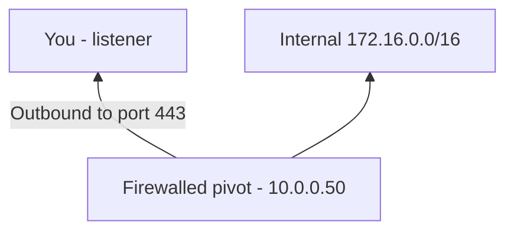
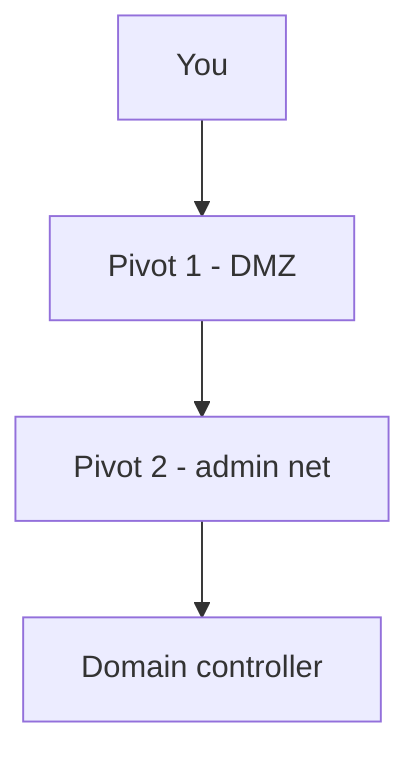

given notes in this folder, perform an overhaul (potentially a complete rewrite) of the Network pivoting primer. or must serve as a starting point and a roadmap for all other notes in the section.

DO NOT read more thatn 50 first lines of each note; you only need to understand the scope of each guide, do not pollute context (the scope definition and first section usually fit the first 20 lines)
## Network pivoting primer

>[!abstract]+ **Scope**: Pivoting, tunneling, and port forwarding concepts, topologies, and tool selection; detailed guides linked per technique.

>Pivoting is the technique of using a system reachable from the operator's machine that has access to networks otherwise unrachable. 

- The intermediary system is common called a **pivot**, **jump host**, or **foothold**.
- Pivoting means **using an existing foothold to extend network reachability beyond the operator's directly reachable network boundary**. 
- A pivot typucally exists because the intermediary has connectivity that the operator does not, such as either:
	- It has an interface connected to an internal subnet (i.e., a dual-homed system also connected to an otherwise unreachable network);
	- It can route to networks that are not exposed externally;
	- Local firewall policy permits connections that would be blocked from the operator's host;
	- Internal services trust or permit traffic originating from the pivot's network location;
	- It can resolve internal DNS names unavailable externally;
	- or it can establish outbound connections that can be repurposed into a tunnel.


>[!example]+ 
> ```mermaid
> flowchart TD
> operator["Operator<br/>10.10.14.5"]
> pivot["Pivot<br/>10.10.10.20<br/>172.16.20.10"]
> network["Internal network<br/>172.16.20.0/24"]
> 
> operator -->|reachable| pivot
> pivot -->|internal reachability| network
> ```
> 
> 
> - The operator can't directly route packets to `172.16.20.0/24`, but the pivot can. A pivoting mechanism therefore creates some form of **data path** between the operator and that network.

- The resulting path does not necessarily behave like ordinary IP routing. Depending on the technique, traffic may be:
	- forwarded between individual sockets;
	- recreated as new TCP connections by the pivot;
	- proxied using SOCKS;
	- encapsulated inside another protocol;
	- injected into a virtual Layer 3 interface;
	- or forwarded by the operating system's native routing stack.


===
- You rarely get direct access to internal subnets after you compromise a perimeter host.
- Firewalls, NAT, and egress filters segment domain controllers, databases, and admin consoles into non-routable networks.
- **Pivoting** routes your traffic through a compromised intermediary (**pivot** or jump box) to reach those segments.


## Pivoting mechanisms

>**Port forwarding** maps traffic arriving at a specific listening address and port to a predetermined destination address and port.

```
listener IP:port -> target IP:port
```

- The forwarding mechanism accepts a connection on the listening socket and transports or recreates that connection toward the destination.

>**Dynamic proxying** exposes a proxy endpoint through which applications dynamically request connections to arbitrary destinations through the pivot.

>[!example]+
>- Instead of statically configuring:
> 
> ```
> 127.0.0.1:8080 -> 172.16.20.10:80
> 127.0.0.1:8443 -> 172.16.20.20:443
> 127.0.0.1:13389 -> 172.16.20.30:3389
> ```
> 
>- A single SOCKS listener may be used:
> 
> ```
> 127.0.0.1:1080
> ```
> 
>- Applications tell the proxy which destination they want:
> 
> ```
> CONNECT 172.16.20.10:80
> CONNECT 172.16.20.20:443
> CONNECT 172.16.20.30:3389
> ```

- The most common example is a **SOCKS proxy**.
- This provides **one-to-many connection forwarding**.

>[!note] A SOCKS pivot is still normally a **proxy**, not transparent IP routing. Applications must either support SOCKS directly or have their socket calls redirected through a compatibility layer such as `proxychains`.

>[!note] To learn more about SOCKS, see [[SOCKS]].

>**Protocol tunneling** encapsulates one protocol or traffic stream inside another protocol that can traverse the available network path.

- For example, traffic may be transported inside:
	- SSH
	- TLS/HTTPS
	- WebSocket
	- DNS (see [[🛠️ DNS tunneling]])
	- ICMP (see [[🛠️ ICMP tunneling with SOCKS]])
	  - RDP (see [[🛠️ RDP and SOCKS tunneling with SocksOverRDP]])
	  - or other application protocol
- The important property is **encapsulation**: the intermediate network observes the carrier protocol rather than directly observing the inner communication.
- In practice, virtually all SSH port forwarding is technically also tunneling because forwarded traffic is carried inside SSH channels. However, it is useful to distinguish **port-forwarding semantics** from techniques designed primarily to bypass protocol restrictions through encapsulation.
- Protocol tunneling is useful when the available communication path is constrained by:
	- firewall rules;
	- outbound ACLs;
	- proxy requirements;
	- restrictive egress filtering;
	- limited exposed services.

>**Layer 3 tunneling** creates a packet-level path to a remote network, usually by presenting a virtual network interface and installing routes for remote prefixes.

- Applications can then address remote systems normally, without being configured to use a SOCKS proxy individfually.
- This is substantially closer to conventional network routing than socket-level forwarding.
- Examples of tools that can provide routing-like pivoting include mechanisms based on:
	- TUN/TAP interfaces;
	- VPN technologies;
	- `sshuttle`;
	- Ligolo-ng;
	- WireGuard;
	- OpenVPN.

---

- **Port forwarding**: static 1-to-1 TCP/UDP redirect from one listener to one target `IP:port`.
	- Use it when you know the exact service you need.
- **Protocol tunneling**: you wrap blocked traffic inside an allowed carrier such as HTTP, DNS, ICMP, or RDP.
	- Use it when egress filters block direct TCP/SSH.
- **Dynamic proxying**: 1-to-many SOCKS proxy. Your tools ask the pivot to open connections on demand.
	- Use it when you need to scan subnets or hit many hosts.
- **Subnet routing**: transparent Layer 3 redirect. Your local tools address internal IPs directly with no per-app proxy setup.
	- Use it when your tools can't use SOCKS.

### Connection-oriented vs packet-oriented pivots

## Understanding common topologies

- Your choice of forward or reverse tunnel depends on firewall direction and hop count.

### Dual-homed pivot

- The pivot has two NICs: one you can reach, one on the internal network.
- You connect inbound to the pivot, then forward to the internal target.


### Egress-only network

- Stateful firewalls drop all inbound connections to the pivot.
- The pivot can still make outbound connections to you.
- You listen on your public host. The pivot dials back and carries the tunnel over that outbound stream.



- Forward dials such as `ssh user@pivot` fail here.
- Reverse mechanisms work here: [[Chisel]] `--reverse`, [[rpivot]] reverse mode, [[SSH port forwarding]] `-R`, [[Plink]] `-R`, [[Meterpreter tunneling]] reverse `portfwd`.

### Chained pivots

- Pivot 1 reaches only an intermediate net. Pivot 2 reaches the crown-jewel tier.
- You chain tunnels: tunnel 2 runs inside tunnel 1.



- To chain tunnels:
	1. Establish a tunnel from you through Pivot 1.
	2. Run a second client through tunnel 1 to Pivot 2.
	3. Send target traffic through tunnel 2.

## Pivoting techniques in this folder

- Each guide below holds full commands, flags, and verification steps. This list gives you the one-line role of each guide:
	- [[SSH port forwarding]]: canonical encrypted `-L` / `-R` / `-D` forwards over SSH.
	- [[Chisel]]: cross-platform SOCKS and port forwards over HTTP/WebSockets for firewall evasion.
	- [[socat]]: ad-hoc single-port TCP/UDP relay and TLS wrapping on Linux.
	- [[netsh]]: living-off-the-land single-port TCP proxy on Windows.
	- [[Plink]]: SSH `-L` / `-R` / `-D` from Windows hosts without native OpenSSH.
	- [[Meterpreter tunneling]]: `portfwd`, `route`, and `socks_proxy` through an existing Meterpreter session.
	- [[rpivot]]: reverse SOCKS4, including through NTLM corporate proxies with Python 2 only.
	- [[🛠️ RDP and SOCKS tunneling with SocksOverRDP]]: SOCKS inside an existing RDP session over port 3389.
	- [[sshuttle]]: transparent subnet routing over SSH with no per-app proxy setup.
	- [[🛠️ Ligolo-ng]]: Layer 3 TUN tunnel with userland stack for VPN-like subnet access.
	- [[🛠️ DNS tunneling]]: `dnscat2` C2 and `iodine` IP-over-DNS when only DNS egress survives.
	- [[🛠️ ICMP tunneling with SOCKS]]: `ptunnel-ng` TCP-over-ICMP plus `ssh -D` when only ping passes.

## Choosing a pivoting method

- Match the method to target count, egress rules, OS, privileges, and whether you can drop files.

### Forwarding one known service

- Use port forwards when you know the exact target `IP:port` and don't need subnet scans.
- [[SSH port forwarding]] with `-L`:
	- Transport: SSH TCP port `22`, standard user; root only for ports below 1024.
	- Direction: forward. You dial the pivot.
	- Use it when SSH is reachable and you need one service such as `172.16.5.19:3389`.
	- Drawback: one rule per service; no UDP/ICMP/raw scans.
- [[socat]]:
	- Transport: raw TCP/UDP/SSL on Linux, standard user.
	- Direction: inbound or outbound relays.
	- Use it when you need a fast bridge with no SSH setup or you want to relay an isolated shell back to you.
	- Drawback: static per-port relays; source IP shows as the pivot; dies after one connection without `fork`.
- [[netsh]]:
	- Transport: Windows `netsh interface portproxy`, TCP only.
	- Direction: forward into the pivot.
	- Use it when you can't drop files on a dual-homed Windows host and you need one RDP/HTTP/SMB port exposed.
	- Drawback: needs Administrator plus firewall rule; one rule per port; no SOCKS or subnet routing.
- [[Plink]]:
	- Transport: SSH from Windows CLI, standard user, needs SSH creds or key.
	- Direction: forward or reverse, always initiated by the `plink` side.
	- Use it when the Windows pivot lacks native `ssh.exe` but allows SSH egress.
	- Drawback: `-pw` shows in command line and logs; often flagged.
- [[Meterpreter tunneling]] with `portfwd`:
	- Transport: inside the existing Meterpreter channel, no extra ports needed.
	- Direction: local `-l` or reverse `-R`.
	- Use it when you already hold a session and need quick access to one internal service.
	- Drawback: TCP only; routes affect Metasploit unless you add SOCKS.

### Scanning subnets through SOCKS

- Use dynamic SOCKS when you don't know targets yet and need Nmap, browsers, and Impacket-style tools to hit many hosts.
- [[SSH port forwarding]] with `-D`
- [[Chisel]] in `socks` mode
- [[rpivot]]
- [[Meterpreter tunneling]] with `socks_proxy`:
	- Transport: SOCKS4/5 over SSH, WebSockets, or Meterpreter channel.
	- Direction: forward except [[rpivot]] and [[Chisel]] `--reverse`, which suit egress-only nets.
	- Use them when you need multi-host enumeration and HTTP/SSH egress is allowed.
	- Drawbacks: you must wrap tools in `proxychains` unless they speak SOCKS natively; Nmap needs `-sT -Pn`; no raw SYN, ICMP, or OS fingerprinting.
- [[🛠️ RDP and SOCKS tunneling with SocksOverRDP]]:
	- Transport: RDP dynamic virtual channels over TCP port `3389`.
	- Direction: forward over an existing RDP session.
	- Use it when only `3389` stays open between jump host and segregated Windows nets.
	- Drawback: Windows plus `mstsc` only; needs RDP creds, admin on the target side, binary drop, and an active GUI session.

### Routing whole subnets transparently

- Use subnet routing when your tools can't take SOCKS settings and you want internal IPs to work directly.
- [[sshuttle]]:
	- Transport: SSH plus local `iptables`/`nft`/`pf` redirect and remote Python helper.
	- Direction: forward. You dial the pivot.
	- Use it when you need whole-CIDR access from Linux with no per-app configuration.
	- Drawback: needs root on your host; TCP only; Nmap still needs `-sT -Pn`.
- [[🛠️ Ligolo-ng]]:
	- Transport: Ligolo control channel plus TUN packet translation.
	- Direction: reverse. The agent on the pivot dials your relay.
	- Use it when you want VPN-like access without SOCKS wrappers and can't run as admin on the pivot.
	- Drawback: unprivileged agent can't do raw packets, so SYN scans fall back to connect scans.

### Crossing restricted egress

- Use carrier tunnels when firewalls allow only one protocol out.
- [[Chisel]] over HTTP/WebSockets:
	- Transport: ports `80`/`443`/`8080`, standard user, Go static binary.
	- Direction: forward or reverse.
	- Use it when HTTP egress is allowed and you can upload ~11 MB.
	- Drawback: binary drop can trigger detection; needs a listener port.
- [[rpivot]] through NTLM proxies:
	- Transport: plain TCP with optional `HTTP CONNECT` plus NTLM auth.
	- Direction: reverse.
	- Use it on legacy Python 2 hosts stuck behind Squid/BlueCoat-style proxies.
	- Drawback: SOCKS4 only, no encryption, unmaintained; prefer [[Chisel]] or [[🛠️ Ligolo-ng]] when you can.
- [[🛠️ DNS tunneling]] with `dnscat2` or `iodine`:
	- Transport: DNS UDP/53 to your authoritative server.
	- Direction: outbound from pivot.
	- Use it as a last resort when only DNS resolves out.
	- Drawback: very slow, noisy, and needs your own domain plus public listener; good for small commands and creds, not scans.
- [[🛠️ ICMP tunneling with SOCKS]] with `ptunnel-ng`:
	- Transport: ICMP Echo payloads plus chained `ssh -D`.
	- Direction: forward from you to the pivot listener.
	- Use it when only ping passes.
	- Drawback: needs root on both ends plus SSHD on the pivot; slow and easy to spot by IDS.

## Operating through SOCKS proxies

- After you open a dynamic proxy with `ssh -D`, [[Chisel]], or [[rpivot]], point your local tools at it.
- Most CLI tools lack native SOCKS settings. `proxychains-ng` fixes that with `LD_PRELOAD` hooks:
	- It loads `libproxychains4.so` before the target program runs.
	- It hooks `connect()`, `socket()`, `gethostbyname()`, and `getaddrinfo()`.
	- When your tool dials `172.16.5.19:445`, the hook redirects that socket to `127.0.0.1:1080` and sends a SOCKS handshake for the real target.

### Setting proxychains options

- Edit `/etc/proxychains4.conf` before you scan:
	- Set `strict_chain` so hops run in order.
	- Set `proxy_dns` so DNS goes through the proxy and doesn't leak locally.
	- Raise `tcp_read_time_out` and `tcp_connect_time_out` on slow links.
	- Add your proxy under `[ProxyList]`:

```text
strict_chain
proxy_dns
tcp_read_time_out 15000
tcp_connect_time_out 8000

[ProxyList]
socks5 127.0.0.1 1080
```

### Scanning through SOCKS proxies

- SOCKS passes TCP connections, not raw packets. That changes how you run Nmap:
	- `-sS` fails because raw SYN packets can't cross Layer 5 SOCKS.
	- `-sn` and `-PE` fail because ICMP doesn't cross SOCKS4 or standard SOCKS5.
	- `-O` fails because you fingerprint the local proxy socket, not the remote kernel stack.
- Run full connect scans and skip host discovery:

```bash
proxychains -q nmap -sT -Pn -p 21,22,80,443,445,3389,8080 172.16.5.19
```

- Use these flags:
	- `-sT`: uses `connect()` calls that `proxychains` can hook.
	- `-Pn`: skips ICMP/ARP discovery and treats the host as up.
	- `-q`: quiets `proxychains` hook logs.

## Inspecting network configuration

## References and further reading

- [`RFC 1928: SOCKS Protocol Version 5 — IETF`](https://datatracker.ietf.org/doc/html/rfc1928)
- [`RFC 4254: The Secure Shell (SSH) Connection Protocol — IETF`](https://datatracker.ietf.org/doc/html/rfc4254)
- [`Proxychains-NG Repository — GitHub`](https://github.com/rofl0r/proxychains-ng)
- [`A Red Teamer's Guide to Pivoting — Artem Kondratenko`](https://artkond.com/2017/03/23/pivoting-guide/)
