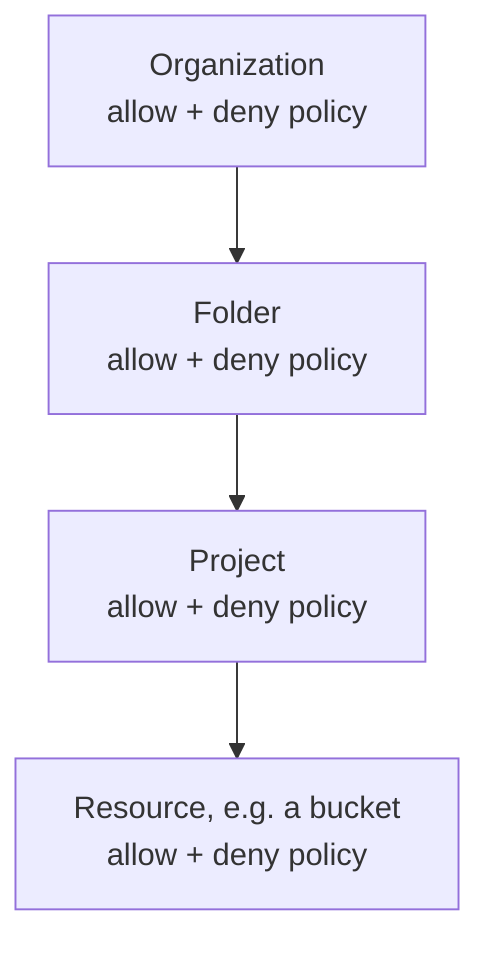
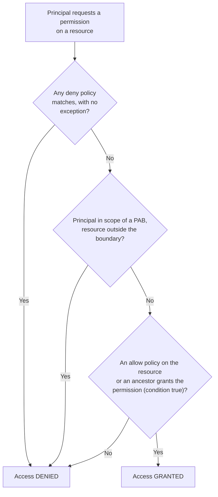

>[!abstract]+ **Scope**: Google Cloud IAM for security engineers — principals and principal types, permissions and roles (basic, predefined, custom), allow policies and bindings, IAM conditions, deny policies, principal access boundary policies, the resource hierarchy and policy inheritance, how access is evaluated, service accounts, keys, impersonation and short-lived credentials, workload and workforce identity federation, organization policy constraints, auditing and troubleshooting access, IAM privilege escalation, hardening, and a `gcloud` command reference.

>[!abstract]+ Table of contents
>- [[#IAM]]
>- [[#Principals]]
>- [[#Permissions and roles]]
>	- [[#Permission format]]
>	- [[#Basic roles]]
>	- [[#Predefined roles]]
>	- [[#Custom roles]]
>- [[#IAM allow policies]]
>	- [[#Policy structure]]
>	- [[#Reading and modifying allow policies]]
>- [[#The resource hierarchy and policy inheritance]]
>- [[#IAM conditions]]
>- [[#IAM deny policies]]
>- [[#Principal access boundary policies]]
>- [[#How access is evaluated]]
>- [[#Service accounts]]
>- [[#Service account keys]]
>- [[#Service account impersonation and short-lived credentials]]
>- [[#Workload identity federation]]
>- [[#Workforce identity federation]]
>- [[#Organization policy constraints]]
>- [[#Auditing and troubleshooting IAM]]
>- [[#IAM privilege escalation]]
>- [[#Hardening IAM]]
>- [[#gcloud command reference]]
>- [[#References and further reading]]

## IAM

>**Identity and Access Management (IAM)** controls *who* (which principal) can do *what* (which role, a set of permissions) *on which* Google Cloud resource.

- Every action in Google Cloud requires one or more permissions, and the caller gets those permissions only through a role granted to its identity.
- Granting access in IAM involves three components:
	- **Principal**: the identity of a human user or workload that the access is granted to.
	- **Role**: the named collection of permissions that's granted.
	- **Resource**: the Google Cloud resource the principal is allowed to act on.
- Access is governed by three kinds of policy, evaluated together:
	- **Allow policies** grant roles to principals on a resource (the classic "IAM policy").
	- **Deny policies** block specific permissions for specific principals, and are checked before allow policies.
	- **Principal access boundary (PAB) policies** cap which resources a principal can reach at all, regardless of the roles they hold.
- The combination of these policies, inherited down the [[#The resource hierarchy and policy inheritance|resource hierarchy]], produces a principal's *effective access*. See [[#How access is evaluated]].

>[!note] See [`IAM overview — Google Cloud`](https://docs.cloud.google.com/iam/docs/overview).

## Principals

>**Principals** represent one or more identities that have authenticated to Google Cloud.

- Principals fall into two broad groups:
	- **Human users**: Google Accounts, Google groups, Google Workspace accounts, Cloud Identity domains, and federated human identities in a workforce identity pool.
	- **Workloads**: service accounts and federated workload identities in a workload identity pool.
- In a policy, each principal is written as a typed identifier. The identifier type decides how the principal authenticates and how you reference it in `gcloud` and in policy files.

| Principal identifier | Description |
| --- | --- |
| `user:alice@example.com` | Reference a single Google Account (a human or a Cloud Identity user). |
| `group:team@example.com` | Reference all members of a Google group, including nested groups. |
| `serviceAccount:app@PROJECT_ID.iam.gserviceaccount.com` | Reference a user-managed or default [[#Service accounts\|service account]]. |
| `domain:example.com` | Reference every account in a Google Workspace or Cloud Identity domain. |
| `principal://.../subject/SUBJECT` | Reference a single federated identity (workforce or workload pool). |
| `principalSet://.../group/GROUP` | Reference a set of federated identities selected by an attribute, such as a group or repository. |
| `allAuthenticatedUsers` | Reference any principal authenticated with a Google Account or service account (not anonymous). Treat as public. |
| `allUsers` | Reference anyone on the internet, including unauthenticated callers. A public grant — audit aggressively. |

>[!warning] `allUsers` and `allAuthenticatedUsers` make a resource effectively public. The organization policy constraint `constraints/iam.allowedPolicyMemberDomains` (domain-restricted sharing) blocks these identifiers and limits grants to approved domains. See [[#Organization policy constraints]].

- A service account is both a principal (it authenticates and acts) and a resource (it has its own allow policy that says who may impersonate or manage it). This dual nature is the root of most GCP privilege escalation — see [[#IAM privilege escalation]].

>[!note] See [`IAM principals — Google Cloud`](https://docs.cloud.google.com/iam/docs/principals-overview).

## Permissions and roles

>**Permissions** determine which operations are allowed on a resource. You never grant a permission to a principal directly — you grant a role, and the role carries the permissions.

### Permission format

- Permissions are written as `service.resource.verb`, for example:
	- `compute.instances.list` — list Compute Engine instances.
	- `storage.objects.get` — read an object in Cloud Storage.
	- `iam.serviceAccounts.actAs` — run or deploy a workload as a service account.
	- `resourcemanager.projects.setIamPolicy` — change the allow policy on a project.
- Permissions usually map one-to-one to REST API methods. For example, the `resourcemanager.projects.list` permission backs the `projects.list` method.
- List the permissions that can be set on a given resource:

```bash
gcloud iam list-testable-permissions //cloudresourcemanager.googleapis.com/projects/PROJECT_ID
```

>**Roles** are named collections of permissions. Granting a role to a principal on a resource grants every permission in that role.

- IAM has three kinds of role: basic, predefined, and custom.

### Basic roles

- Basic (primitive) roles predate IAM and grant broad access across every service in a project.

| Role | Description |
| --- | --- |
| `roles/viewer` | Grant read-only access to most resources. |
| `roles/editor` | Grant viewer access plus permission to modify most resources. |
| `roles/owner` | Grant editor access plus permission to manage roles, billing, and the project itself. |

>[!warning] Basic roles are coarse and ignore least privilege. `roles/editor` alone is a privilege-escalation surface (it can create service accounts, deploy workloads, and mint tokens). Avoid them outside throwaway sandboxes, and watch for the Compute Engine default service account that still ships with `roles/editor` on legacy projects.

### Predefined roles

- Predefined roles are curated and maintained by Google Cloud services, scoped to a single service, and updated as services add permissions (for example `roles/storage.objectAdmin`, `roles/iam.serviceAccountTokenCreator`).
- List and inspect roles:

```bash
gcloud iam roles list
```

```bash
gcloud iam roles describe roles/storage.objectAdmin
```

- Find only the roles that can be granted on a specific resource:

```bash
gcloud iam list-grantable-roles //cloudresourcemanager.googleapis.com/projects/PROJECT_ID
```

### Custom roles

- Custom roles contain exactly the permissions you list, and are the main tool for least privilege when no predefined role fits.
- Custom roles are defined at the project or organization level and can only include permissions supported for custom roles (the `--stage` flag tracks their lifecycle: `ALPHA`, `BETA`, `GA`, `DISABLED`).
- Create a project-level custom role from flags:

```bash
gcloud iam roles create incidentResponder --project=PROJECT_ID \
  --title="Incident responder" \
  --description="Read logs and stop instances" \
  --permissions=logging.logEntries.list,compute.instances.stop \
  --stage=GA
```

- The same role from a YAML definition, which is easier to review and keep in version control:

```bash
gcloud iam roles create incidentResponder --project=PROJECT_ID --file=role.yaml
```

```yaml
title: "Incident responder"
description: "Read logs and stop instances"
stage: "GA"
includedPermissions:
- logging.logEntries.list
- compute.instances.stop
```

>[!important] `iam.roles.update` on a custom role you already hold is a privilege-escalation path: you can add any permission to the role and grant it to yourself. Treat custom-role edit rights as sensitive. See [[#IAM privilege escalation]].

>[!note] See [`Roles and permissions — Google Cloud`](https://docs.cloud.google.com/iam/docs/roles-overview) and [`Understanding roles`](https://docs.cloud.google.com/iam/docs/understanding-roles).

## IAM allow policies

>An **allow policy** (formerly "IAM policy") is a collection of *bindings* attached to a resource. Each binding grants one role to a set of principals, optionally gated by a condition.

### Policy structure

- A binding is the atomic unit of a grant: one role, a list of members, and an optional condition.
- An allow policy attached to a resource looks like this:

```json
{
  "bindings": [
    {
      "role": "roles/storage.objectViewer",
      "members": [
        "user:alice@example.com",
        "group:analysts@example.com",
        "serviceAccount:etl@my-project.iam.gserviceaccount.com"
      ]
    },
    {
      "role": "roles/storage.admin",
      "members": ["group:storage-admins@example.com"],
      "condition": {
        "title": "prod-only",
        "expression": "resource.name.startsWith('projects/_/buckets/prod-')"
      }
    }
  ],
  "etag": "BwX1a2b3c4=",
  "version": 3
}
```

- Key fields:
	- `role` — the role granted by the binding.
	- `members` — the principals the role is granted to, using the identifiers from [[#Principals]].
	- `condition` — an optional [[#IAM conditions|IAM condition]]; a binding with a condition is only in effect when the expression is true.
	- `etag` — an optimistic-concurrency token. You read a policy, modify it, and write it back with the same `etag`; a concurrent change invalidates the `etag` and your write fails instead of clobbering it.
	- `version` — the schema version. Use `3` whenever conditions are present; versions `1` and `2` can't express conditions.

### Reading and modifying allow policies

- Allow policies attach at every level of the hierarchy. The read/write commands mirror the resource type:

```bash
gcloud projects get-iam-policy PROJECT_ID
```

```bash
gcloud resource-manager folders get-iam-policy FOLDER_ID
```

```bash
gcloud organizations get-iam-policy ORG_ID
```

- Grant a role with a single incremental change (the common, safe path — it only touches one binding):

```bash
gcloud projects add-iam-policy-binding PROJECT_ID \
  --member="user:alice@example.com" \
  --role="roles/viewer"
```

- Revoke that same grant:

```bash
gcloud projects remove-iam-policy-binding PROJECT_ID \
  --member="user:alice@example.com" \
  --role="roles/viewer"
```

- Replace the entire policy from a file (read-modify-write with the `etag`). This is the same outcome as an `add`/`remove` but rewrites every binding at once, so it's riskier — a stale file drops grants you didn't mean to touch:

```bash
gcloud projects get-iam-policy PROJECT_ID --format=json > policy.json
```

```bash
gcloud projects set-iam-policy PROJECT_ID policy.json
```

>[!tip] Prefer `add-iam-policy-binding` / `remove-iam-policy-binding` over `set-iam-policy` for day-to-day changes. The incremental commands can't accidentally delete bindings that another engineer added between your read and write.

>[!note] See [`Understanding allow policies — Google Cloud`](https://docs.cloud.google.com/iam/docs/policies).

## The resource hierarchy and policy inheritance

- Google Cloud resources are arranged in a hierarchy: **organization → folders → projects → service resources** (buckets, instances, and so on). The hierarchy itself is covered in [[🛠️ Overview of Google Cloud Services]].



- Allow policies are **inherited downward** and are **additive**. A principal's effective allow policy on a resource is the *union* of the bindings set on that resource and on every ancestor.
- This has two consequences a security engineer must internalize:
	- A grant at the organization or folder level silently applies to every project and resource beneath it. Always check ancestors, not just the resource in question.
	- You **can't** take away an inherited grant with an allow policy lower down — allow policies only add. To remove inherited access you either delete the binding at the level where it was granted, or block it with a [[#IAM deny policies|deny policy]] or a [[#Principal access boundary policies|PAB policy]].
- Trace the ancestry of a project before reasoning about its effective access:

```bash
gcloud projects get-ancestors PROJECT_ID
```

## IAM conditions

>**IAM conditions** add a logical expression (written in Common Expression Language, CEL) to a role binding. The binding grants access only when the expression evaluates to true.

- Conditions implement attribute-based access control on top of role grants. Common attributes:
	- `request.time` — grant access only within a time window (temporary access, business hours).
	- `resource.name` / `resource.type` — scope a grant to specific resources by name prefix or type.
	- `request.auth.claims` and request attributes — gate on properties of the request.
- Grant a role that expires automatically at the end of the year:

```bash
gcloud projects add-iam-policy-binding PROJECT_ID \
  --member="user:contractor@example.com" \
  --role="roles/compute.viewer" \
  --condition='title=temp-access,description=Expires end of 2026,expression=request.time < timestamp("2026-12-31T00:00:00Z")'
```

>[!warning] Conditions are allow-list refinements, not deny rules. A conditional binding that fails its condition grants nothing, but it never blocks access that another binding grants. For hard blocks, use [[#IAM deny policies]].

>[!note] See [`IAM Conditions overview — Google Cloud`](https://docs.cloud.google.com/iam/docs/conditions-overview).

## IAM deny policies

>**Deny policies** list permissions that are refused to specified principals, regardless of any allow policy. Deny rules are evaluated *before* allow rules.

- Deny policies attach to the organization, a folder, or a project, and inherit downward like allow policies. They're managed through the IAM v2 API, separately from allow policies.
- A deny rule names:
	- `deniedPrincipals` — who is blocked (and optional `exceptionPrincipals` who are not).
	- `deniedPermissions` — what's blocked, written in the **fully qualified** form `service.googleapis.com/resource.verb` (note the difference from the `service.resource.verb` form used in allow policies), with optional `exceptionPermissions`.
	- `denialCondition` — an optional CEL condition, commonly matching resource tags.
- Example deny policy that blocks service-account key creation for everyone except a break-glass group:

```json
{
  "displayName": "Block SA key creation",
  "rules": [
    {
      "denyRule": {
        "deniedPrincipals": ["principalSet://goog/public:all"],
        "exceptionPrincipals": [
          "principalSet://goog/group/break-glass@example.com"
        ],
        "deniedPermissions": ["iam.googleapis.com/serviceAccountKeys.create"]
      }
    }
  ]
}
```

- Create the deny policy against an attachment point (the resource it protects):

```bash
gcloud iam policies create block-sa-keys \
  --attachment-point="cloudresourcemanager.googleapis.com/projects/PROJECT_ID" \
  --kind=denypolicies \
  --policy-file=deny-policy.json
```

- List and inspect deny policies on a resource:

```bash
gcloud iam policies list \
  --attachment-point="cloudresourcemanager.googleapis.com/projects/PROJECT_ID" \
  --kind=denypolicies
```

>[!note] See [`Deny policies overview — Google Cloud`](https://docs.cloud.google.com/iam/docs/deny-overview).

## Principal access boundary policies

>**Principal access boundary (PAB) policies** define the set of resources a principal is *allowed to access at all*. Even if an allow policy grants a role, a principal outside the boundary can't use it.

- Deny policies answer "which permissions are blocked"; PAB policies answer "which resources this identity may ever touch." They're the GCP analogue of AWS permission boundaries and are a strong containment control for powerful identities and for limiting blast radius after a credential leak.
- A PAB policy lists allowed resources (projects, folders, or the whole organization), and is then attached to a set of principals through a **policy binding**.
- Create a boundary and inspect existing ones:

```bash
gcloud iam principal-access-boundary-policies create prod-boundary \
  --organization=ORG_ID \
  --location=global \
  --policy-file=pab-policy.yaml
```

```bash
gcloud iam principal-access-boundary-policies list \
  --organization=ORG_ID --location=global
```

- Bind the boundary to a principal set (for example a workforce pool or a group) so it takes effect:

```bash
gcloud iam policy-bindings create prod-boundary-binding \
  --organization=ORG_ID --location=global \
  --policy=prod-boundary \
  --policy-kind=principalAccessBoundaryPolicy \
  --target-principal-set="//iam.googleapis.com/locations/global/workforcePools/POOL_ID/*"
```

>[!note] See [`Principal access boundary policies — Google Cloud`](https://docs.cloud.google.com/iam/docs/principal-access-boundary-policies).

## How access is evaluated

- When a principal calls an API, Google Cloud decides whether the specific permission is allowed on the specific resource by combining every policy in the hierarchy:



- In short, access is granted only when **all** of the following hold:
	- No deny policy blocks the permission for this principal.
	- The resource is within the principal's access boundary (or the principal isn't in scope of any PAB).
	- An allow policy on the resource or one of its ancestors grants a role containing the permission, and any condition on that binding is true.
- Because grants come from anywhere in the hierarchy, the *source* of an effective permission is often an ancestor policy. Use [[#Auditing and troubleshooting IAM|Policy Troubleshooter and Policy Analyzer]] to find where a grant actually originates.

## Service accounts

>A **service account** is a special principal that represents a workload (an application, a VM, a pipeline) rather than a human. Workloads authenticate as a service account to call Google Cloud APIs.

- A service account has an email identity (`NAME@PROJECT_ID.iam.gserviceaccount.com`) and a numeric unique ID. It's simultaneously a *principal* (it holds roles and acts) and a *resource* (its own allow policy controls who can impersonate or manage it).

### Types of service accounts

| Type | Description |
| --- | --- |
| User-managed | Create and control these yourself; the primary identity for your own workloads (`NAME@PROJECT_ID.iam.gserviceaccount.com`). |
| Default | Recognize the auto-created Compute Engine (`PROJECT_NUMBER-compute@developer.gserviceaccount.com`) and App Engine defaults; legacy projects attach `roles/editor` to them. |
| Google-managed (service agents) | Identify per-service accounts (`service-PROJECT_NUMBER@...gserviceaccount.com`) that Google uses to act on your resources; you don't create or hold keys for them. |

- Create and manage user-managed service accounts:

```bash
gcloud iam service-accounts create etl-runner \
  --display-name="ETL runner"
```

```bash
gcloud iam service-accounts list
```

```bash
gcloud iam service-accounts describe etl-runner@PROJECT_ID.iam.gserviceaccount.com
```

### How service accounts authenticate

- A workload acts as a service account in one of three ways:
	- **Attached service account**: a resource (a VM, Cloud Run service, GKE workload) is configured to run as a service account, and code obtains tokens from the metadata server. This is the recommended pattern — no keys on disk.
	- **Impersonation**: a principal with the right role asks IAM for short-lived credentials for the service account. See [[#Service account impersonation and short-lived credentials]].
	- **Service account keys**: a long-lived private key file authenticates as the account. The last resort — see [[#Service account keys]].
- Attaching a service account to a resource requires the deployer to hold `iam.serviceAccounts.actAs` on that account (the `roles/iam.serviceAccountUser` role). This is why "who can deploy a workload" is really "who can act as this account" — and a frequent escalation path.
- Service account access tokens are OAuth 2.0 bearer tokens scoped to Google APIs; the [[🛠️ OAuth]] note covers the token model itself. Older attached accounts also carry OAuth *access scopes*, a legacy coarse limit applied on top of IAM roles.

>[!note] See [`Service accounts overview — Google Cloud`](https://docs.cloud.google.com/iam/docs/service-account-overview).

## Service account keys

>A **service account key** is a long-lived RSA private key that authenticates as a service account without any further login. Anyone who holds the key file is that service account.

- Two kinds of key exist:
	- **User-managed keys**: you create them, and you get the private key as a JSON file. They don't expire by default and are the single most common cause of GCP compromise — committed to Git, baked into images, or left in CI.
	- **Google-managed keys**: Google holds the private key and uses it for impersonation and signing on your behalf; you never see the private material.
- Create, list, and delete user-managed keys:

```bash
gcloud iam service-accounts keys create key.json \
  --iam-account=etl-runner@PROJECT_ID.iam.gserviceaccount.com
```

```bash
gcloud iam service-accounts keys list \
  --iam-account=etl-runner@PROJECT_ID.iam.gserviceaccount.com
```

```bash
gcloud iam service-accounts keys delete KEY_ID \
  --iam-account=etl-runner@PROJECT_ID.iam.gserviceaccount.com
```

- Authenticate the CLI with a key file (what an attacker does with a leaked key):

```bash
gcloud auth activate-service-account --key-file=key.json
```

>[!warning] Prefer any keyless option — attached service accounts, impersonation, or [[#Workload identity federation]] — over user-managed keys. Enforce this with the organization policy constraints `constraints/iam.disableServiceAccountKeyCreation` and `constraints/iam.disableServiceAccountKeyUpload`, and cap lifetime with `constraints/iam.serviceAccountKeyExpiryHours`. The `keys list` command is a quick way to audit where long-lived keys still exist.

>[!note] See [`Create and manage service account keys — Google Cloud`](https://docs.cloud.google.com/iam/docs/keys-create-delete).

## Service account impersonation and short-lived credentials

>**Impersonation** lets an authorized principal obtain short-lived credentials for a service account and act as it, with no key file involved.

- Impersonation is backed by the IAM Service Account Credentials API (`iamcredentials.googleapis.com`), which issues OAuth access tokens, OpenID Connect ID tokens, and signatures that expire within an hour.

### Impersonation roles and permissions

| Role / permission | Description |
| --- | --- |
| `roles/iam.serviceAccountTokenCreator` | Grant the ability to mint access tokens, ID tokens, and signatures for the service account. |
| `roles/iam.serviceAccountUser` | Grant `iam.serviceAccounts.actAs` to attach the account to a resource and run workloads as it. |
| `iam.serviceAccounts.getAccessToken` | Permit requesting an OAuth access token for the account directly. |
| `iam.serviceAccounts.getOpenIdToken` | Permit requesting an OIDC ID token for the account. |
| `iam.serviceAccounts.signBlob` / `signJwt` | Permit signing arbitrary data or JWTs as the account. |
| `iam.serviceAccounts.implicitDelegation` | Permit chaining through one account to mint tokens for a third account. |

- Grant one principal the ability to impersonate a service account (note this is set on the service account *as a resource*):

```bash
gcloud iam service-accounts add-iam-policy-binding \
  privileged@PROJECT_ID.iam.gserviceaccount.com \
  --member="user:alice@example.com" \
  --role="roles/iam.serviceAccountTokenCreator"
```

### Generating short-lived credentials

- Run any single `gcloud` command as another account with the global `--impersonate-service-account` flag:

```bash
gcloud compute instances list \
  --impersonate-service-account=privileged@PROJECT_ID.iam.gserviceaccount.com
```

- Print an access token for a service account you can impersonate, then use it as a bearer token against any Google API:

```bash
gcloud auth print-access-token \
  --impersonate-service-account=privileged@PROJECT_ID.iam.gserviceaccount.com
```

- The same token via the REST API directly, which is what tooling and exploit scripts call:

```bash
curl -s -X POST \
  -H "Authorization: Bearer $(gcloud auth print-access-token)" \
  -H "Content-Type: application/json" \
  -d '{"scope":["https://www.googleapis.com/auth/cloud-platform"]}' \
  "https://iamcredentials.googleapis.com/v1/projects/-/serviceAccounts/privileged@PROJECT_ID.iam.gserviceaccount.com:generateAccessToken"
```

>[!important] `roles/iam.serviceAccountTokenCreator` on a more privileged account is a direct escalation: hold it and you *are* that account. During a review, enumerate who holds token-creator and actAs on every service account, not just the project-level roles.

>[!note] See [`Service account impersonation — Google Cloud`](https://docs.cloud.google.com/iam/docs/service-account-impersonation).

## Workload identity federation

>**Workload identity federation** lets external workloads (AWS, Azure, GitHub Actions, Kubernetes, any OIDC or SAML provider) obtain short-lived Google Cloud credentials by exchanging their own identity tokens — no service account keys.

- The external token is exchanged at the Security Token Service for a federated credential, which either accesses resources directly or impersonates a service account. This is the keyless replacement for exported key files and the target state for any CI/CD or multi-cloud workload.
- Components:
	- **Workload identity pool**: a container for external identities in a project.
	- **Provider**: the trust configuration for one external issuer (OIDC, AWS, or SAML), including attribute mapping and attribute conditions that restrict which external identities are accepted.
	- **Principal / principalSet**: external identities are referenced in allow policies as `principal://` (one subject) or `principalSet://` (an attribute group, such as one GitHub repository).
- Create a pool and an OIDC provider (here, GitHub Actions):

```bash
gcloud iam workload-identity-pools create github-pool \
  --location=global --display-name="GitHub Actions"
```

```bash
gcloud iam workload-identity-pools providers create-oidc github-provider \
  --location=global --workload-identity-pool=github-pool \
  --issuer-uri="https://token.actions.githubusercontent.com" \
  --attribute-mapping="google.subject=assertion.sub,attribute.repository=assertion.repository" \
  --attribute-condition="assertion.repository=='my-org/my-repo'"
```

- Generate a credential-configuration file that an external workload uses to authenticate:

```bash
gcloud iam workload-identity-pools create-cred-config \
  projects/PROJECT_NUMBER/locations/global/workloadIdentityPools/github-pool/providers/github-provider \
  --service-account=ci@PROJECT_ID.iam.gserviceaccount.com \
  --output-file=credential-config.json
```

- Because providers trust an external issuer, a weak or missing `--attribute-condition` is a critical misconfiguration: without it, *any* repository or tenant on that issuer can obtain your credentials. Federated identities exchange and present OIDC/JWT tokens — see [[🛠️ JWT]] for the token format and its validation pitfalls.

>[!note] See [`Workload identity federation — Google Cloud`](https://docs.cloud.google.com/iam/docs/workload-identity-federation).

## Workforce identity federation

>**Workforce identity federation** lets external *human* identities from your own IdP (Okta, Microsoft Entra ID, Ping, any OIDC/SAML provider) sign in to Google Cloud — the console, the CLI, and APIs — without Google Accounts.

- It uses **workforce pools** (at the organization level) rather than workload pools, and principals are referenced as `principal://iam.googleapis.com/locations/global/workforcePools/POOL_ID/subject/SUBJECT` (or `principalSet://` for a group).
- Create a workforce pool and an OIDC provider:

```bash
gcloud iam workforce-pools create corp-pool \
  --organization=ORG_ID --location=global \
  --display-name="Corp SSO"
```

```bash
gcloud iam workforce-pools providers create-oidc okta \
  --workforce-pool=corp-pool --location=global \
  --issuer-uri="https://example.okta.com" \
  --client-id="CLIENT_ID" \
  --attribute-mapping="google.subject=assertion.sub,google.groups=assertion.groups"
```

>[!note] See [`Workforce identity federation — Google Cloud`](https://docs.cloud.google.com/iam/docs/workforce-identity-federation).

## Organization policy constraints

>**Organization policies** are configuration guardrails applied across the resource hierarchy. They're managed by the Organization Policy Service — a separate system from IAM. IAM decides *who can do what*; organization policies decide *what configurations are permitted at all*.

- A policy sets a **constraint** on resources below its attachment point. Constraints come in types:
	- **Boolean** constraints turn a behavior on or off (for example, disable key creation).
	- **List** constraints allow or deny specific values (for example, allowed domains, allowed regions).
	- **Custom** constraints express your own rules in CEL against resource fields.
- IAM-relevant constraints every security engineer should set:

| Constraint | Description |
| --- | --- |
| `constraints/iam.disableServiceAccountKeyCreation` | Block creation of user-managed service account keys. |
| `constraints/iam.disableServiceAccountKeyUpload` | Block uploading external public keys to service accounts. |
| `constraints/iam.allowedPolicyMemberDomains` | Restrict grants to principals from approved domains (domain-restricted sharing), blocking `allUsers`. |
| `constraints/iam.automaticIamGrantsForDefaultServiceAccounts` | Stop the `roles/editor` grant that default service accounts receive on creation. |
| `constraints/iam.serviceAccountKeyExpiryHours` | Cap the maximum lifetime of any service account key. |

- List and inspect effective constraints, then apply one (v2 `gcloud org-policies`):

```bash
gcloud org-policies list --project=PROJECT_ID
```

```bash
gcloud org-policies describe iam.disableServiceAccountKeyCreation \
  --project=PROJECT_ID --effective
```

```bash
gcloud org-policies set-policy policy.yaml
```

>[!warning] `orgpolicy.policy.set` is a sensitive permission: whoever holds it can switch off the very guardrails above. Treat it like `setIamPolicy` and keep it off the broad roles.

>[!note] See [`Organization Policy Service overview — Google Cloud`](https://docs.cloud.google.com/resource-manager/docs/organization-policy/overview).

## Auditing and troubleshooting IAM

### Audit logging

- Cloud Audit Logs record administrative and data access across Google Cloud:
	- **Admin Activity** logs are always on and free. Every `SetIamPolicy` call lands here — this is your record of who changed access and when.
	- **Data Access** logs must be enabled explicitly and capture reads, including `GetIamPolicy`.
- Find recent IAM policy changes in a project:

```bash
gcloud logging read 'protoPayload.methodName="SetIamPolicy"' \
  --project=PROJECT_ID --limit=20 --freshness=7d
```

### Troubleshooting and analyzing access

- Google's Policy Intelligence tools answer the hard questions ("does Alice have this permission, and where did it come from?"):
	- **Policy Troubleshooter** explains whether a specific principal has a specific permission on a specific resource, and which binding grants or withholds it.
	- **Policy Analyzer** (via Cloud Asset Inventory) answers "who can access what" across the hierarchy and surfaces the *source* of each grant.
	- **Policy Simulator** previews the impact of a proposed policy change before you apply it, flagging access that would break.
	- **Role recommendations** (IAM Recommender / Active Assist) suggest trimming unused permissions based on 90 days of observed usage.
- Troubleshoot one principal's access to one resource:

```bash
gcloud policy-troubleshoot iam //cloudresourcemanager.googleapis.com/projects/PROJECT_ID \
  --principal-email=alice@example.com \
  --permission=resourcemanager.projects.setIamPolicy
```

- Analyze who can do what across an organization (Policy Analyzer):

```bash
gcloud asset analyze-iam-policy \
  --organization=ORG_ID \
  --identity="user:alice@example.com"
```

- Search allow policies across a scope for a given principal — fast for sweeping an org during a review:

```bash
gcloud asset search-all-iam-policies \
  --scope=organizations/ORG_ID \
  --query="policy:alice@example.com"
```

- Pull least-privilege recommendations for a project:

```bash
gcloud recommender recommendations list \
  --project=PROJECT_ID --location=global \
  --recommender=google.iam.policy.Recommender
```

>[!note] See [`Troubleshoot access — Google Cloud`](https://docs.cloud.google.com/iam/docs/troubleshoot-access) and [`Policy Analyzer`](https://docs.cloud.google.com/policy-intelligence/docs/policy-analyzer-overview).

## IAM privilege escalation

>[!abstract] This section is for **authorized** assessment of GCP environments (your own, a client engagement with scope, or a CTF). GCP privilege escalation is almost always a configuration weakness, not a platform bug — the goal is to find and fix it.

- Nearly every GCP escalation reduces to one of three moves: **change a policy** to grant yourself more, **act as a more privileged identity**, or **deploy a workload that runs as one**.

### Dangerous permissions

| Permission | Escalation it enables |
| --- | --- |
| `resourcemanager.projects.setIamPolicy` (also folders/organizations) | Grant yourself any role on the resource. |
| `iam.serviceAccounts.setIamPolicy` | Grant yourself token-creator on a privileged service account, then impersonate it. |
| `iam.serviceAccounts.getAccessToken` / `actAs` | Mint tokens for, or run workloads as, a more privileged account. |
| `iam.serviceAccounts.signJwt` / `signBlob` | Forge signed assertions or JWTs to obtain the account's tokens. |
| `iam.serviceAccounts.implicitDelegation` | Chain through one account to reach a third, more privileged account. |
| `iam.serviceAccountKeys.create` | Mint a long-lived key for a privileged service account. |
| `iam.roles.update` | Add arbitrary permissions to a custom role you already hold. |
| `cloudfunctions.functions.create` + `actAs` | Deploy a function that runs as a privileged service account. |
| `compute.instances.create` + `actAs` | Launch a VM attached to a privileged account and read its token from the metadata server. |
| `cloudbuild.builds.create` + `actAs` | Run a build as the Cloud Build service account, often highly privileged. |
| `orgpolicy.policy.set` | Disable the guardrails (key-creation blocks, domain restriction) that stop the moves above. |

### Common escalation paths

- **Policy rewrite**: with `setIamPolicy` on a project, grant your own principal `roles/owner`:

```bash
gcloud projects add-iam-policy-binding PROJECT_ID \
  --member="user:you@example.com" --role="roles/owner"
```

- **Token theft via impersonation**: with token-creator on a privileged account, print its access token and act as it (see [[#Service account impersonation and short-lived credentials]]):

```bash
gcloud auth print-access-token \
  --impersonate-service-account=privileged@PROJECT_ID.iam.gserviceaccount.com
```

- **Run-as deployment**: with `actAs` plus a deploy permission, ship a workload that runs as a privileged account and exfiltrate its token from the metadata endpoint `http://metadata.google.internal/computeMetadata/v1/instance/service-accounts/default/token`.

### Enumerating access as a principal

- Dump the project policy and filter to your own principal:

```bash
gcloud projects get-iam-policy PROJECT_ID \
  --flatten="bindings[].members" \
  --filter="bindings.members:you@example.com" \
  --format="table(bindings.role)"
```

- Enumerate every service account and check which ones you can impersonate:

```bash
gcloud iam service-accounts list
```

```bash
gcloud iam service-accounts get-iam-policy SA_EMAIL
```

- List exactly which permissions your current credentials hold on a resource (the definitive answer, resolving custom roles and conditions):

```bash
gcloud iam list-testable-permissions //cloudresourcemanager.googleapis.com/projects/PROJECT_ID
```

>[!note] See [`Privilege escalation in Google Cloud Platform — Rhino Security Labs`](https://rhinosecuritylabs.com/gcp/privilege-escalation-google-cloud-platform-part-1/) and [`GCP privilege escalation — HackTricks Cloud`](https://cloud.hacktricks.wiki/en/pentesting-cloud/gcp-security/gcp-privilege-escalation/index.html).

## Hardening IAM

- Grant the least privilege:
	- Use predefined or custom roles, not basic roles. Prefer groups over individual users so access tracks HR lifecycle.
	- Keep `setIamPolicy`, `actAs`, `serviceAccountTokenCreator`, `iam.roles.update`, and `orgpolicy.policy.set` on a small, audited set of admins.
	- Act on the IAM Recommender's findings to trim unused permissions.
- Eliminate long-lived credentials:
	- Replace user-managed keys with [[#Workload identity federation]], attached service accounts, or impersonation.
	- Enforce `constraints/iam.disableServiceAccountKeyCreation` and cap key lifetime where a key is unavoidable.
- Set guardrails that survive a mistake:
	- Apply [[#IAM deny policies|deny policies]] for permissions that should never be used (such as key creation) and [[#Principal access boundary policies|PAB policies]] to contain powerful identities.
	- Turn on domain-restricted sharing (`constraints/iam.allowedPolicyMemberDomains`) to block `allUsers` and external principals.
- Monitor and verify:
	- Alert on `SetIamPolicy` in Admin Activity logs and on any grant of `roles/owner` or token-creator.
	- Periodically run Policy Analyzer to confirm no principal has reached further than intended.

### Migrating service account keys to federation

- A recurring hardening project is moving workloads off exported keys and onto keyless federation. A workable sequence:
	1. Enumerate every service account and its outstanding user-managed keys across the estate:

```bash
for sa in $(gcloud iam service-accounts list --format="value(email)"); do
  gcloud iam service-accounts keys list --iam-account="$sa" \
    --managed-by=user --format="table(name,validAfterTime)"
done
```

	2. For each account still backed by a key, identify the consuming workload (CI job, external service, on-prem host) from where the key is used.
	3. Stand up a [[#Workload identity federation|workload identity pool]] and provider for the workload's identity source, with a tight `--attribute-condition`.
	4. Repoint the workload at the generated credential-configuration file, confirm it authenticates, then delete the old key with `gcloud iam service-accounts keys delete`.
	5. Once no keys remain, enforce `constraints/iam.disableServiceAccountKeyCreation` so new keys can't reappear.

## gcloud command reference

- The commands below are grouped by task. Each group links to its official `gcloud` reference page. Replace the placeholder identifiers (`PROJECT_ID`, `ORG_ID`, `SA_EMAIL`, and so on) with your own.

- Authentication and context — [`gcloud auth`](https://docs.cloud.google.com/sdk/gcloud/reference/auth):

| Command | Description |
| --- | --- |
| `gcloud auth login` | Authenticate the CLI as a human user. |
| `gcloud auth activate-service-account --key-file=key.json` | Authenticate as a service account from a key file. |
| `gcloud auth print-access-token [--impersonate-service-account=SA_EMAIL]` | Print an OAuth access token, optionally for an impersonated account. |
| `gcloud auth print-identity-token [--impersonate-service-account=SA_EMAIL]` | Print an OIDC ID token for the current or impersonated identity. |
| `gcloud config set project PROJECT_ID` | Set the active project for subsequent commands. |

- Roles and permissions — [`gcloud iam roles`](https://docs.cloud.google.com/sdk/gcloud/reference/iam/roles) and [`gcloud iam`](https://docs.cloud.google.com/sdk/gcloud/reference/iam):

| Command | Description |
| --- | --- |
| `gcloud iam roles list [--project=PROJECT_ID \| --organization=ORG_ID]` | List predefined or custom roles. |
| `gcloud iam roles describe ROLE_ID` | Show a role's included permissions and stage. |
| `gcloud iam roles create ... --permissions=... --stage=GA` | Create a custom role. |
| `gcloud iam roles update ... --add-permissions=...` | Modify a custom role's permissions. |
| `gcloud iam list-testable-permissions FULL_RESOURCE_NAME` | List permissions settable on a resource (and that you hold). |
| `gcloud iam list-grantable-roles FULL_RESOURCE_NAME` | List roles grantable on a resource. |

- Allow policies — [`gcloud projects`](https://docs.cloud.google.com/sdk/gcloud/reference/projects) and [`gcloud resource-manager`](https://docs.cloud.google.com/sdk/gcloud/reference/resource-manager):

| Command | Description |
| --- | --- |
| `gcloud projects get-iam-policy PROJECT_ID` | Read a project's allow policy. |
| `gcloud projects add-iam-policy-binding PROJECT_ID --member=... --role=...` | Grant a role to a principal on a project. |
| `gcloud projects remove-iam-policy-binding PROJECT_ID --member=... --role=...` | Revoke a role from a principal on a project. |
| `gcloud projects set-iam-policy PROJECT_ID policy.json` | Replace a project's entire allow policy. |
| `gcloud resource-manager folders get-iam-policy FOLDER_ID` | Read a folder's allow policy. |
| `gcloud organizations get-iam-policy ORG_ID` | Read an organization's allow policy. |
| `gcloud projects get-ancestors PROJECT_ID` | List a project's folder and organization ancestors. |

- Deny and boundary policies — [`gcloud iam policies`](https://docs.cloud.google.com/sdk/gcloud/reference/iam/policies) and [`gcloud iam principal-access-boundary-policies`](https://docs.cloud.google.com/sdk/gcloud/reference/iam/principal-access-boundary-policies):

| Command | Description |
| --- | --- |
| `gcloud iam policies create ... --kind=denypolicies --policy-file=...` | Create a deny policy on an attachment point. |
| `gcloud iam policies list --attachment-point=... --kind=denypolicies` | List deny policies on a resource. |
| `gcloud iam principal-access-boundary-policies create ...` | Create a principal access boundary policy. |
| `gcloud iam principal-access-boundary-policies list --organization=ORG_ID --location=global` | List boundary policies. |
| `gcloud iam policy-bindings create ...` | Bind a boundary policy to a principal set. |

- Service accounts and keys — [`gcloud iam service-accounts`](https://docs.cloud.google.com/sdk/gcloud/reference/iam/service-accounts) and [`gcloud iam service-accounts keys`](https://docs.cloud.google.com/sdk/gcloud/reference/iam/service-accounts/keys):

| Command | Description |
| --- | --- |
| `gcloud iam service-accounts create NAME --display-name=...` | Create a service account. |
| `gcloud iam service-accounts list` | List service accounts in a project. |
| `gcloud iam service-accounts get-iam-policy SA_EMAIL` | Read who can impersonate or manage a service account. |
| `gcloud iam service-accounts add-iam-policy-binding SA_EMAIL --member=... --role=...` | Grant impersonation or admin rights on a service account. |
| `gcloud iam service-accounts keys list --iam-account=SA_EMAIL` | List a service account's keys (audit long-lived keys). |
| `gcloud iam service-accounts keys create key.json --iam-account=SA_EMAIL` | Create a user-managed key. |
| `gcloud iam service-accounts keys delete KEY_ID --iam-account=SA_EMAIL` | Delete a user-managed key. |

- Impersonation — [`gcloud` global flags](https://docs.cloud.google.com/sdk/gcloud/reference#GCLOUD-WIDE-FLAGS):

| Command | Description |
| --- | --- |
| `gcloud COMMAND --impersonate-service-account=SA_EMAIL` | Run any command as an impersonated service account. |
| `gcloud auth print-access-token --impersonate-service-account=SA_EMAIL` | Mint a short-lived access token for a service account. |

- Federation — [`gcloud iam workload-identity-pools`](https://docs.cloud.google.com/sdk/gcloud/reference/iam/workload-identity-pools) and [`gcloud iam workforce-pools`](https://docs.cloud.google.com/sdk/gcloud/reference/iam/workforce-pools):

| Command | Description |
| --- | --- |
| `gcloud iam workload-identity-pools create ...` | Create a workload identity pool. |
| `gcloud iam workload-identity-pools providers create-oidc ...` | Add an OIDC provider with attribute mapping and conditions. |
| `gcloud iam workload-identity-pools create-cred-config ...` | Generate a credential-configuration file for an external workload. |
| `gcloud iam workforce-pools create ...` | Create a workforce identity pool for external human users. |
| `gcloud iam workforce-pools providers create-oidc ...` | Add a workforce OIDC provider. |

- Organization policy — [`gcloud org-policies`](https://docs.cloud.google.com/sdk/gcloud/reference/org-policies):

| Command | Description |
| --- | --- |
| `gcloud org-policies list --project=PROJECT_ID` | List organization policies affecting a resource. |
| `gcloud org-policies describe CONSTRAINT --project=PROJECT_ID --effective` | Show the effective policy for a constraint. |
| `gcloud org-policies set-policy policy.yaml` | Apply an organization policy from a file. |

- Analysis and troubleshooting — [`gcloud policy-troubleshoot`](https://docs.cloud.google.com/sdk/gcloud/reference/policy-troubleshoot), [`gcloud asset`](https://docs.cloud.google.com/sdk/gcloud/reference/asset), and [`gcloud recommender`](https://docs.cloud.google.com/sdk/gcloud/reference/recommender):

| Command | Description |
| --- | --- |
| `gcloud policy-troubleshoot iam FULL_RESOURCE_NAME --principal-email=... --permission=...` | Explain whether a principal has a permission and why. |
| `gcloud asset analyze-iam-policy --organization=ORG_ID --identity=...` | Analyze who can access what (Policy Analyzer). |
| `gcloud asset search-all-iam-policies --scope=... --query="policy:..."` | Search allow policies across a scope. |
| `gcloud recommender recommendations list --recommender=google.iam.policy.Recommender ...` | List least-privilege role recommendations. |
| `gcloud logging read 'protoPayload.methodName="SetIamPolicy"'` | Find IAM policy changes in audit logs. |

>[!note] The full command tree lives under [`gcloud iam`](https://docs.cloud.google.com/sdk/gcloud/reference/iam). Append `--help` to any command for its exact flags.

## References and further reading

- [`IAM overview — Google Cloud documentation`](https://docs.cloud.google.com/iam/docs/overview)
- [`IAM principals — Google Cloud`](https://docs.cloud.google.com/iam/docs/principals-overview)
- [`Roles and permissions — Google Cloud`](https://docs.cloud.google.com/iam/docs/roles-overview)
- [`Understanding allow policies — Google Cloud`](https://docs.cloud.google.com/iam/docs/policies)
- [`IAM Conditions overview — Google Cloud`](https://docs.cloud.google.com/iam/docs/conditions-overview)
- [`Deny policies overview — Google Cloud`](https://docs.cloud.google.com/iam/docs/deny-overview)
- [`Principal access boundary policies — Google Cloud`](https://docs.cloud.google.com/iam/docs/principal-access-boundary-policies)
- [`Service accounts overview — Google Cloud`](https://docs.cloud.google.com/iam/docs/service-account-overview)
- [`Service account impersonation — Google Cloud`](https://docs.cloud.google.com/iam/docs/service-account-impersonation)
- [`Create and manage service account keys — Google Cloud`](https://docs.cloud.google.com/iam/docs/keys-create-delete)
- [`Workload identity federation — Google Cloud`](https://docs.cloud.google.com/iam/docs/workload-identity-federation)
- [`Workforce identity federation — Google Cloud`](https://docs.cloud.google.com/iam/docs/workforce-identity-federation)
- [`Organization Policy Service overview — Google Cloud`](https://docs.cloud.google.com/resource-manager/docs/organization-policy/overview)
- [`IAM best practices — Google Cloud`](https://docs.cloud.google.com/iam/docs/using-iam-securely)
- [`gcloud iam command reference — Google Cloud`](https://docs.cloud.google.com/sdk/gcloud/reference/iam)
- [`Privilege escalation in Google Cloud Platform, Part 1 — Rhino Security Labs`](https://rhinosecuritylabs.com/gcp/privilege-escalation-google-cloud-platform-part-1/)
- [`GCP privilege escalation — HackTricks Cloud`](https://cloud.hacktricks.wiki/en/pentesting-cloud/gcp-security/gcp-privilege-escalation/index.html)
