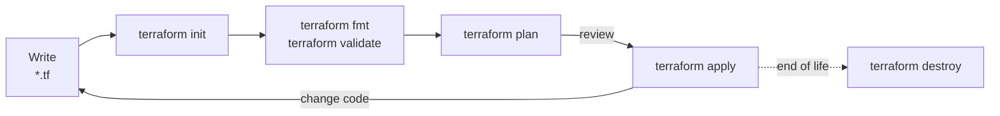

> The **Terraform CLI** is the `terraform` command-line program through which configurations are initialised, validated, planned, applied, and inspected. All Terraform workflows, interactive or automated, are built from its subcommands.

- Commands operate on the working directory (the root module). `-chdir=<DIR>` runs a command against another directory without changing into it:

```bash
terraform -chdir=live/prod/network plan
```

- `terraform -help` and `terraform <COMMAND> -help` list all options of a command.

## Core workflow



1. **Write** — describe the desired infrastructure in `.tf` files.
2. **Initialise** — `terraform init` prepares the working directory: backend, modules, providers.
3. **Validate** — `terraform fmt` and `terraform validate` catch formatting and structural errors without contacting any API.
4. **Plan** — `terraform plan` compares the configuration with state and real infrastructure and shows the actions required.
5. **Apply** — `terraform apply` executes the plan after confirmation and records the results in state.
6. **Iterate** — every change to infrastructure starts again with a change to the code, followed by plan and apply.
7. **Destroy** — `terraform destroy` removes everything the configuration manages when it is no longer needed.

How Terraform executes a run internally is described in [[Terraform#How a run executes]]. Running this workflow in pipelines is covered in [[Terraform automation]].

## Initializing a working directory

`terraform init` must be run before any other command in a new working directory, and again whenever the backend, the provider requirements, or module sources change. It is safe to run repeatedly.

It performs three tasks:

1. **Backend initialisation** — configures the backend and, if the configuration changed, offers to migrate state (see [[Terraform backends#Migrating state between backends]]).
2. **Module installation** — downloads child modules into `.terraform/modules/`.
3. **Provider installation** — selects provider versions that satisfy all constraints (or those recorded in `.terraform.lock.hcl`), downloads them into `.terraform/providers/`, verifies their checksums, and creates or updates the lock file (see [[Terraform providers#Dependency lock file]]).

| Option | Purpose |
| ------ | ------- |
| `-upgrade` | Select the newest provider and module versions allowed by constraints, ignoring the lock file. |
| `-lockfile=readonly` | Fail instead of modifying the dependency lock file. |
| `-backend-config=<FILE or KEY=VALUE>` | Supply partial backend configuration. |
| `-backend=false` | Skip backend initialisation (for validation-only jobs). |
| `-reconfigure` | Use the backend configuration as is, without migrating existing state. |
| `-migrate-state` | Copy existing state to the newly configured backend. |
| `-force-copy` | Answer "yes" to state migration prompts. |
| `-get=false` | Skip module installation. |
| `-plugin-dir=<DIR>` | Install providers only from the given directory. |
| `-input=false` | Fail instead of prompting for missing values. |

- The `.terraform/` directory is local, machine-specific, and must not be committed.

## Validating and formatting

### terraform fmt

- Rewrite all files of the current directory and its subdirectories in canonical style:

```bash
terraform fmt -recursive
```

- Check formatting without modifying files, printing the differences; the command exits with a non-zero status if any file is not formatted, which is the form used in CI:

```bash
terraform fmt -check -diff -recursive
```

- `fmt` only rewrites layout (indentation, alignment, spacing, line endings). It never changes semantics.

### terraform validate

- Check the configuration for syntax errors, invalid references, wrong argument names and types, and missing required arguments:

```bash
terraform validate
```

- Produce machine-readable results:

```bash
terraform validate -json
```

- Validation uses provider schemas, so the directory must be initialised; it does not need state or API access. In CI, `terraform init -backend=false` is sufficient.
- Validation cannot detect errors that depend on real infrastructure or on values known only at plan time — invalid instance types, name collisions, quota limits, permission errors. Those surface only in `plan` or `apply`. Deeper static checks are covered in [[Terraform testing#Static checks]].

## Planning

`terraform plan` computes the changes required to make real infrastructure match the configuration and prints them. It does not change infrastructure.

- Create a plan:

```bash
terraform plan
```

- Create a plan with a specific variable file and save it for a later apply:

```bash
terraform plan -var-file=environments/prod.tfvars -out=tfplan
```

| Option | Purpose |
| ------ | ------- |
| `-out=<FILE>` | Save the plan to a file for `terraform apply <FILE>`. |
| `-var`, `-var-file` | Assign root module variables (see [[Terraform variables and outputs#Assigning values to root module variables]]). |
| `-destroy` | Plan the destruction of all managed objects. |
| `-refresh-only` | Plan only state updates for drift, without configuration changes. |
| `-refresh=false` | Skip refreshing; plan against stored state. |
| `-replace=<ADDRESS>` | Plan the replacement of a specific resource instance. |
| `-target=<ADDRESS>` | Restrict the plan to a resource or module and its dependencies. |
| `-generate-config-out=<FILE>` | Write configuration for resources referenced by `import` blocks. |
| `-detailed-exitcode` | Return exit code 2 when the plan contains changes. |
| `-lock-timeout=<DURATION>` | Wait for the state lock up to the given duration. |
| `-parallelism=<N>` | Limit concurrent operations (default 10). |
| `-input=false` | Fail instead of prompting for missing variables. |
| `-no-color` | Disable ANSI colours, for logs and PR comments. |
| `-json` | Emit the plan as a stream of JSON messages. |

## Reading a plan

```text
Terraform will perform the following actions:

  # aws_instance.web must be replaced
-/+ resource "aws_instance" "web" {
      ~ ami                          = "ami-0aaa1111bbbb2222c" -> "ami-0ddd3333eeee4444f" # forces replacement
      ~ id                           = "i-0a1b2c3d4e5f67890" -> (known after apply)
      ~ private_ip                   = "10.0.1.15" -> (known after apply)
        tags                         = {
            "Name" = "web"
        }
        # (28 unchanged attributes hidden)
    }

  # aws_security_group_rule.https will be created
  + resource "aws_security_group_rule" "https" {
      + cidr_blocks       = ["0.0.0.0/0"]
      + from_port         = 443
      + id                = (known after apply)
      ...
    }

Plan: 2 to add, 0 to change, 1 to destroy.
```

| Symbol | Action |
| ------ | ------ |
| `+` | Create. |
| `-` | Destroy. |
| `~` | Update in place. |
| `-/+` | Destroy, then create a replacement. |
| `+/-` | Create a replacement, then destroy the original (`create_before_destroy`). |
| `<=` | Read a data source during apply. |

- `# forces replacement` marks the attribute that causes a replacement. Replacements of stateful resources (databases, volumes, key vaults) deserve the most scrutiny in review.
- `(known after apply)` marks values computed by the provider. A large number of unexpected unknowns usually indicates a deferred data source or a `depends_on` that is too coarse (see [[Terraform data sources#When data sources are read]]).
- `(sensitive value)` marks redacted values.
- The section "Objects have changed outside of Terraform" lists drift detected during refresh (see [[Terraform state#Refresh and drift]]).
- "Changes to Outputs" lists changes to root module outputs.
- The summary line counts creations (including the create half of replacements), updates, and destructions.

What to look for when reviewing a plan:

- Destroys and replacements, especially of resources holding data.
- Changes to IAM policies, role assignments, security groups, firewall rules, and network exposure.
- Changes that were not expected from the code diff — they indicate drift or an upgraded provider that changed defaults.
- Resources in the plan that belong to a different environment or account than intended.

## Saved plans

- A saved plan (`terraform plan -out=tfplan`) records the exact set of actions, the configuration, the variable values, and the state snapshot it was computed from.
- Applying the saved plan executes exactly those actions, without prompting:

```bash
terraform apply tfplan
```

- If the state changed after the plan was created (another apply ran in between), Terraform refuses to apply it: "Saved plan is stale". The plan must be recreated.
- Inspect a saved plan in human-readable form:

```bash
terraform show tfplan
```

- Convert a saved plan to JSON, the input format for policy engines and plan-based tests (see [[Terraform security#Policy as code]]):

```bash
terraform show -json tfplan > tfplan.json
```

- The plan file is a ZIP archive that contains the configuration, all variable values, and the prior state — in plaintext, including sensitive values (ephemeral values excepted). It must be handled with the same care as state: never committed, stored only in protected artifact storage, and deleted after use (see [[Terraform security#Protecting state and plan files]]).
- A saved plan can be applied only by the same Terraform version, with the same providers, on a working directory initialised the same way.

## Applying

- Plan and apply in one step, with an interactive confirmation:

```bash
terraform apply
```

- Apply without confirmation — only in automation, and preferably only with a saved plan that was reviewed:

```bash
terraform apply -auto-approve
```

- `terraform apply` accepts the same planning options as `terraform plan` when it is not given a plan file.
- When applying without a saved plan, Terraform computes a new plan first. What is applied may differ from what was reviewed earlier if the code, the state, or the infrastructure changed in the meantime.
- If an apply fails partway, the changes that succeeded remain in effect and are recorded in state. Terraform does not roll back; the next plan shows what remains to be done.

## Destroying

- Plan and execute the destruction of every object the configuration manages:

```bash
terraform destroy
```

- `terraform destroy` is an alias for `terraform apply -destroy`. To review destruction separately, plan it explicitly:

```bash
terraform plan -destroy -out=destroy.tfplan
terraform apply destroy.tfplan
```

- Objects are destroyed in reverse dependency order.
- Resources with `prevent_destroy` make the plan fail. To leave specific resources in place while destroying the rest, remove them from management first with `removed` blocks (see [[Terraform state#Refactoring with moved and removed blocks]]).

## Resource targeting

- Restrict a plan or apply to specific resources and everything they depend on:

```bash
terraform apply -target=module.network -target='aws_instance.web["blue"]'
```

- Targeting is an exceptional tool for recovery from errors or for breaking circular bootstrap problems. Terraform prints a warning on every targeted run, because the result is a partially applied configuration: resources outside the target are neither updated nor checked, and the next untargeted plan may contain surprises.
- Routine use of `-target` indicates that the configuration should be split into separate root modules (see [[Terraform project structure#State decomposition]]).
- OpenTofu additionally offers `-exclude`, the inverse of `-target`.

## Other commands

| Command | Purpose |
| ------- | ------- |
| `terraform output` | Show root module outputs (see [[Terraform variables and outputs#Output values]]). |
| `terraform show` | Show the current state or a saved plan. |
| `terraform console` | Evaluate expressions interactively (see [[Terraform expressions and functions#Terraform console]]). |
| `terraform graph` | Produce the dependency graph in DOT format. |
| `terraform providers` | Show provider requirements; subcommands `lock`, `mirror`, and `schema` manage and inspect providers. |
| `terraform get` | Download or update modules without the rest of `init`. |
| `terraform state` | Inspect and modify state (see [[Terraform state#Modifying state]]). |
| `terraform import` | Import an existing object into state (see [[Terraform state#Importing existing infrastructure]]). |
| `terraform workspace` | Manage CLI workspaces (see [[Terraform state#Workspaces]]). |
| `terraform force-unlock` | Release a stale state lock (see [[Terraform backends#State locking]]). |
| `terraform test` | Run `.tftest.hcl` tests (see [[Terraform testing#The terraform test framework]]). |
| `terraform untaint` | Clear the tainted status of a resource. |
| `terraform login`, `terraform logout` | Obtain or remove an API token for HCP Terraform or Terraform Enterprise. |
| `terraform metadata functions -json` | Print the signatures of all built-in functions. |
| `terraform version` | Print the Terraform and provider versions; `-json` for machine-readable output. |

## Environment variables

| Variable | Purpose |
| -------- | ------- |
| `TF_LOG` | Enable logging at `TRACE`, `DEBUG`, `INFO`, `WARN`, or `ERROR` level; `JSON` produces TRACE-level logs as JSON. |
| `TF_LOG_CORE`, `TF_LOG_PROVIDER` | Set the log level for Terraform Core and for providers separately. |
| `TF_LOG_PATH` | Write logs to a file instead of standard error. |
| `TF_INPUT` | Set to `0` or `false` to disable interactive prompts. |
| `TF_IN_AUTOMATION` | Set to any non-empty value to adjust output for automation (no suggestions to run follow-up commands). |
| `TF_CLI_ARGS` | Add arguments to every command. |
| `TF_CLI_ARGS_<COMMAND>` | Add arguments to one command, for example `TF_CLI_ARGS_plan="-parallelism=20"`. |
| `TF_VAR_<NAME>` | Assign a root module input variable. |
| `TF_WORKSPACE` | Select the CLI workspace. |
| `TF_DATA_DIR` | Use a different directory than `.terraform` for per-directory data. |
| `TF_PLUGIN_CACHE_DIR` | Enable the provider plugin cache. |
| `TF_CLI_CONFIG_FILE` | Use a different CLI configuration file. |
| `TF_REGISTRY_CLIENT_TIMEOUT` | Change the timeout for registry requests (seconds). |
| `CHECKPOINT_DISABLE` | Disable the Checkpoint upgrade and security bulletin check. |

## Exit codes

| Command | Code | Meaning |
| ------- | ---- | ------- |
| Most commands | `0` | Success. |
| Most commands | `1` | Error. |
| `plan -detailed-exitcode` | `0` | Success, no changes. |
| `plan -detailed-exitcode` | `1` | Error. |
| `plan -detailed-exitcode` | `2` | Success, the plan contains changes. |
| `fmt -check` | `3` | Some files are not formatted (any non-zero value indicates failure). |

- `-detailed-exitcode` is the basis of drift detection jobs (see [[Terraform automation#Scheduled drift detection]]). Scripts that use it must not treat exit code 2 as a failure:

```bash
set +e
terraform plan -detailed-exitcode -input=false -lock-timeout=5m -out=tfplan
code=$?
set -e
case "$code" in
  0) echo "No changes." ;;
  2) echo "Changes detected." ;;
  *) echo "Plan failed." >&2; exit "$code" ;;
esac
```

## Debugging and troubleshooting

### Logging

- Enable detailed logging for a single command and write it to a file:

```bash
TF_LOG=DEBUG TF_LOG_PATH=./terraform-debug.log terraform plan
```

- Log only provider activity at the most detailed level, including API requests and responses:

```bash
TF_LOG_PROVIDER=TRACE TF_LOG_PATH=./provider-trace.log terraform apply
```

- `TRACE` and `DEBUG` logs can contain sensitive data: request and response bodies, resource attributes, and secret values that are redacted in normal output. Debug logs must not be enabled in shared CI logs and must be deleted after use.
- If Terraform itself panics, it writes `crash.log` to the working directory. It is useful for bug reports but may contain the same sensitive data.

### Common errors

| Error | Typical cause | Resolution |
| ----- | ------------- | ---------- |
| `Error acquiring the state lock` | Another operation holds the lock, or a crashed run left it behind. | Wait or use `-lock-timeout`; if the holder is confirmed dead, `terraform force-unlock`. |
| `Backend initialization required` / `Backend configuration changed` | The backend block changed since the last `init`. | Run `terraform init -reconfigure` or `-migrate-state`. |
| `Inconsistent dependency lock file` | Provider requirements changed, or the lock file lacks entries. | Run `terraform init` (or `-upgrade`) and commit the updated lock file. |
| `no available releases match the given constraints` | Version constraints of different modules are incompatible. | Inspect `terraform providers` and relax or align the constraints. |
| `Invalid for_each argument` | `for_each` keys depend on values known only after apply. | Derive keys from variables or literals; keep computed values in `each.value`. |
| `Invalid count argument` | `count` depends on a value known only after apply. | Compute the count from inputs instead of resource attributes. |
| `Cycle: ...` | Resources reference each other directly or indirectly. | Break the cycle with separate resources (for example, standalone rule resources). |
| `Saved plan is stale` | State changed after the plan was created. | Create a new plan. |
| `Provider produced inconsistent final plan` / `inconsistent result after apply` | A provider bug. | Upgrade the provider, retry, report the issue upstream. |
| `state snapshot was created by Terraform vX, which is newer than current vY` | A newer Terraform version wrote the state. | Upgrade the CLI; align versions across the team with `required_version`. |
| `already exists` (API error during create) | The object exists outside Terraform. | Import it (see [[Terraform state#Importing existing infrastructure]]). |
| `Unsupported argument` / `Unsupported attribute` | A typo, or a provider upgrade renamed the argument. | Check the provider documentation and its upgrade guide. |
| `Error: Failed to query available provider packages` | Registry unreachable, or the provider address is wrong (often an undeclared provider resolved to `hashicorp/<NAME>`). | Check connectivity, mirrors, and `required_providers`. |

### Systematic approach

1. Read the full error, including the file and line it points to and the resource address.
2. Determine the phase in which it occurs: `init` (backend, providers, modules), `validate` (configuration), `plan` (evaluation, refresh, provider planning), or `apply` (API calls).
3. Reproduce with `-target` or in `terraform console` to isolate the expression or resource involved.
4. Enable `TF_LOG_PROVIDER=DEBUG` to see the actual API calls if the error originates in a provider.
5. Check the provider's changelog and issue tracker for the version in use.

## Performance

Plan and apply time grows with the number of resources, because every refresh calls the provider APIs for every resource.

- **Parallelism** — `-parallelism=<N>` raises or lowers the number of concurrent operations (default 10). Raising it speeds up large applies; lowering it avoids API rate limiting (throttling errors, HTTP 429).
- **Skipping refresh** — `-refresh=false` avoids reading every resource, at the cost of planning against possibly stale data. It is reasonable for quick iteration, not for production applies.
- **Splitting state** — the most effective measure. Smaller root modules plan faster, limit the blast radius of mistakes, and allow different teams and pipelines to work in parallel (see [[Terraform project structure#State decomposition]]).
- **Plugin cache** — `TF_PLUGIN_CACHE_DIR` avoids downloading providers on every `init` (see [[Terraform providers#Provider installation]]).
- **Avoid unnecessary data sources** — each one is an API call per plan; values already available as resource attributes or variables should be used directly.
- **Avoid `-target` as a performance tool** — it hides parts of the configuration from the plan and leads to inconsistent states.

## References

- [Terraform CLI documentation](https://developer.hashicorp.com/terraform/cli)
- [terraform plan](https://developer.hashicorp.com/terraform/cli/commands/plan)
- [terraform apply](https://developer.hashicorp.com/terraform/cli/commands/apply)
- [Environment variables](https://developer.hashicorp.com/terraform/cli/config/environment-variables)
- [Debugging Terraform](https://developer.hashicorp.com/terraform/internals/debugging)
