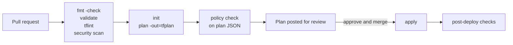

> **Running Terraform in automation** means executing the plan and apply workflow in CI/CD pipelines or on a dedicated platform instead of on engineers' workstations, so that every infrastructure change is reviewed, reproducible, attributable, and executed in a controlled environment.

- Automation turns the configuration repository into the single entry point for infrastructure changes. A merged pull request, not a terminal session, is what changes production.
- The commands themselves are described in [[Terraform CLI]]; the security requirements of pipelines are covered in [[Terraform security]].

## Automation principles

- **Non-interactive execution** — pass `-input=false` to every command (or set `TF_INPUT=0`), use `-auto-approve` only when applying a reviewed saved plan, and set `TF_IN_AUTOMATION=1` to suppress hints meant for humans.
- **Pinned tool versions** — pin the Terraform CLI version in the pipeline, enforce it with `required_version`, and install providers with `terraform init -lockfile=readonly`.
- **One writer per state** — serialise runs that target the same state. Locking prevents corruption, but queued or cancelled runs are easier to reason about when the pipeline itself guarantees one run per state at a time.
- **Plan and apply as separate steps** — the plan is produced, shown to reviewers, and then applied. Applying exactly what was reviewed requires either a saved plan or a re-plan whose output is compared with the reviewed one.
- **Ephemeral runners** — run every job in a fresh container or VM, so that no state, plan, provider binary, or credential persists between runs.
- **Least privilege per stage** — the identity used for planning should not be able to apply, and production apply privileges should be reachable only from protected branches with approval.
- **Clear output** — post a readable plan summary to the pull request (`terraform show -no-color tfplan`) and keep full logs as run artifacts.
- **No local applies to production** — workstations may plan against development environments, but production changes go through the pipeline, with a documented break-glass procedure for emergencies.

## Pipeline design



A typical pipeline has the following stages:

1. **Static checks** on every push — `terraform fmt -check -recursive`, `terraform validate`, TFLint, and security scanners. They need no cloud access (see [[Terraform testing#Static checks]] and [[Terraform security#Static analysis]]).
2. **Plan** on every pull request — for each affected root module, `terraform init` and `terraform plan -out=tfplan`, then `terraform show -json` for policy evaluation.
3. **Policy check** — Conftest, Sentinel, or OPA against the plan JSON (see [[Terraform security#Policy as code]]).
4. **Review** — the plan output is posted to the pull request; reviewers approve the code and the plan together.
5. **Apply** after merge (or after an explicit approval step) — apply the plan.
6. **Post-deployment checks** — smoke tests, `check` block results, monitoring.

### Applying what was reviewed

There are two common ways to connect the reviewed plan with the apply:

| Approach | Description | Trade-off |
| -------- | ----------- | --------- |
| Apply the saved plan | Store `tfplan` as a protected artifact of the plan job and apply exactly that file. | The plan contains secrets in plaintext and becomes stale if state changes between plan and apply; Terraform then refuses it and a new plan is needed. |
| Re-plan and apply with approval | Run a fresh plan in the apply job, show it, and require manual approval before `apply`. | Simpler artifact handling, but the applied plan can differ from the one reviewed on the pull request; reviewers must check the second plan. |

- Pull request automation tools such as Atlantis and HCP Terraform apply the plan that was shown on the pull request and lock the state between plan and apply, which avoids both problems.

### Monorepos with several root modules

- Detect which root modules a change affects (by path filters, or by dependency analysis of local module references) and run plan and apply only for those.
- Run independent root modules in parallel, and dependent ones in order (network before applications).
- Tools such as Terragrunt, Terramate, and Atlantis provide change detection and ordering across many root modules.

## GitHub Actions

```yaml
# .github/workflows/terraform.yml
name: terraform

on:
  pull_request:
    paths: ["live/prod/network/**", "modules/**"]
  push:
    branches: [main]
    paths: ["live/prod/network/**", "modules/**"]

permissions:
  contents: read
  pull-requests: write

concurrency:
  group: terraform-prod-network
  cancel-in-progress: false

env:
  TF_IN_AUTOMATION: "1"
  TF_INPUT: "0"

defaults:
  run:
    working-directory: live/prod/network

jobs:
  plan:
    if: github.event_name == 'pull_request'
    runs-on: ubuntu-latest
    steps:
      - uses: actions/checkout@v4

      - uses: hashicorp/setup-terraform@v3
        with:
          terraform_version: "1.13.0"
          terraform_wrapper: false

      # Cloud authentication for the job is configured here (not covered in this note).

      - run: terraform fmt -check -recursive ../../..
      - run: terraform init -lockfile=readonly
      - run: terraform validate
      - run: terraform plan -lock-timeout=5m -out=tfplan
      - run: terraform show -json tfplan > tfplan.json
      - run: conftest test tfplan.json --policy ../../../policy

      - name: Post plan to the pull request
        run: |
          {
            echo '### Plan: live/prod/network'
            echo '```text'
            terraform show -no-color tfplan | tail -c 60000
            echo '```'
          } > plan.md
          gh pr comment "${{ github.event.pull_request.number }}" --body-file plan.md --edit-last || \
          gh pr comment "${{ github.event.pull_request.number }}" --body-file plan.md
        env:
          GH_TOKEN: ${{ github.token }}

  apply:
    if: github.event_name == 'push'
    runs-on: ubuntu-latest
    environment: production
    steps:
      - uses: actions/checkout@v4

      - uses: hashicorp/setup-terraform@v3
        with:
          terraform_version: "1.13.0"
          terraform_wrapper: false

      # Cloud authentication for the job is configured here (not covered in this note).

      - run: terraform init -lockfile=readonly
      - run: terraform plan -lock-timeout=5m -out=tfplan
      - run: terraform apply tfplan
```

- `concurrency` with `cancel-in-progress: false` queues runs for the same state instead of cancelling a running apply.
- The `production` environment can require reviewers, which turns the apply job into an approval gate showing the fresh plan.
- `terraform_wrapper: false` disables the setup action's wrapper script, which otherwise alters the exit codes and output of Terraform commands.
- GitHub Actions should be pinned to full commit SHAs rather than version tags, for the same supply chain reasons as Terraform modules (see [[Terraform security#Supply chain security]]).
- Pull requests from forks should not trigger privileged plans (see [[Terraform security#Code execution during plan]]). Workflows triggered by `pull_request_target` run with the base repository's privileges and must never check out and plan the fork's code.

## GitLab CI

```yaml
# .gitlab-ci.yml
image:
  name: hashicorp/terraform:1.13.0
  entrypoint: [""]

variables:
  TF_ROOT: live/prod/network
  TF_IN_AUTOMATION: "1"
  TF_INPUT: "0"

stages: [validate, plan, apply]

.terraform:
  before_script:
    - cd "$TF_ROOT"
    - terraform init -lockfile=readonly

fmt:
  stage: validate
  script:
    - terraform fmt -check -recursive

validate:
  extends: .terraform
  stage: validate
  script:
    - terraform validate

plan:
  extends: .terraform
  stage: plan
  script:
    - terraform plan -lock-timeout=5m -out=tfplan
    - terraform show -no-color tfplan
  artifacts:
    paths: ["$TF_ROOT/tfplan"]
    expire_in: 1 day
    access: developer

apply:
  extends: .terraform
  stage: apply
  script:
    - terraform apply tfplan
  dependencies: [plan]
  rules:
    - if: $CI_COMMIT_BRANCH == $CI_DEFAULT_BRANCH
      when: manual
  environment:
    name: production
  resource_group: prod-network
```

- `resource_group` ensures only one job per state runs at a time.
- The `plan` artifact holds the saved plan, which contains secrets; its expiry and `access` setting limit exposure.
- `when: manual` on the default branch turns apply into an explicit approval, and protected environments restrict who can trigger it.
- GitLab can host Terraform state itself through the `http` backend (GitLab-managed Terraform state), with locking and versioning per project. The backend addresses follow the pattern `${CI_API_V4_URL}/projects/${CI_PROJECT_ID}/terraform/state/<STATE_NAME>` for state and `.../lock` for locking; the setup is documented in GitLab's "GitLab-managed Terraform state" guide.

## Jenkins

```groovy
// Jenkinsfile
pipeline {
  agent { docker { image 'hashicorp/terraform:1.13.0'; args '--entrypoint=' } }
  environment {
    TF_IN_AUTOMATION = '1'
    TF_INPUT         = '0'
  }
  options { disableConcurrentBuilds() }
  stages {
    stage('Init')     { steps { dir('live/prod/network') { sh 'terraform init -lockfile=readonly' } } }
    stage('Validate') { steps { dir('live/prod/network') { sh 'terraform fmt -check && terraform validate' } } }
    stage('Plan')     { steps { dir('live/prod/network') { sh 'terraform plan -out=tfplan && terraform show -no-color tfplan' } } }
    stage('Approve') {
      when { branch 'main' }
      steps { input message: 'Apply this plan to production?' }
    }
    stage('Apply') {
      when { branch 'main' }
      steps { dir('live/prod/network') { sh 'terraform apply tfplan' } }
    }
  }
  post { always { cleanWs() } }
}
```

- `disableConcurrentBuilds()` serialises runs of the job, and `cleanWs()` removes the plan file and `.terraform/` after every build.

## Running Terraform in containers

Running Terraform from a container image gives every developer and pipeline the same Terraform version without local installation.

- Run a command with the official image, mounting the working directory:

```bash
docker run --rm -it \
  -v "$PWD":/workspace -w /workspace \
  -u "$(id -u):$(id -g)" \
  hashicorp/terraform:1.13.0 plan
```

- Wrap it in a shell alias for daily use:

```bash
alias terraform='docker run --rm -it -v "$PWD":/workspace -w /workspace -u "$(id -u):$(id -g)" hashicorp/terraform:1.13.0'
```

- The official image's entrypoint is `terraform`, so arguments are passed directly. CI systems that run their own shell commands need the entrypoint cleared (as in the GitLab and Jenkins examples above).
- A custom image can bundle Terraform with TFLint, Checkov, Conftest, and a pre-populated provider mirror, which makes pipelines faster and independent of external downloads.
- The image tag should be a full version, and ideally pinned by digest.

## HCP Terraform and Terraform Enterprise

> **HCP Terraform** (formerly Terraform Cloud) is HashiCorp's managed service for running Terraform. **Terraform Enterprise** is its self-hosted distribution. Both provide remote state, remote execution, access control, policy enforcement, and a private registry.

| Concept | Description |
| ------- | ----------- |
| Organisation | The top-level account, containing projects, teams, and settings. |
| Project | A group of workspaces with shared access permissions and policies. |
| Workspace | A unit with its own configuration source, state, variables, permissions, and run history. Not the same as a CLI workspace. |
| Run | One plan (and optionally apply) of a workspace, executed in a queue so only one run per workspace is active. |
| Variable set | Variables and environment variables shared across several workspaces or projects. |
| Policy set | Sentinel or OPA policies evaluated on runs of attached workspaces. |
| Run task | An integration with an external service (scanner, cost tool) called at defined stages of a run. |
| Agent | A self-hosted worker that executes runs inside a private network. |
| Private registry | Organisation-scoped registry for modules and providers. |

### Workflows

| Workflow | Trigger | Typical use |
| -------- | ------- | ----------- |
| VCS-driven | A push or pull request in a connected repository. | Standard GitOps-style flow: speculative plans on pull requests, applies on merge. |
| CLI-driven | `terraform plan` / `terraform apply` on a workstation, executed remotely. | Interactive development with remote state and execution. |
| API-driven | Calls to the HCP Terraform API from another system. | Integration with existing pipelines and internal platforms. |

- CLI-driven runs require the `cloud` block in configuration (see [[Terraform backends#HCP Terraform]]) and an API token obtained with `terraform login`.
- Each workspace has an **execution mode**: *remote* (runs on HCP Terraform's workers), *agent* (runs on self-hosted agents), or *local* (runs on the caller's machine, using the platform only for state).

### Features relevant to governance

- **Speculative plans** on pull requests, posted as status checks, that can never be applied.
- **Run queuing and state locking** per workspace, which serialise changes.
- **Policy enforcement** with Sentinel or OPA between plan and apply, with enforcement levels (see [[Terraform security#Policy as code]]).
- **Team permissions** at organisation, project, and workspace level, separating who can read state, queue plans, and approve applies.
- **Audit trail** of runs, approvals, and state versions, with API access for export to a SIEM.
- **Health assessments** that run drift detection and evaluate `check` blocks on a schedule (see [[Terraform testing#Check blocks]]).
- **Private registry** for modules and providers, including module testing integration.

## Atlantis

> **Atlantis** is a self-hosted application that runs `terraform plan` and `terraform apply` in response to pull request events and comments, and posts the output to the pull request.

- The workflow is driven by comments: Atlantis plans automatically when a pull request changes Terraform files, and a reviewer comments `atlantis apply` to apply the plan shown.
- Atlantis locks each project (directory and workspace) from the first plan until the pull request is merged or closed, so that two pull requests cannot interleave changes to the same state.

```yaml
# atlantis.yaml
version: 3
projects:
  - name: prod-network
    dir: live/prod/network
    workspace: default
    terraform_version: v1.13.0
    autoplan:
      enabled: true
      when_modified: ["*.tf", "../../../modules/**/*.tf"]
    apply_requirements: [approved, mergeable]
```

- `apply_requirements` blocks `atlantis apply` until the pull request is approved and mergeable.
- The server-side repository configuration controls which settings repositories may override. Custom workflows can run arbitrary commands, so allowing repositories to define their own workflows lets anyone who can open a pull request execute code on the Atlantis server.
- The Atlantis server holds the privileges of every project it manages and should be treated as a production system: isolated network, restricted access to its UI and webhook endpoint, webhook secrets, and an allow-list of repositories.

## Terragrunt

> **Terragrunt** is a thin wrapper around Terraform (and OpenTofu) by Gruntwork that removes repetition across many root modules: it generates backend and provider configuration, passes outputs between stacks, and runs commands across many modules in dependency order.

```text
live/
├── root.hcl
├── prod/
│   ├── network/
│   │   └── terragrunt.hcl
│   └── app/
│       └── terragrunt.hcl
└── staging/
    └── ...
```

```hcl
# live/root.hcl
remote_state {
  backend = "s3"
  generate = {
    path      = "backend.tf"
    if_exists = "overwrite_terragrunt"
  }
  config = {
    bucket       = "acme-tfstate"
    key          = "${path_relative_to_include()}/terraform.tfstate"
    region       = "eu-central-1"
    encrypt      = true
    use_lockfile = true
  }
}
```

```hcl
# live/prod/app/terragrunt.hcl
include "root" {
  path = find_in_parent_folders("root.hcl")
}

terraform {
  source = "git::https://git.example.com/infra/modules.git//app?ref=v1.4.0"
}

dependency "network" {
  config_path = "../network"
}

inputs = {
  vpc_id     = dependency.network.outputs.vpc_id
  subnet_ids = dependency.network.outputs.private_subnet_ids
}
```

- `remote_state` generates a unique backend key for each module from its path, so the backend is defined once for the whole tree.
- `dependency` blocks read outputs of other stacks and define the order in which stacks are applied.
- `inputs` become the module's variable values.

Running Terragrunt:

- Plan a single stack:

```bash
cd live/prod/app
terragrunt plan
```

- Plan every stack under a directory, in dependency order:

```bash
cd live/prod
terragrunt run --all plan
```

- Older Terragrunt releases use `terragrunt run-all plan` for the same operation.

## Scheduled drift detection

Drift detection runs a plan on a schedule and reports when real infrastructure no longer matches the code (see [[Infrastructure as Code#Configuration drift]]).

```yaml
# .github/workflows/drift.yml
name: drift-detection

on:
  schedule:
    - cron: "0 6 * * *"

permissions:
  contents: read
  issues: write

jobs:
  drift:
    runs-on: ubuntu-latest
    strategy:
      fail-fast: false
      matrix:
        root: [live/prod/network, live/prod/app]
    defaults:
      run:
        working-directory: ${{ matrix.root }}
    steps:
      - uses: actions/checkout@v4
      - uses: hashicorp/setup-terraform@v3
        with:
          terraform_version: "1.13.0"
          terraform_wrapper: false

      # Read-only cloud authentication for the job is configured here (not covered in this note).

      - run: terraform init -lockfile=readonly
      - id: plan
        run: |
          set +e
          terraform plan -detailed-exitcode -lock-timeout=5m -no-color > plan.txt
          echo "code=$?" >> "$GITHUB_OUTPUT"
      - if: steps.plan.outputs.code == '2'
        run: gh issue create --title "Drift detected in ${{ matrix.root }}" --body-file plan.txt --label drift
        env:
          GH_TOKEN: ${{ github.token }}
      - if: steps.plan.outputs.code == '1'
        run: exit 1
```

- Exit code `2` from `-detailed-exitcode` means the plan contains changes — drift or unapplied code (see [[Terraform CLI#Exit codes]]).
- Drift jobs need only read access to infrastructure and state; they never apply.
- HCP Terraform provides the same capability as health assessments.

## Integrating with Ansible

Terraform provisions infrastructure; Ansible configures the software on it (see [[Infrastructure as Code#Provisioning and configuration management]]). Several integration patterns exist:

| Pattern | Description |
| ------- | ----------- |
| Generated inventory | Terraform writes an Ansible inventory file from resource attributes; the pipeline runs `ansible-playbook` afterwards. |
| Dynamic inventory | Ansible discovers hosts directly from the cloud API by tags that Terraform sets (for example, the `amazon.aws.aws_ec2` or `azure.azcollection.azure_rm` inventory plugins). |
| Terraform provider for Ansible | The `ansible/ansible` provider declares hosts and groups as Terraform resources; the `cloud.terraform` collection's inventory plugin reads them from state. |
| Ansible drives Terraform | A playbook runs Terraform with the `cloud.terraform.terraform` module, then configures the created hosts in the same play. |
| Provisioner | A `local-exec` provisioner runs `ansible-playbook` after a host is created. |
| Image baking | Packer runs Ansible to build a machine image; Terraform deploys instances from that image (immutable model). |

### Generated inventory

```hcl
resource "local_file" "ansible_inventory" {
  filename        = "${path.module}/inventory.ini"
  file_permission = "0644"
  content = templatefile("${path.module}/templates/inventory.ini.tftpl", {
    web_hosts = { for name, inst in aws_instance.web : name => inst.private_ip }
  })
}
```

```text
# templates/inventory.ini.tftpl
[web]
%{ for name, ip in web_hosts ~}
${name} ansible_host=${ip}
%{ endfor ~}
```

```bash
terraform apply
ansible-playbook -i inventory.ini site.yml
```

### Dynamic inventory by tags

- Terraform tags instances with their role:

```hcl
resource "aws_instance" "web" {
  for_each      = toset(["web-1", "web-2"])
  ami           = data.aws_ami.app.id
  instance_type = "t3.small"

  tags = {
    Name = each.key
    Role = "web"
  }
}
```

- Ansible groups hosts by that tag:

```yaml
# inventory.aws_ec2.yml
plugin: amazon.aws.aws_ec2
regions: [eu-central-1]
filters:
  tag:ManagedBy: terraform
keyed_groups:
  - key: tags.Role
    prefix: role
hostnames:
  - private-ip-address
```

```bash
ansible-playbook -i inventory.aws_ec2.yml site.yml --limit role_web
```

- Dynamic inventory decouples the tools completely: Ansible needs no access to Terraform state and always sees the current set of hosts.

### Terraform provider for Ansible

```hcl
terraform {
  required_providers {
    ansible = {
      source  = "ansible/ansible"
      version = "~> 1.3"
    }
  }
}

resource "ansible_host" "web" {
  for_each = aws_instance.web
  name     = each.value.private_ip
  groups   = ["web"]

  variables = {
    ansible_user = "ubuntu"
  }
}
```

```yaml
# inventory.yml
plugin: cloud.terraform.terraform_provider
project_path: ./infra
```

```bash
ansible-playbook -i inventory.yml site.yml
```

### Provisioner

```hcl
resource "terraform_data" "configure_web" {
  for_each         = aws_instance.web
  triggers_replace = [each.value.id]

  provisioner "local-exec" {
    command = "ansible-playbook -i \"$HOST,\" site.yml"
    environment = {
      HOST = each.value.private_ip
    }
  }
}
```

- The trailing comma makes Ansible treat the value as an inline list of hosts rather than an inventory file path.
- This couples configuration to provisioning: a playbook failure fails the apply, and the playbook does not rerun when it changes. Separate pipeline steps or dynamic inventory are usually preferable (see [[Terraform resources#Provisioners]]).

## Integrating with Kubernetes and Helm

Terraform can manage both Kubernetes clusters (EKS, AKS, GKE) and objects inside them through the `hashicorp/kubernetes` and `hashicorp/helm` providers.

```hcl
terraform {
  required_providers {
    helm = {
      source  = "hashicorp/helm"
      version = "~> 3.0"
    }
  }
}

resource "helm_release" "cert_manager" {
  name             = "cert-manager"
  repository       = "https://charts.jetstack.io"
  chart            = "cert-manager"
  version          = var.cert_manager_chart_version
  namespace        = "cert-manager"
  create_namespace = true

  values = [
    yamlencode({
      crds = {
        enabled = true
      }
    })
  ]
}
```

Design considerations:

- **Separate the cluster from its contents.** A provider cannot be configured from values that are unknown until apply. When the cluster and the in-cluster resources live in one configuration, the first plan cannot configure the Kubernetes and Helm providers, and later replacements of the cluster leave the providers pointing at a cluster that is being destroyed. Creating the cluster in one root module and the in-cluster resources in another avoids both problems (see [[Terraform project structure#State decomposition]]).
- **Decide what Terraform owns inside the cluster.** Terraform is well suited to cluster add-ons and platform components (ingress controllers, cert-manager, monitoring agents, namespaces, RBAC). Application workloads are usually better deployed by a GitOps controller such as Argo CD or Flux, which reconciles continuously (see [[Infrastructure as Code#GitOps]]). A common pattern is that Terraform installs the GitOps controller, which then manages everything else.
- **Helm values end up in state.** Every value passed to `helm_release` is stored in Terraform state, so secrets should be supplied to the cluster through a secrets operator rather than through Helm values in Terraform.
- **The Helm provider version matters.** Version 3 of `hashicorp/helm` changed nested blocks such as `set` and `kubernetes` to attribute syntax; configurations written for version 2 must be migrated following the provider's upgrade guide.

## References

- [Running Terraform in automation](https://developer.hashicorp.com/terraform/tutorials/automation/automate-terraform)
- [hashicorp/setup-terraform](https://github.com/hashicorp/setup-terraform)
- [HCP Terraform documentation](https://developer.hashicorp.com/terraform/cloud-docs)
- [Atlantis](https://www.runatlantis.io/)
- [Terragrunt](https://terragrunt.gruntwork.io/)
- [Using Terraform and Ansible together](https://spacelift.io/blog/using-terraform-and-ansible-together)
- [cloud.terraform Ansible collection](https://github.com/ansible-collections/cloud.terraform)
