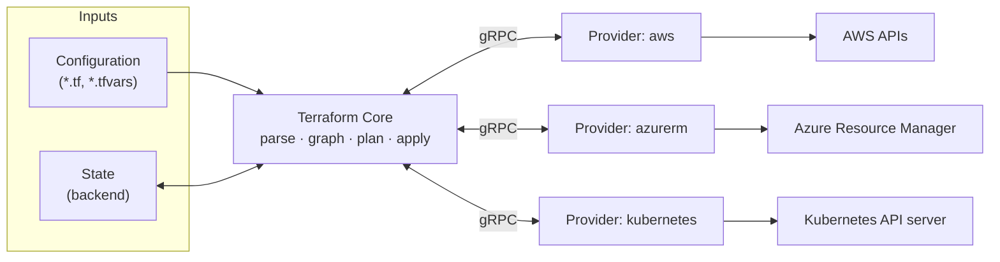

> **Terraform** is a declarative Infrastructure as Code tool developed by HashiCorp that provisions and manages infrastructure through the APIs of cloud platforms and other services. Configurations are written in the HashiCorp Configuration Language (HCL) or JSON, and Terraform reconciles real infrastructure with them by computing and executing an execution plan.

- Terraform is a single statically linked binary written in Go. Support for individual platforms is delivered as separate plugins called providers.
- Any system that exposes an API can be managed if a provider exists for it: public clouds (AWS, Azure, Google Cloud), Kubernetes, SaaS platforms (GitHub, Cloudflare, Datadog, Okta), on-premises virtualisation (vSphere, Proxmox), and local resources (files, TLS keys, random values).
- Terraform records what it manages in a state file and uses that record to compute the difference between the configuration and reality on every run.
- The general concepts behind declarative provisioning, drift, and GitOps are covered in [[Infrastructure as Code]].

## Terraform notes

| Note | Scope |
| ---- | ----- |
| [[Infrastructure as Code]] | IaC paradigms: declarative and imperative, push and pull, mutable and immutable, drift, GitOps. |
| [[Terraform configuration language]] | Configuration files, HCL syntax, block types, the `terraform` block, version constraints. |
| [[Terraform providers]] | Provider requirements and configuration, aliases, authentication, the dependency lock file, installation and mirrors. |
| [[Terraform resources]] | Resource blocks, addresses, meta-arguments, lifecycle rules, custom conditions, dependencies, provisioners, ephemeral resources. |
| [[Terraform data sources]] | Read-only queries of existing infrastructure, read timing, filters, special-purpose data sources. |
| [[Terraform variables and outputs]] | Input variables, type constraints, validation, `.tfvars` files, precedence, locals, outputs. |
| [[Terraform expressions and functions]] | Types, references, conditionals, `for` and splat expressions, dynamic blocks, templates, built-in functions. |
| [[Terraform modules]] | Module structure, sources, versioning, composition, design, documentation, publishing. |
| [[Terraform state]] | State anatomy, refresh and drift, state commands, import, refactoring, workspaces, recovery. |
| [[Terraform backends]] | Backend types, locking, migration, sharing state, securing state storage. |
| [[Terraform CLI]] | The core workflow, command options, reading plans, environment variables, troubleshooting, performance. |
| [[Terraform testing]] | Static checks, check blocks, the native test framework, mocks, Terratest. |
| [[Terraform security]] | Threat model, secrets, supply chain, code execution during plan, state tampering, scanners, policy as code. |
| [[Terraform automation]] | CI/CD pipelines, HCP Terraform, Atlantis, Terragrunt, integration with Ansible and Kubernetes. |
| [[Terraform project structure]] | File and repository layout, naming, environment separation, state decomposition, VCS hygiene. |

## Capabilities

- **Declarative configuration**
	- The configuration describes the desired end state. Terraform determines which create, update, and delete operations are required and in which order.
- **Execution plans**
	- Before changing anything, Terraform produces a plan that lists every action it intends to take. The plan can be reviewed, saved, and applied exactly as reviewed.
- **Resource graph**
	- Terraform builds a dependency graph of all resources and walks it to order operations correctly and to parallelise independent ones.
- **State management**
	- A state file maps each resource in the configuration to a real object, records metadata such as dependencies, and allows Terraform to detect drift.
- **Provider ecosystem**
	- Thousands of providers are published in the [Terraform Registry](https://registry.terraform.io/), which allows a single tool and workflow to manage resources across multiple vendors.
- **Modules**
	- Configurations can be packaged as reusable modules, versioned, and shared through registries.

Typical use cases:

- Creating infrastructure from scratch according to a reviewed definition.
- Modifying existing infrastructure by changing the definition and applying the difference.
- Replicating infrastructure: the same configuration with different inputs produces equivalent environments for development, testing, disaster recovery, or new regions.
- Bringing manually created infrastructure under management through import (see [[Terraform state#Importing existing infrastructure]]).

## Licensing and OpenTofu

- Terraform was released under the Mozilla Public License 2.0 (MPL 2.0) until version 1.5.x.
- In August 2023, HashiCorp relicensed Terraform under the Business Source License 1.1 (BSL), starting with version 1.6. The BSL permits most internal use but restricts offering products that compete with HashiCorp.
- In response, the community forked the last MPL-licensed release into **OpenTofu**, now a Linux Foundation project. OpenTofu uses the `tofu` binary, reads the same HCL configuration, and is largely compatible with Terraform 1.5 and later configurations and state files. Its features have since diverged, for example:
	- client-side state and plan encryption (see [[Terraform backends#Securing state storage]]);
	- early evaluation of variables and locals in backend blocks and module sources;
	- `for_each` on provider blocks and the `-exclude` planning option.
- IBM completed its acquisition of HashiCorp in February 2025. Terraform Cloud was renamed **HCP Terraform** in 2024; the self-hosted edition is Terraform Enterprise (see [[Terraform automation#HCP Terraform and Terraform Enterprise]]).

>[!note]
>Commands in these notes use the `terraform` binary. Unless a section explicitly mentions a Terraform-only feature, the same commands work with `tofu`.

## Architecture

Terraform consists of two kinds of components:

- **Terraform Core** — the `terraform` binary, which reads configuration and state, builds the dependency graph, computes plans, and orchestrates their execution.
- **Providers** — plugins that implement the resource types and data sources of a particular API and translate Core's requests into API calls.



### Terraform Core

Terraform Core works with two inputs:

1. **Configuration** — the user-written `.tf` files (and variable values) that describe the desired state.
2. **State** — the record of the objects Terraform previously created and their last known attributes.

Its responsibilities are:

- Parsing and validating configuration, resolving the module tree, and evaluating expressions.
- Installing providers and modules (`terraform init`).
- Reading, locking, and writing state through the configured backend.
- Building the resource dependency graph.
- Computing the execution plan by asking providers how each resource must change.
- Executing the plan by walking the graph and asking providers to apply each change.

Core has no knowledge of any specific cloud. Everything API-specific lives in providers.

### Providers

- Each provider is a separate executable, downloaded by `terraform init` (typically from the Terraform Registry) into `.terraform/providers/`.
- A provider defines a schema of resource types (`aws_instance`, `azurerm_storage_account`), data sources, ephemeral resources, and functions, and implements the create, read, update, and delete (CRUD) logic for each of them.
- Most providers require authentication to their API, configured in a `provider` block or through environment variables.
- Providers run with the privileges of the user or pipeline that runs Terraform and receive its credentials. They are therefore part of the trusted computing base (see [[Terraform security#Supply chain security]]).

Provider requirements, configuration, and installation are covered in [[Terraform providers]].

### Plugin protocol

- Core launches each provider as a child process and communicates with it over gRPC on a local socket, using HashiCorp's `go-plugin` library. The protocol is versioned; current providers implement plugin protocol version 5 or 6.
- The main remote procedure calls are:

| RPC | Purpose |
| --- | ------- |
| `GetProviderSchema` | Return the schema of the provider configuration, resources, data sources, and functions. |
| `ValidateProviderConfig`, `ValidateResourceConfig` | Validate configuration values before planning. |
| `ConfigureProvider` | Pass provider configuration (credentials, region) to the plugin. |
| `UpgradeResourceState` | Migrate a resource's stored state to the current schema version. |
| `ReadResource` | Refresh the current attributes of an existing object from the API. |
| `PlanResourceChange` | Compute the proposed new state and report whether the change requires replacement. |
| `ApplyResourceChange` | Perform the create, update, or delete operation. |
| `ImportResourceState` | Translate an import ID into resource state. |
| `ReadDataSource` | Execute a data source query. |
| `OpenEphemeralResource`, `RenewEphemeralResource`, `CloseEphemeralResource` | Manage the lifecycle of ephemeral resources. |
| `CallFunction` | Execute a provider-defined function. |

- Because the planning logic is split between Core and providers, a provider bug can produce errors such as "Provider produced inconsistent final plan". Such errors are reported against the provider, not Terraform (see [[Terraform CLI#Debugging and troubleshooting]]).

### Resource graph

- Terraform builds a directed acyclic graph (DAG) in which nodes are resources, data sources, modules, providers, variables, locals, and outputs, and edges are dependencies.
- Dependencies are inferred from references in expressions (implicit dependencies) or declared with `depends_on` (explicit dependencies). See [[Terraform resources#Dependencies and the resource graph]].
- During apply, Terraform walks the graph and executes independent nodes concurrently, up to 10 operations at a time by default (`-parallelism`).
- On destroy, the graph is walked in reverse so that dependents are destroyed before their dependencies.
- A cycle in the graph is a configuration error and is reported before any change is made.

## How a run executes

A `terraform apply` without a saved plan proceeds as follows:

1. **Load configuration** — parse all `.tf` files of the root module and its child modules and validate their structure.
2. **Initialise providers** — start the provider plugins recorded in `.terraform/` and fetch their schemas.
3. **Acquire the state lock** and read the latest state snapshot from the backend.
4. **Refresh** — for each resource in state, call `ReadResource` to obtain its current attributes, and record any drift.
5. **Plan** — build the graph and, for each resource, call `PlanResourceChange` with the prior state and the configuration. Unknown values (attributes that will be known only after creation) are propagated as `(known after apply)`.
6. **Confirm** — print the plan and wait for interactive approval, unless `-auto-approve` is set.
7. **Apply** — walk the graph and call `ApplyResourceChange` for each planned action, respecting dependencies and the parallelism limit. State is persisted as changes complete, so a failure leaves a state that reflects the work already done.
8. **Write outputs**, persist the final state, and release the lock.

Each step and its options are covered in [[Terraform CLI]]. The state file itself is described in [[Terraform state]].

## Terraform compared with other IaC tools

| Tool | Language | State | Scope | Model | License |
| ---- | -------- | ----- | ----- | ----- | ------- |
| Terraform | HCL, JSON | State file in a backend | Any provider | Declarative, push | BSL 1.1 |
| OpenTofu | HCL, JSON | State file in a backend (optionally encrypted) | Any provider | Declarative, push | MPL 2.0 |
| AWS CloudFormation | YAML, JSON | Managed by AWS as stacks | AWS (plus registry extensions) | Declarative, push | Proprietary service |
| AWS CDK | TypeScript, Python, Java, C#, Go | Synthesised to CloudFormation stacks | AWS | Imperative code producing a declarative template | Apache 2.0 |
| Azure Bicep / ARM templates | Bicep, JSON | Azure Resource Manager is the source of truth | Azure | Declarative, push | MIT (Bicep) |
| Pulumi | TypeScript, Python, Go, C#, Java, YAML | State in Pulumi Cloud or a self-managed backend | Any provider | Imperative code producing a declarative graph | Apache 2.0 |
| Crossplane | Kubernetes custom resources (YAML) | Kubernetes API (etcd) | Any provider | Declarative, continuously reconciled | Apache 2.0 |
| Ansible | YAML playbooks | Stateless; queries targets on each run | Hosts and APIs | Procedural tasks with idempotent modules, push | GPL 3.0 |

- **Terraform and CloudFormation**
	- CloudFormation requires no state management and supports drift detection and automatic rollback natively, but covers only AWS and exposes new AWS features with varying delay.
	- Terraform provides one language and workflow across providers, a reviewable plan for every change, and a larger module ecosystem, at the cost of operating the state backend yourself.
- **Terraform and Azure Resource Manager**
	- ARM templates and Bicep are Azure's native IaC. They do not require a state file because Azure Resource Manager tracks deployments itself, but they cannot manage resources outside Azure.
- **Terraform and Ansible**
	- Ansible is primarily a configuration management tool that connects to hosts (usually over SSH or WinRM) and configures their software. It does not maintain state, so it cannot detect that a previously created resource should now be deleted.
	- Terraform is a provisioning tool. It manages the lifecycle of infrastructure objects but is poorly suited to configuring software inside hosts.
	- The tools are complementary; combinations are covered in [[Terraform automation#Integrating with Ansible]].

## Installation

Terraform is distributed as a single binary for Linux, macOS, Windows, FreeBSD, OpenBSD, and Solaris on several architectures. HashiCorp publishes official package repositories for common distributions.

- Install on Debian or Ubuntu from the HashiCorp APT repository:

```bash
sudo apt-get update && sudo apt-get install -y gnupg software-properties-common wget
wget -O- https://apt.releases.hashicorp.com/gpg | \
  gpg --dearmor | \
  sudo tee /usr/share/keyrings/hashicorp-archive-keyring.gpg > /dev/null
```

- Verify the fingerprint of the imported key before trusting the repository:

```bash
gpg --no-default-keyring \
  --keyring /usr/share/keyrings/hashicorp-archive-keyring.gpg \
  --fingerprint
```

- The output must show the fingerprint published in HashiCorp's installation documentation (`798A EC65 4E5C 1542 8C8E 42EE AA16 FCBC A621 E701` at the time of writing). Then add the repository and install:

```bash
echo "deb [arch=$(dpkg --print-architecture) signed-by=/usr/share/keyrings/hashicorp-archive-keyring.gpg] \
https://apt.releases.hashicorp.com $(lsb_release -cs) main" | \
  sudo tee /etc/apt/sources.list.d/hashicorp.list
sudo apt-get update && sudo apt-get install terraform
```

- Install on RHEL, Rocky Linux, or AlmaLinux from the HashiCorp RPM repository:

```bash
sudo dnf install -y dnf-plugins-core
sudo dnf config-manager --add-repo https://rpm.releases.hashicorp.com/RHEL/hashicorp.repo
sudo dnf install -y terraform
```

- Install on Arch Linux and derivatives:

```bash
sudo pacman -S terraform
```

- Install on macOS from the HashiCorp Homebrew tap (the formula in Homebrew core is frozen at the last MPL-licensed release):

```bash
brew tap hashicorp/tap
brew install hashicorp/tap/terraform
```

- Install on Windows:

```powershell
winget install --id Hashicorp.Terraform -e
```

```powershell
choco install terraform
```

- Verify the installation:

```bash
terraform version
```

### Verifying release binaries

When installing from a downloaded archive, verify both the integrity and the authenticity of the release. HashiCorp signs the `SHA256SUMS` file of every release with its PGP key.

- Download the archive, the checksum file, and its signature:

```bash
TF_VERSION="1.13.0"   # the release being installed
BASE="https://releases.hashicorp.com/terraform/${TF_VERSION}"
curl -fsSLO "${BASE}/terraform_${TF_VERSION}_linux_amd64.zip"
curl -fsSLO "${BASE}/terraform_${TF_VERSION}_SHA256SUMS"
curl -fsSLO "${BASE}/terraform_${TF_VERSION}_SHA256SUMS.sig"
```

- Import HashiCorp's public key and verify the signature of the checksum file:

```bash
curl -fsSL https://www.hashicorp.com/.well-known/pgp-key.txt | gpg --import
gpg --verify "terraform_${TF_VERSION}_SHA256SUMS.sig" "terraform_${TF_VERSION}_SHA256SUMS"
```

- Verify the archive checksum and install the binary:

```bash
sha256sum --ignore-missing -c "terraform_${TF_VERSION}_SHA256SUMS"
unzip "terraform_${TF_VERSION}_linux_amd64.zip" terraform
sudo install -m 0755 terraform /usr/local/bin/terraform
```

>[!warning]
>`gpg --verify` reports "Good signature" for any key in the local keyring. Compare the fingerprint of the signing key with the one HashiCorp publishes on its [security page](https://www.hashicorp.com/security) rather than trusting the key file alone.

### Version managers and containers

Different configurations often require different Terraform versions (see [[Terraform configuration language#Version constraints]]). Version managers install several versions side by side and select one per directory.

- Install and select a version with `tfenv`, which also honours a `.terraform-version` file in the working directory:

```bash
tfenv install 1.13.0
tfenv use 1.13.0
```

- Select a version with `tfswitch`, which can read the `required_version` constraint from the configuration:

```bash
tfswitch
```

- Pin a version per project with `mise`:

```bash
mise use terraform@1.13.0
```

- Run Terraform from the official container image without installing it (see [[Terraform automation#Running Terraform in containers]]):

```bash
docker run --rm -it -v "$PWD":/workspace -w /workspace hashicorp/terraform:1.13.0 version
```

### Shell completion

- Install tab completion for Bash or Zsh:

```bash
terraform -install-autocomplete
```

## References

- [Terraform documentation](https://developer.hashicorp.com/terraform/docs)
- [Install Terraform](https://developer.hashicorp.com/terraform/install)
- [Terraform plugin protocol](https://developer.hashicorp.com/terraform/plugin/terraform-plugin-protocol)
- [OpenTofu documentation](https://opentofu.org/docs/)
